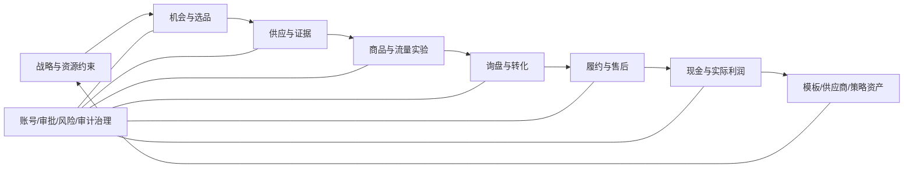
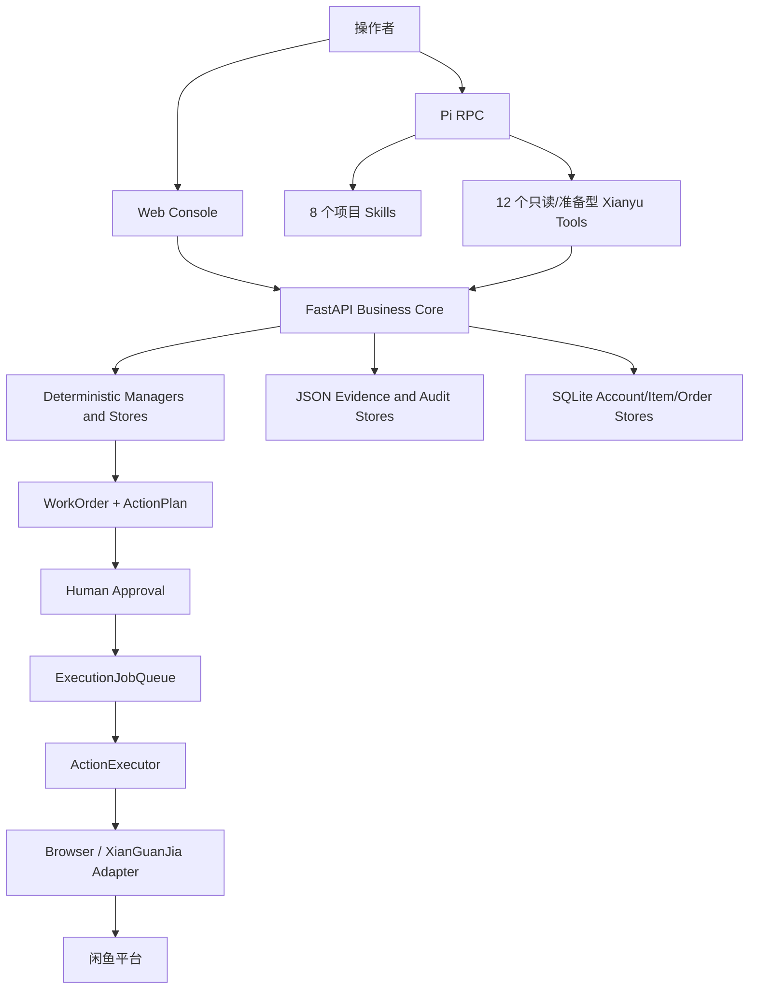

# Zcode 接管总说明：Xianyu Pi 一人公司项目

> 生成时间：2026-08-29（Asia/Shanghai）  
> 工作区：`E:\闲鱼\xianyu`  
> 接管对象：Zcode 及后续本地编码代理  
> 本文件优先级：高于 2026-08-29 之前的 `PROJECT_STATUS.md` 和 `docs/PROJECT_PLAN.md` 状态描述  
> 当前结论：技术底座通过本地验收，真实商业 Alpha 尚未开始；先完成 P0 数据库路径修复和 Git 基线，再接入真实账号与一个真实商品。

---

## 0. 给 Zcode 的第一条指令

先阅读本文件，不要立刻重构、清理或批量提交。按以下顺序重新确认现场：

```powershell
cd E:\闲鱼\xianyu
git status --short
git branch --show-current
powershell -NoProfile -ExecutionPolicy Bypass -File .\scripts\run_tests_isolated.ps1
node --check web\app.js
node --check .pi\extensions\xianyu-ops.ts
git diff --check
Invoke-RestMethod http://127.0.0.1:8788/health
Invoke-RestMethod http://127.0.0.1:8788/dashboard/first-run-readiness
```

硬性接管规则：

1. 不得运行 `git reset --hard`、`git clean -fd`、`git checkout -- .` 或删除当前未跟踪代码。
2. 当前大量功能尚未提交，Git 的旧 `HEAD` 不是当前系统真实能力。
3. 测试只能使用 `scripts/run_tests_isolated.ps1`，不得让测试写入 `data/live`。
4. 在修复第 13 节的 SQLite 初始化顺序问题之前，不得导入真实卖家账号或真实 Cookie。
5. 不得把占位候选 `T`、历史测试工单、synthetic 订单或 mock 回执写成真实经营结果。
6. 平台动作继续走 `WorkOrder -> Approval -> ExecutionJobQueue -> ActionExecutor`，不得增加第二条直连执行路径。
7. Pi 是唯一主要自然语言基座；不要重新引入 OpenClaw 作为主运行时。
8. 闲鱼和跨境电商是两个平行项目，不能合并账号、数据库、候选、审批或执行队列。

---

## 1. 总目标

最终要落地的不是“一个会聊天的多 Agent Demo”，而是一套由一个操作者经营、Pi 辅助决策、确定性系统保存事实和控制动作的闲鱼一人公司操作系统。

项目总目标是：

> 用一个真实且有权运营的闲鱼卖家账号、一个真实供应商 SKU 和一笔有完整证据的订单，跑通从选品、证据、核算、上架、询盘、成交、采购、双边物流、售后到实际利润对账的闭环；闭环稳定后再扩展到最多三个商品和更多账号。

真正的完成标准不是接口数量、测试数量、页面可打开或 LLM 成功回复，而是同时具备以下证据：

1. 一个真实账号通过专用浏览器登录、身份预览和二阶段绑定。
2. 同一账号的 Prompt、商品同步、订单同步、运行连接和认证新鲜度全部通过。
3. 一个精确商品和供应商 SKU 完成 12 项一品启动包。
4. 报价、库存、履约、图片权利和市场基线五类文件进入不可变证据存档并通过 SHA-256 校验。
5. 当前账号和类目的商业条款、保证金/买保、退货、比例费率和固定费用已按当天页面记录。
6. 候选按当前条款重算后，由 Agent 评审并由操作者批准当前证据指纹。
7. Day-0 启动预览达到 20/20，并只启动一个商品批次。
8. 上架草稿经过人工核对、审批、队列和执行，获得真实平台商品 ID。
9. 至少一个真实询盘进入系统，回复草稿经审批并获得真实发送回执。
10. 至少一笔真实付款订单完成采购审批、供应商订单、供应商物流和闲鱼物流关联。
11. 平台签收后记录实际实收、采购、运费、平台费和证据，系统重算实际利润。
12. 完成 7 天中期复盘和 14 天最终复盘，明确继续、修改、暂停或淘汰。

---

## 2. 项目边界与已经确定的关键决策

### 2.1 项目边界

- 本项目：`E:\闲鱼\xianyu`，只负责国内闲鱼经营。
- 跨境电商项目保持独立；不共享运行数据和商业上下文。
- `E:\GitHub上下载的\一人公司方法论` 用作经营方法和复盘框架，不作为运行时依赖。
- `闲鱼赚钱路子.docx` 已被提炼为选品、上架、转化、履约和心态方法，不复制其中第三方商业内容作为商品文案。
- 本地和 GitHub 闲鱼项目只用于提取架构、状态机、账号运行、消息接入和降级思路，不整体并入本仓库。

### 2.2 运行时决策

- Pi 已替代 OpenClaw，作为唯一主要自然语言入口。
- 当前项目固定使用项目本地 `@earendil-works/pi-coding-agent` `0.84.2`。
- 当前 Pi provider/model 为 `deepseek/deepseek-v4-flash`，thinking 为 `low`。
- FastAPI 是业务事实源；Pi 不能自行定义通过、审批或执行结果。
- Python 专家 Agent 保留在 FastAPI 后面，不再为每个专家启动一个独立 Agent 运行时。
- `/agents/openclaw/message` 和 `/agents/hermes/message` 仅为历史兼容入口，后续应在 Pi 实盘稳定后退役。

### 2.3 商业决策

- 首轮只接一个账号、一个品类、一个商品。
- 首单闭环前不扩展多账号，不同时测试多个商品。
- 当前默认毛利门槛为毛利额 `20` 元和毛利率 `30%`，但真实放行必须使用目标账号和类目的当天费用重算。
- 报价和库存证据 24 小时过期，市场基线 72 小时过期。
- 发布、回复、删除、退款、履约采购和争议回复都需要人工审批。
- 启动批次不等于发布；每一次平台写动作仍有独立审批和执行回执。

---

## 3. 2026-08-29 当前真实状态

### 3.1 技术验收

| 项目 | 当前结果 | 证据 |
|---|---|---|
| 全量隔离测试 | PASS | 2026-08-29 重新运行 `926` 个 unittest，`0` 失败，耗时约 25.8 秒 |
| 测试数据隔离 | PASS | 测试前后 `data/live` 均为 13 个文件，SHA-256 变化数 `0` |
| Python 编译 | PASS | 核心商业、证据、Pi 和 server 模块 `py_compile` 通过 |
| 前端语法 | PASS | `node --check web/app.js` 通过 |
| Pi 扩展语法 | PASS | `node --check .pi/extensions/xianyu-ops.ts` 通过 |
| Diff 空白检查 | PASS | `git diff --check` 通过 |
| FastAPI | PASS | `http://127.0.0.1:8788/health` 返回 `ok=true` |
| 控制台 | PASS | `/console` 返回 200，HTML 含 OPC 和候选证据存档区域 |
| Pi 进程 | PASS WITH WARNING | `running=true`、13 个工具、`external_action_tools=false`；主动启动握手本轮超时，随后被动状态正常 |
| 执行适配器 | CONFIGURED | 当前为 `browser`，支持订单和商品同步；没有真实登录会话 |

服务当前已经启动并留在后台，地址：

- API：`http://127.0.0.1:8788`
- 控制台：`http://127.0.0.1:8788/console`

启动本轮只追加了 Pi session JSONL：13 个真实文件中仅 `data/live/pi_sessions/...jsonl` 从 88734 增至 88860 字节；候选、工单、订单、报告和事件账本未变化。

### 3.2 真实商业账本

| 项目 | 当前值 | 解释 |
|---|---:|---|
| 卖家账号 | 0 | 尚未绑定任何真实账号 |
| 候选商品 | 1 | 只有占位候选 `rc_e54c573384a7`，标题 `T` |
| 候选评分 | 20，`weak` | 只适合作为旧测试记录，不能经营 |
| 一品启动包 | 1/12 | 只有 `channel_scope` 通过 |
| 候选首阻塞 | `product_identity` | 缺真实标题、类目、SKU 和至少两个规格 |
| 候选证据存档 | 0 | 五类证据全部缺失 |
| 历史 WorkOrders | 15 | 全部 `quarantined` |
| 历史 Approvals | 15 | 全部 `rejected`，原因是首个真实账号前隔离 |
| ExecutionJobs | 0 | 没有待执行或失败任务 |
| MessageIntake | 0 | 无真实询盘，无待回复审批 |
| 活动 Commercial Alpha | 0 | 尚未启动真实批次 |
| OrderRuntime | 1 synthetic | 观察到一个历史 synthetic paid 记录，`operational_orders=0`，绝不能算真实订单 |
| 全局首阻塞 | `account_configured` | 业务上下一项是接入账号，但必须先修 SQLite 路径问题 |

### 3.3 Git 现场

- 当前分支：`codex/opc-dashboard-v1`
- 当前 `HEAD`：`6fe128976cb9866a9a24a3ca9edf1db893dd40bb`
- `HEAD` 时间：2026-06-11 02:04:14 +0800
- `HEAD` 主题：`docs: replace MiMo references with generic LLM descriptions`
- 创建本交接文件之前：37 个已跟踪文件有修改，67 个未跟踪路径；本文件会再增加 1 个未跟踪路径。
- 当前大量 Phase 9-28 代码都不在 `HEAD` 中。不要从旧提交判断当前能力，也不要清理未跟踪目录。

建议 Zcode 先制作非破坏性现场清单和补丁备份，再按功能域拆分提交；禁止把 `.env`、`data/`、浏览器 profile、Cookie、日志和本地凭据提交进 Git。

---

## 4. 真正的一人公司框架：多个反馈环，不是一条直线

实际经营不是“选品 -> 上架 -> 成交”一次性流水线，而是七个互相反馈的循环：



### 4.1 战略与资源循环

- 输入：操作者时间、现金预算、账号能力、供应商关系和可承担风险。
- 决策：本周只解决一个主要瓶颈，不同时追多个品类。
- 输出：本周目标、预算、停止条件和一个具体商品方向。
- 系统承载：OPC dashboard、daily/weekly review、resource audit、niche positioning。

### 4.2 机会与选品循环

- 输入：冷门品类、高客单、批量需求、区域需求、同商品多链接差异。
- 处理：七维评分，但分数只是发现证据，不是发布许可。
- 输出：一个精确商品和 SKU，而不是泛品类口号。
- 系统承载：Discovery、ProductScorer、候选列表、竞品证据 Pi skill。

### 4.3 供应与证据循环

- 输入：供应商身份、报价、库存、履约、退换/破损、图片权利。
- 处理：真实文件存档、观察时间、SHA-256、修订和过期。
- 输出：可复核的一品启动包。
- 系统承载：CandidateEvidenceStore、12-gate activation packet、商业条款快照。

### 4.4 商品与流量实验循环

- 输入：证据合格候选、结构化草稿、真实发布 ID 和初始流量。
- 处理：一次只改变标题、封面、价格呈现、描述、城市或发货承诺中的一个变量。
- 输出：保留、撤回、修改或停止的证据结论。
- 系统承载：CommercialTrial、traffic observations、single-variable experiments。

### 4.5 询盘与转化循环

- 输入：真实买家消息、商品事实、价格、库存、交付和售后边界。
- 处理：意图分类、回复草稿、人工审批、真实发送回执。
- 输出：买家问题模式、模板效果和成交/流失原因。
- 系统承载：MessageIntakeLedger、conversation profiles、buyer-conversion skill。

### 4.6 履约与售后循环

- 输入：真实付款订单和精确 SKU。
- 处理：规格、地址、库存、报价核对，采购审批，供应商订单和双边物流。
- 输出：签收、异常、退货、破损责任和供应商可靠性记录。
- 系统承载：OrderRuntime、fulfillment lock、PurchaseTask、ResaleOrder。

### 4.7 现金与资产循环

- 输入：实际实收、采购、运费、平台费、退款和操作耗时。
- 处理：系统重算利润；未完整对账的正利润不计入成绩，已发生亏损保守计入止损。
- 输出：真实利润、供应商评分、标题模式、回复模板和下轮资源分配。
- 当前缺口：Dashboard 的回复模板、标题模式和供应商笔记资产统计仍显示 TODO，需要在首单后以真实数据实现。

---

## 5. 当前目标架构



职责边界：

| 层 | 职责 | 不负责 |
|---|---|---|
| Pi | 理解自然语言、选择 Skill、调用类型化工具、解释首阻塞 | 不保存商业真相，不审批，不执行平台动作 |
| FastAPI | 校验、门禁、状态机、证据、审计和 API | 不把 LLM 文本当成交/发布证据 |
| Specialist Agents | 选品、上架、客服、订单、分析和 GitHub 研究建议 | 不绕过业务服务直接写平台 |
| WorkOrder/Approval | 形成可审阅动作及人工决定 | 不自动运行已批准动作 |
| Execution Queue | 幂等排队、重试、取消、执行状态 | 不产生审批 |
| ActionExecutor | 唯一动作分发器，绑定批准快照和账号 | 不自行选择商品或账号 |
| Adapter | 封装浏览器或第三方服务差异 | 不决定商业门禁 |
| Data stores | 保存账号、候选、证据、工单、消息、订单和利润 | 不替代平台真实状态 |

---

## 6. Pi 运行时现状

### 6.1 13 个允许工具

Pi 实际工具面为 `read` 加 12 个项目工具：

| 工具 | 作用 | 是否产生外部平台动作 |
|---|---|---|
| `read` | 读取项目文档和 playbook | 否 |
| `xianyu_business_snapshot` | 读取账号、候选、队列、readiness 和下一步 | 否 |
| `xianyu_market_search` | 有界读取当前市场搜索和可观察价格 | 否 |
| `xianyu_candidates` | 读取候选、评分和核算 | 否 |
| `xianyu_candidate_activation_packet` | 读取一个候选的 12 项门禁 | 否 |
| `xianyu_candidate_evidence` | 读取证据元数据、状态和完整性，不下载文件 | 否 |
| `xianyu_work_orders` | 读取工单和审批状态 | 否 |
| `xianyu_commercial_terms` | 读取账号+类目条款和候选版本匹配 | 否 |
| `xianyu_publish_preflight` | 执行只读发布门禁评估 | 否 |
| `xianyu_commercial_launch_preview` | 执行只读 20-gate 启动预览 | 否 |
| `xianyu_review_candidate` | 创建内部 Agent 评审记录 | 否，只有内部记录 |
| `xianyu_prepare_listing` | 创建本地草稿和审批工单 | 否，不发布 |
| `xianyu_prepare_customer_reply` | 创建回复草稿 | 否，不发送 |

Pi 没有 shell、编辑、写文件、审批、运行队列、发送消息、退款、删除或履约工具。健康接口必须持续返回 `external_action_tools=false`。

### 6.2 8 个项目 Skills

| Skill 目录 | 作用 |
|---|---|
| `commercial-alpha` | 读取首阻塞并按真实业务顺序推进一个账号/商品 |
| `product-selection` | 七维选品、供应证据和一品纪律 |
| `competitor-evidence` | 当前竞品事实、展示价、标题/规格/信任信号分离 |
| `commercial-experiment` | 单变量、预注册观察规则和 continue/revise/pause/stop 决策 |
| `listing` | 结构化草稿、图片权利、条款和发布预检 |
| `buyer-conversion` | 买家意图和审批后的回复草稿 |
| `fulfillment` | 付款、采购、双物流、售后和利润对账 |
| `weekly-review` | 区分技术状态和商业表现，找一个主要瓶颈 |

来源说明在 `docs/PI_SKILL_PROVENANCE.md`。第三方 Skills 未直接安装到执行链路；只适配了有许可、可审计的经营结构。

---

## 7. 真实商业运行顺序

下面是首轮必须严格遵守的顺序。它是一轮受控实验的执行顺序，不替代第 4 节的长期反馈环。

### 阶段 A：工程与历史现场

1. 修复 SQLite 配置加载问题并完成无损迁移演练。
2. 建立 Git 可恢复基线，不丢当前未提交代码。
3. 全量隔离测试通过，真实数据哈希不变。
4. 确认 15 个历史工单继续保持 `quarantined`，不得认领到新账号。

### 阶段 B：账号接入

1. 控制台点击「打开登录浏览器」。
2. 操作者在专用 Edge profile 内完成登录、扫码或平台人工验证。
3. 点击「检测当前账号」，只读获取脱敏账号 ID 和会话摘要。
4. 核对实际账号后，在五分钟内输入一次性 `BIND ...` 完成绑定。
5. 初始化该账号 Prompt。
6. 对同一账号执行商品和订单真实同步。
7. 确认 runtime connected、heartbeat/token/cookie 证据不超过 300 秒且无阻塞。

### 阶段 C：一个商品证据包

1. 新建精确候选，不修改占位候选 `T` 伪装成真实商品。
2. 填写真实标题、闲鱼类目、供应商平台、商品 URL、供应商简称、精确 SKU 和至少两个规格。
3. 上传五类文件：`supplier_quote`、`supplier_stock`、`supplier_fulfillment`、`image_rights`、`market_baseline`。
4. 确认每类只有一个 `active` artifact，完整性为 OK，候选引用由系统生成。
5. 填写采购价、运费、MOQ、库存状态/数量、出库时效、退换和破损责任。
6. 准备至少一张自有或明确授权图片；不能把竞品图当自有图。
7. 记录两个不同的可比闲鱼链接、展示价区间和可复核需求信号。

12 项门禁固定为：

1. `channel_scope`
2. `product_identity`
3. `supplier_source`
4. `supplier_verified`
5. `supplier_quote_evidence`
6. `supplier_stock_evidence`
7. `supplier_fulfillment_evidence`
8. `image_assets`
9. `image_rights`
10. `market_baseline`
11. `unit_economics`
12. `manual_decision_current`

### 阶段 D：账号商业条款和批准

1. 在目标账号、目标类目的执行当天页面核对经营身份、协议、支付、类目权限、退货/例外、退货能力、保证金/买保和实际费用。
2. 保存 `account + category` 条款快照，要求不超过 24 小时。
3. 用 `目标售价 * 比例费率 + 每单固定费用` 重算平台费用和候选利润。
4. 让 Agent 评审重算后的当前修订。
5. 操作者只批准当前 `evidence_fingerprint`。
6. 再次读取启动包，必须为 `12/12`、`ready=true`。

### 阶段 E：Day-0 原子启动

使用：

```text
POST /commercial-launch/preview
POST /commercial-launch/start
```

20 个启动门禁：

1. `historical_work_resolved`
2. `account_configured`
3. `account_enabled`
4. `live_adapter`
5. `sync_capabilities`
6. `prompt_ready`
7. `sync_current`
8. `runtime_connected`
9. `runtime_fresh`
10. `runtime_unblocked`
11. `candidate_selected`
12. `candidate_manual_approved`
13. `candidate_category_valid`
14. `account_commercial_terms_ready`
15. `candidate_preflight_ready`
16. `launch_controls_valid`
17. `procurement_cost_known`
18. `cash_budget_covers_unit`
19. `launch_scope_one_item`
20. `no_active_trial`

`preview` 必须零副作用；`start` 必须验证相同 preview token 和 `START 1`，并且只创建一个批次，不发布商品。

### 阶段 F：上架、流量和单变量实验

1. 从批次生成结构化草稿。
2. 人工核对标题、关键词、首图要求、规格表、价格阶梯、信任段、履约售后和验证问题。
3. 审批发布，进入队列，由 ActionExecutor 调用已批准账号。
4. 确认真实平台商品 ID；stub ID 不计。
5. 保存第一份浏览/想要基线；平台字段不可用时用操作者凭证，不把缺失字段记为 0。
6. 一个观察窗内只改变一个变量；先 proposal/approval/execution，再通过同步或人工凭证激活计时。

### 阶段 G：询盘、订单、履约和利润

1. 真实消息进入 MessageIntake，并按 message ID 或稳定哈希去重。
2. 生成回复草稿，人工审批，队列发送；只有成功发送任务才能完成 `inquiry_responded`。
3. 真实 paid 订单必须绑定同一 trial/account/item/candidate。
4. fulfillment handoff 同时核对规格、地址、库存和报价，获取幂等锁并创建采购审批。
5. 操作者完成供应商下单，记录供应商订单 ID、供应商物流和闲鱼物流。
6. 平台 delivered 后填写实际实收、采购、运费、平台费、证据备注和引用。
7. 系统重算 `actual_profit`，再进行最终决策。

---

## 8. 已完成能力总览

### 8.1 基础治理（历史 Phase 1-7）

- 原 OpenClaw 自然语言入口、Agent Registry 和专业 Agent 已建立；当前自然语言入口已迁移到 Pi。
- Agent 协作消息和圆桌讨论持久化。
- WorkOrder、ActionPlan、Approval 和审批快照。
- ActionExecutor 与单一动作分发边界。
- ExecutionJobQueue 的 queued/running/completed/failed/cancelled、重试和取消。
- 订单履约 WorkOrder/Approval/Queue 基础链路。

### 8.2 OPC 方法和策略层

- `docs/ops/opc/`：资源盘点、定位、MVP 验证、转化循环、周复盘。
- `docs/ops/xianyu/`：选品、上架、转化回复、履约售后、自动化集成、候选证据存档。
- ProductScorer 七维评分：冷门、高客单、批量、差异化、供应优势、履约风险、合规风险。
- Discovery 支持原材料、高客单、批量需求、区域和同商品多链接方法。
- 客服意图、履约检查和售后分类已经进入代码。

### 8.3 安全桥接和运营控制台

- Ecommerce listing draft/review 通过幂等桥接进入闲鱼 WorkOrder，不直接执行。
- OPC daily dashboard、账号队列、readiness、daily/weekly review。
- WorkOrder/Approval/ExecutionJob 筛选、状态、事件时间线和显式队列运行控制。
- 删除、退款和敏感争议回复都有独立审批。

### 8.4 消息接入

- Feishu/HTTP/Xianyu IM 入站转成 MessageIntake 和回复 Approval。
- 消息去重、最近记录、健康、保留清理、失败重试、runbook、incident bundle 和 dry-run health check。
- 多账号归属、Prompt profile、conversation summary 和 account-specific settings。
- Phase 16 的周期化 SLA 快照状态在旧计划中没有清晰的 complete 标记，Zcode 需要重新审计，不要自动宣称完成。

### 8.5 Commercial Alpha

- 同账号 readiness 和真实 adapter/sync/runtime 门禁。
- Evidence-based publish preflight。
- 账户/候选/商品/订单/时间强绑定的 CommercialTrial。
- 采购预算、已发布容量、止损、售后率和观察期控制。
- 流量快照、浏览/想要可用性、单变量实验和激活证据。
- 询盘已回复、采购、双物流、delivery 和实际利润闭环。
- 15 个历史工单的显式 quarantine，避免污染首个真实账号。
- 20-gate 原子 Day-0 preview/start 和 token 幂等。
- 账号+类目商业条款及候选重定价。
- 二阶段浏览器账号接入。
- 12-gate 一品启动包和证据修订指纹。
- 五类候选证据不可变存档、哈希校验、替换链和 Pi 只读元数据。

### 8.6 前端

- 统一 Console 覆盖账号、队列、readiness、候选、Commercial Alpha、消息、订单、审批和执行。
- 一品启动包具有 36 个结构化控件。
- 候选证据上传具有桌面和移动布局，引用框只读。
- Phase 22-28 已留存多组桌面/移动 Playwright 截图，位于 `output/playwright/`。

---

## 9. 关键代码地图

### 9.1 业务核心

| 文件 | 职责 |
|---|---|
| `xianyu_agent/server.py` | FastAPI 路由和服务组合根；当前约 211 个 GET/POST/PATCH/DELETE 路由 |
| `xianyu_agent/config.py` | `.env` 和 Settings |
| `xianyu_agent/db_manager.py` | SQLite 账号、商品、订单、会话等；当前有初始化顺序缺陷 |
| `xianyu_agent/resale.py` | 候选、评分、计划、草稿、采购、转售订单 |
| `xianyu_agent/work_orders.py` | WorkOrder、ActionPlan、Approval |
| `xianyu_agent/execution_queue.py` | 执行队列和状态 |
| `xianyu_agent/action_executor.py` | 唯一平台动作执行分发器 |
| `xianyu_agent/adapters.py` | adapter contract 和实现选择 |
| `xianyu_agent/browser_adapter.py` | Playwright/CDP 闲鱼浏览器适配 |
| `xianyu_agent/browser_control.py` | 专用登录浏览器生命周期 |

### 9.2 商业证据

| 文件 | 职责 |
|---|---|
| `candidate_activation.py` | 12 项候选激活门禁和 evidence fingerprint |
| `candidate_evidence_store.py` | 五类不可变证据、content-addressed blob、SHA-256 和生命周期 |
| `commercial_preflight.py` | 账号+候选发布前门禁 |
| `commercial_launch.py` | 20-gate Day-0 preview/start token |
| `commercial_trial.py` | 批次、漏斗、实验、止损和最终复盘 |
| `account_commercial_terms.py` | 账号+类目商业条款和费用版本 |
| `account_runtime.py` | 连接、认证新鲜度和 blocker |
| `sync_persistence.py` | 商品/订单同步结果和 freshness |
| `order_runtime.py` | 平台订单状态、synthetic 隔离和履约锁 |

### 9.3 Pi

| 路径 | 职责 |
|---|---|
| `xianyu_agent/pi_runtime.py` | 持久 Pi RPC 子进程、strict allowlist、session |
| `.pi/SYSTEM.md` | Pi 项目级系统合同 |
| `.pi/extensions/xianyu-ops.ts` | 12 个类型化业务工具 |
| `.pi/skills/*/SKILL.md` | 8 个经营技能 |
| `package.json` | 固定 Pi 版本和 Node 最低版本 |

### 9.4 运营和前端

| 路径 | 职责 |
|---|---|
| `xianyu_agent/opc_dashboard.py` | 每日 cockpit、瓶颈和 next actions |
| `xianyu_agent/message_intake.py` | 消息 ledger、去重、健康和重试 |
| `xianyu_agent/message_import_scheduler.py` | 多账号消息导入调度状态 |
| `web/console.html` | Console 页面结构 |
| `web/app.js` | 交互、API 调用和渲染 |
| `web/style.css` | 桌面/移动布局 |
| `scripts/start_xianyu_workflow.ps1` | 隐藏窗口启动、PID 校验、服务和 Pi 健康检查 |
| `scripts/stop_xianyu_workflow.ps1` | 仅停止属于本项目的已记录进程 |
| `scripts/run_tests_isolated.ps1` | 临时 DATA_DIR/DB_PATH 全量测试 |

当前规模参考：64 个顶层 Python 模块、70 个 `test_*.py` 文件、211 个 FastAPI 路由。数量不是完成证明，只用于帮助 Zcode 估算改动影响面。

---

## 10. 关键 API 地图

### 10.1 状态和 Pi

```text
GET  /health
POST /agent/message
GET  /agents/pi/status
POST /agents/pi/message
GET  /dashboard/opc-daily
GET  /dashboard/first-run-readiness
```

### 10.2 账号

```text
GET  /accounts
POST /accounts/browser-import/open
POST /accounts/browser-import/preview
POST /accounts/browser-import/commit
GET  /accounts/{cookie_id}/prompt-profile
POST /accounts/{cookie_id}/prompt-profile/bootstrap
GET  /accounts/{cookie_id}/commercial-terms
POST /accounts/{cookie_id}/commercial-terms
POST /adapter/sync-persist
```

### 10.3 候选和证据

```text
POST  /resale/candidates
GET   /resale/candidates
GET   /resale/candidates/{id}/activation-packet
PATCH /resale/candidates/{id}/activation-packet
GET   /resale/candidates/{id}/evidence-artifacts
POST  /resale/candidates/{id}/evidence-artifacts
GET   /resale/candidates/{id}/evidence-artifacts/{artifact_id}/file
POST  /resale/candidates/{id}/agent-review
POST  /resale/candidates/{id}/decision
GET   /resale/candidates/{id}/publish-preflight
POST  /resale/candidates/{id}/listing-draft
```

### 10.4 启动、试运营和实验

```text
POST /commercial-launch/preview
POST /commercial-launch/start
GET  /commercial-trials/active
GET  /commercial-trials/{trial_id}
POST /commercial-trials/{trial_id}/items/{item_id}/traffic-observations
POST /commercial-trials/{trial_id}/items/{item_id}/experiments
POST /commercial-trials/{trial_id}/experiments/{experiment_id}/activate
POST /commercial-trials/{trial_id}/experiments/{experiment_id}/decision
POST /commercial-trials/{trial_id}/orders/{order_id}/fulfillment-handoff
POST /commercial-trials/{trial_id}/orders/{order_id}/fulfillment-release
```

### 10.5 审批、执行、消息和订单

```text
GET  /work-orders
POST /approvals/{approval_id}/decision
POST /approvals/{approval_id}/execute
GET  /execution-jobs
POST /execution-jobs/run-next
POST /execution-jobs/{job_id}/retry
POST /message-intake/envelope
GET  /message-intake/metrics
GET  /orders/runtime
GET  /resale/purchase-tasks
GET  /resale/orders
```

弃用或兼容路由不能作为新实现入口：`POST /commercial-trials`、`/trial-run/*`、`/agents/openclaw/message`、`/agents/hermes/message`。

---

## 11. 数据和证据存储

### 11.1 JSON 业务账本

设计目标是放在 `data/live`，包括：

- `resale_candidates.json`
- `work_orders.json`
- `execution_jobs.json`（存在记录时创建）
- `message_intake.json`（存在记录时创建）
- `order_runtime_state.json`
- `commercial_trials.json`（存在批次时创建）
- `candidate_evidence/index.json` 和 `candidate_evidence/blobs/...`（上传后创建）
- `agent_collaboration.jsonl`
- `events.jsonl`
- `pi_sessions/*.jsonl`

测试必须重定向到系统临时目录。真实证据备份必须把 `resale_candidates.json` 和整个 `candidate_evidence/` 作为同一个一致性快照。

### 11.2 SQLite

SQLite 保存账号 Cookie、账号配置、商品、订单、会话、同步数据等。这里存在当前最重要的工程缺陷：

- `.env` 配置：`DATA_DIR=E:\闲鱼\xianyu\data\live`
- `.env` 配置：`DB_PATH=E:\闲鱼\xianyu\data\live\xianyu_data.db`
- 当前启动日志实际显示：`Database initialized: data/xianyu_data.db`
- `data/live/xianyu_data.db` 当前不存在。
- 根因：`xianyu_agent.db_manager` 在 `Settings.from_env()` 之前被导入，模块级 `db_manager = DBManager()` 读取不到 `.env`，于是使用默认相对路径。

这意味着 JSON 已经写 `data/live`，SQLite 仍在旧 `data/xianyu_data.db`。在接入真实账号前必须修复，避免把 Cookie 和账号状态写到错误数据边界。

---

## 12. 参考项目已经学了什么

详细审计位于：

- `docs/research/github-reference-projects.md`
- `docs/research/local-xianyu-program-architecture.md`
- `docs/research/local-project-learning-roadmap.md`
- `docs/research/local-xianyu-tools-audit.md`
- `docs/research/browser-account-onboarding-reference-2026-08-25.md`
- `docs/research/candidate-activation-reference-2026-08-25.md`
- `docs/research/xianyu-official-commercial-rules-2026-08-18.md`
- `docs/research/github-and-pi-ecosystem-review-2026-08-30.md`

已吸收的主要设计：

1. `XianYuApis`：协议/WebSocket、token 刷新和 adapter contract 思路。
2. `xianyu-auto-reply`：账号状态、人工接管、订单状态和后台模块边界；未复制其高风险登录/远程代码。
3. `mulitXianYuAugent`：多账号 Prompt、conversation context、seller mode 分离。
4. `XianyuAutoAgent`：意图分类和专家回复路由。
5. `goofish-watcher/fastPickUp`：Discovery Inbox 和线索生命周期。
6. `harringtonwalker/xianyu-automation`：来源/SKU、权利事实、证据 freshness、修订 supersede、审批与回执分离。
7. Pi 生态：官方 RPC、Skills 和本地 extension；未增加第二套浏览器或 MCP 执行路径。
8. 2026-08-30 新审查：后续优先吸收执行任务 lease/fencing、unknown-result
   人工闭环和 Reply Outbox；第三方 Pi Package 不进入当前生产业务 RPC。

继续学习参考项目时，只提取字段、状态机、错误处理和可测试合同；不能把 README 功能声明当本项目运行证明，也不要整体复制外部执行代码。

---

## 13. 仍未完成和已知问题

### P0：真实账号前必须完成

1. **SQLite `.env` 加载顺序错误**  
   修复 `db_manager` 的模块级初始化，使服务明确使用 `settings.db_path`；为旧数据库到 `data/live` 的迁移设计备份、行数/哈希核对、失败回滚和重复执行幂等。迁移过程不得打印 Cookie。

2. **Git 没有当前版本基线**  
   当前所有重要成果仍在一个很大的脏工作区中。先做补丁/文件清单备份，再按 config/runtime、Pi、commercial core、UI、tests、docs 分组形成可审阅提交。不要把运行数据和输出目录误加进 Git。

3. **启动握手偶发超时**  
   本轮 `active=true` 30 秒请求超时，但启动脚本的被动状态兜底确认 Pi `running=true`。需要区分模型首次响应慢和 Pi 进程失败，补充耗时/阶段日志；不能把 warning 静默当成功，也不能因一次慢响应启动第二个 Pi。

### P1：商业 Alpha 外部输入

1. 没有真实卖家账号登录和绑定。
2. 没有真实供应商 SKU 和五类文件证据。
3. 没有当前账号+类目商业条款。
4. 没有 12/12 候选、20/20 启动预览或活动批次。
5. 没有真实发布 ID、流量基线、询盘、回复回执或付款订单。
6. 没有供应商采购、双物流、签收和实际利润。

这些不能由 Zcode 伪造。Zcode 可以提供流程、UI、校验和错误修复，但账号登录、平台页面核验、供应商事实和人工批准必须由操作者完成。

### P2：数据与文档质量

1. `docs/PROJECT_PLAN.md` 的早期架构图仍含 MiMo/历史 OpenClaw 表述；当前真实入口是 Pi。
2. Phase 24 历史文字写 19 gates，Phase 25 后当前实际为 20 gates。
3. Phase 16 没有明确 complete 状态，需要按代码和测试重新审计。
4. OPC dashboard 的 `asset_updates` 明确为 TODO。
5. 当前 dashboard 报告 `new_candidates_this_week=1`，但唯一候选创建于 2026-08-02；需要检查周窗口计算或旧数据时间解析。
6. README 有一些历史营销式能力描述，不能作为实盘验收依据。
7. `legacy_openclaw_available=true` 仍存在，应在 Pi 真实 Alpha 稳定后退役，而不是现在冒险删除。

### P3：首单后再做

1. 回复模板、标题模式、供应商笔记资产持久化和实际贡献统计。
2. 候选证据的一键一致性备份、离线完整性审计和恢复演练。
3. Message intake SLA 周期快照和告警的最终验收。
4. 一个账号连续运行稳定性、断线恢复、登录失效和人工接管演练。
5. 只有首单闭环后才扩到 2-3 个商品，再评估多账号。

---

## 14. 下一阶段目标：Phase 29

### 目标名称

**Phase 29：Production Data Boundary And Commercial Alpha Onboarding**

### 目标定义

先修复和验证真实数据边界，然后在不伪造任何业务记录的前提下，把一个真实账号和一个真实商品推进到 `candidate 12/12 + launch 20/20`。如果操作者输入暂时不到位，Zcode 停在准确的 BLOCKED 状态，并交付最短的人工作业清单。

### 14.1 工作包 A：SQLite 数据边界修复

任务：

1. 取消或延迟 `db_manager = DBManager()` 的 import-time 默认路径初始化。
2. 在服务组合根使用 `Settings.from_env().db_path` 显式配置 singleton。
3. 保证 Agent、Adapter 和 API 使用同一个 DBManager 实例。
4. 新增测试：未预设环境时加载 `.env` 后必须使用 `DB_PATH`。
5. 新增测试：服务导入不得提前创建 `data/xianyu_data.db`。
6. 设计迁移工具的 `--dry-run`、备份、目标非空保护、哈希、表/行数核对、重复执行幂等。
7. 在临时副本演练迁移；没有操作者确认，不直接删除旧 DB。

验收：

- 服务日志显示绝对路径 `E:\闲鱼\xianyu\data\live\xianyu_data.db`。
- `/accounts`、items、orders 等读取迁移前后计数一致。
- 旧 DB 保留只读备份；任何凭据不出现在终端或 Markdown。
- 全量测试通过，真实 JSON 账本无意外变化。

### 14.2 工作包 B：Git 可恢复基线

任务：

1. 保存 `git status`、diff stat 和未跟踪文件清单。
2. 检查 `.gitignore`，明确排除 `.env`、`data/`、浏览器 profile、日志、PID 和临时 Playwright 状态。
3. 选择性保留真正需要的 QA 截图，不提交无意义运行缓存。
4. 按功能域分组检查并提交；每组提交前运行相关测试。
5. 最后运行 926+ 全量套件和静态检查。

验收：

- Git 工作树可解释，核心代码不再只存在于未跟踪文件。
- 每个提交主题单一且能回滚。
- 没有 secret/data/log/profile 进入仓库。

### 14.3 工作包 C：真实账号 onboarding

由操作者完成平台登录，Zcode 负责观察和修复系统问题：

1. 打开专用 Edge profile。
2. 操作者登录闲鱼。
3. preview 实际 `unb` 身份和会话摘要。
4. 操作者输入一次性 BIND 语句。
5. 检查账号只保存到修复后的 live SQLite。
6. Prompt bootstrap。
7. 同账号 listing/order sync。
8. readiness 要求 first blocker 从 `account_configured` 继续向后推进，直到账号相关 gates 全过。

### 14.4 工作包 D：真实一品启动包

1. 操作者选择一个真实 SKU 和供应商。
2. Zcode 不代填事实，只修复验证或 UI 问题。
3. 五类文件逐一上传，验证 active、候选绑定和 hash。
4. 保存事实后确认旧决策自动失效。
5. 记录目标账号+类目条款并重算。
6. Agent review 后由操作者 approve。
7. 达到 12/12。

### 14.5 工作包 E：20/20 Day-0 准备

1. 使用一个账号、一个候选和一件采购预算做 preview。
2. 每次只修复 first blocker，不跳过顺序。
3. 达到 20/20 后由操作者核对 `START 1`。
4. 启动一个 batch；验证重试不产生重复 batch。
5. 到这里仍不自动发布。

Phase 29 完成条件：数据路径正确、Git 基线可恢复、真实账号 readiness 通过、一个候选 12/12、Day-0 20/20、一个批次创建成功且没有平台写动作被意外触发。

---

## 15. Phase 30-33 落地计划

### Phase 30：首个真实发布

- 从 trial 生成一个 listing draft。
- 操作者逐字段核对并审批。
- 队列执行一次，保存真实 external item ID。
- 遇到验证码/类目/成色/图片阻断时停在人工处理，不盲目重试。
- 同步商品确认平台值和发布状态。

完成条件：一个真实发布 ID、批准快照、execution evidence 和平台确认全部强关联。

### Phase 31：流量和询盘闭环

- 建立第一份浏览/想要基线。
- 至少观察一个预设窗口，不提前修改多个变量。
- 如需实验，只创建一个变量 proposal。
- 导入第一条真实询盘，生成回复草稿，人工审批并确认发送。
- 记录询盘问题和流失/成交原因。

完成条件：流量证据、一个可解释实验或明确不实验、至少一个真实 intake 和发送回执。

### Phase 32：首单履约和利润

- 同步一个真实 paid order。
- 四项核对和 fulfillment handoff。
- 采购审批、供应商订单 ID、供应商物流和闲鱼物流。
- 平台 delivered 后实际费用对账。
- 系统重算实际利润，亏损即时进入止损口径。

完成条件：一条从平台订单到实际利润的全链路审计记录。没有订单时不能伪造；按 14 天无成交实验结案。

### Phase 33：14 天复盘和有限扩展

- Day 1-3：只验证发布、消息和订单链路稳定性。
- Day 4-7：根据一个主要瓶颈运行一个单变量实验。
- Day 7：中期 continue/revise/pause/stop。
- Day 8-13：执行一个修订方向，不扩功能面。
- Day 14：按实际利润、询盘率、成交率、退款率和操作耗时决策。
- 只有闭环通过后，扩展到最多 3 个商品；多账号更晚。

---

## 16. 操作者必须提供的真实输入

Zcode 无法替代以下输入。缺少时必须写 BLOCKED，不得生成看似真实的占位数据：

1. 有权运营的闲鱼卖家账号及人工登录。
2. 目标品类和一个精确商品/SKU。
3. 供应商真实商品链接和可识别简称。
4. 当前采购价、运费、MOQ、库存和观察时间。
5. 发货时效、无价格信息发货、退换、错货和破损责任。
6. 自有图片或供应商/许可授权证据。
7. 两个可比闲鱼链接、当前展示价和需求观察。
8. 当前账号和类目页面中的支付、退货、保证金/买保和费用。
9. 首轮采购现金预算和最大可接受亏损。
10. 候选批准、发布审批、回复审批、采购审批和必要的平台人工验证。

---

## 17. 测试与验收纪律

### 17.1 每次代码改动

```powershell
cd E:\闲鱼\xianyu
powershell -NoProfile -ExecutionPolicy Bypass -File .\scripts\run_tests_isolated.ps1
node --check web\app.js
node --check .pi\extensions\xianyu-ops.ts
git diff --check
```

### 17.2 服务级改动

```powershell
powershell -NoProfile -ExecutionPolicy Bypass -File .\scripts\stop_xianyu_workflow.ps1
powershell -NoProfile -ExecutionPolicy Bypass -File .\scripts\start_xianyu_workflow.ps1
Invoke-RestMethod http://127.0.0.1:8788/health
Invoke-RestMethod 'http://127.0.0.1:8788/agents/pi/status?active=false'
```

### 17.3 UI 改动

- 使用 Edge/Playwright 验证桌面 1280x720 和移动 390x844。
- 检查 document 和关键 panel 水平溢出。
- 检查按钮、表单、modal 底部可达。
- 记录 console errors/warnings 和网络请求。
- 对真实服务做布局 QA 时只发 GET；写入流程用临时数据或明确的真实操作者动作。

### 17.4 真实数据保护

- 测试前后对 `data/live` 文件生成 SHA-256 manifest。
- 测试结果、服务健康、外部账号/平台证据分别报告。
- 只有 Pi session append 不能被写成业务记录变化。
- mock/stub/synthetic 只证明代码路径，不证明真实发布、成交或利润。

---

## 18. Definition of Done

### 技术 READY

- Git 有可恢复基线。
- SQLite 和 JSON 均位于明确的 live 数据边界。
- 926+ 全量测试、静态检查和 UI 回归通过。
- 服务和 Pi 可稳定启动，慢握手可解释且不重复进程。
- 无测试污染真实数据。

### Commercial Alpha READY

- 一个真实账号 readiness 全过。
- 一个候选 12/12。
- 五类 evidence artifacts active 且完整。
- 当前商业条款匹配候选。
- Day-0 preview 20/20。

### Commercial Alpha COMPLETE

- 一个真实 batch。
- 一个真实商品发布回执。
- 真实流量/询盘证据。
- 有订单时完成采购、双物流、签收和利润；无订单时保留完整 14 天无成交实验。
- 最终复盘给出一个有证据的 continue/revise/pause/stop 结论。

### 可扩展

- 上述闭环重复稳定。
- 供应商履约和售后可控。
- 实际利润达到阈值。
- 操作者每日工作量和异常处理可承受。
- 才允许 2-3 个商品，再评估多账号。

---

## 19. Zcode 接手后的建议汇报格式

每个工作包完成后使用以下格式，避免泛泛汇报：

```markdown
## 本轮目标

## 修改文件

## 实际行为变化

## 验证
- PASS:
- FAIL:
- BLOCKED:

## 真实数据影响
- data/live 变更：
- SQLite 变更：
- 平台外部动作：

## 当前第一个阻塞

## 下一步唯一目标
```

不要使用“应该可用”“看起来完成”“理论上支持”代替实际证据。

---

## 20. 必读文档顺序

1. `ZCODE_HANDOFF.md`（本文件）
2. `PROJECT_STATUS.md`（2026-08-26 快照，注意可能落后于本文件）
3. `docs/PROJECT_PLAN.md`（完整历史和 Phase 1-28）
4. `docs/ops/commercial-alpha-runbook.md`（真实业务顺序）
5. `docs/ops/xianyu/candidate-evidence-archive.md`（五类证据 SOP）
6. `docs/ops/pi-migration.md`（Pi 运行合同）
7. `docs/ops/commercial-alpha-batch.md`（批次、订单和止损）
8. `docs/research/local-xianyu-program-architecture.md`（本地参考程序设计）
9. `docs/research/github-reference-projects.md`（GitHub 学习路线）
10. `docs/research/github-and-pi-ecosystem-review-2026-08-30.md`（最新 GitHub/Pi 生态决策）
11. `docs/PI_SKILL_PROVENANCE.md`（Skills 与 Packages 来源）

事实源优先级：当前只读 API/平台回执 > 当前 live 数据 > 本交接文件 > PROJECT_STATUS > PROJECT_PLAN 历史章节 > README 功能描述。

---

## 21. 最后结论

项目现在并不缺更多 Agent，也不缺更多页面。核心商业状态机、证据门禁、审批队列、Pi 工具和运营界面已经相当完整。当前真正阻止落地的是三件事：

1. 先把 SQLite 数据边界和 Git 基线修稳。
2. 让操作者提供一个真实账号和一个真实 SKU 的可验证输入。
3. 严格跑一次从 12/12、20/20 到发布、询盘、订单和实际利润的单商品闭环。

Zcode 下一步不要继续横向增加功能。先完成 Phase 29，把系统从“本地技术 READY”推进到“一个真实账号和商品可以启动 Commercial Alpha”。
