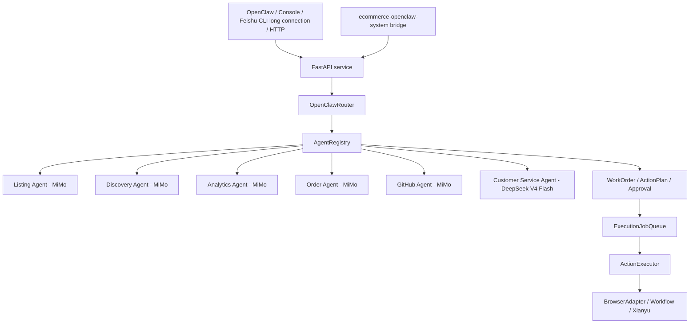

# Xianyu OpenClaw Multi-Agent Project Plan

> Last updated: 2026-05-22
> Workspace: `E:\闲鱼\xianyu`
> Primary goal: build a realistic OpenClaw-driven Xianyu operations system with specialist agents, task tickets, approvals, execution queues, and Feishu CLI long-connection event intake.

## Current Architecture

The project is a local FastAPI multi-agent service that OpenClaw, the console, Feishu CLI, and HTTP clients can call.

When merged with `ecommerce-openclaw-system`, ecommerce is the source of truth for candidates, suppliers, sample verification, launch tests, scale decisions, finance, and dashboard review. This Xianyu project is the channel adapter: it stores Xianyu WorkOrder, Approval, ExecutionJob, ActionExecutor, browser adapter, and Feishu CLI long-connection records.



## Model Policy

- `customer_service`: DeepSeek V4 Flash only.
- `listing`, `discovery`, `order`, `github`, `analytics`: MiMo.
- Ollama must not be used or advertised.
- Do not restore `OLLAMA_BASE_URL`, `OLLAMA_MODEL`, or `/api/generate` execution paths.

## Feishu Policy

- Feishu is connected through Feishu CLI long connection.
- Feishu CLI handles login, app binding, long-lived event subscription, and local event bridging.
- The local FastAPI route `/feishu/events` remains the event handling entrypoint.
- Do not require public webhook URLs, tunnel setup, `YOUR_PUBLIC_TUNNEL`, or `FEISHU_WEBHOOK_URL`.
- `FEISHU_VERIFICATION_TOKEN` may remain if event verification is still used by `/feishu/events`.

## Safety Policy

- Never bypass captchas, human verification, or platform risk-control prompts.
- High-risk actions must go through approval:
  - `publish_listing`
  - `fulfill_order`
  - `send_message`
  - `delete_item`
  - `refund_order`
  - sensitive customer replies
- Approved actions enter the execution queue before running.
- Executions must be idempotent:
  - completed approvals cannot re-execute
  - running approvals cannot re-execute
  - active jobs block duplicate jobs
- Every state transition must be written to the relevant events/history file.

## Completed Phases

### Phase 1: OpenClaw Entry

- Replaced Hermes as the default orchestrator with `OpenClawRouter`.
- Kept `/agents/hermes/message` only as a compatibility alias.
- Registered six internal specialist agents through `AgentRegistry`.

### Phase 2: Agent Collaboration

- Added agent-to-agent messages.
- Added multi-agent roundtable discussions.
- Persisted collaboration history to `data/agent_collaboration.jsonl`.
- Added console collaboration feed.

### Phase 3: Realistic Work Orders

- Added `WorkOrder`, `ActionPlan`, and `Approval`.
- Persisted work orders to `data/work_orders.json`.
- Collaborative listing creates a work order and action plan.
- Risky actions require human approval.

### Phase 4: Approval Center

- Added approval decision APIs.
- Added approval center UI.
- Added approval snapshots.
- Added idempotency protection for execution.

### Phase 5: Action Executor

- Added `ActionExecutor`.
- Moved action-specific execution out of route handlers.
- Implemented `publish_listing` execution.
- Added stubs for future actions.

### Phase 6: Execution Queue

- Added `ExecutionJobQueue`.
- Persisted execution jobs to `data/execution_jobs.json`.
- Added queued, running, completed, failed, cancelled states.
- Added retry and cancel operations.

### Phase 7: Order Fulfillment

- Implemented `fulfill_order` action handler.
- Added `/workflows/orders/{order_id}/fulfill`.
- Created order fulfillment work orders, approvals, snapshots, and queue execution.

### Phase OPC-1: OPC Operating Artifacts and Xianyu Playbooks

Status: complete.

What changed:

- Added project boundary note confirming two-project architecture (Xianyu + Ecommerce under OpenClaw).
- Created OPC operating artifacts under `docs/ops/opc/`:
  - `resource-audit.md` — inventory of accounts, suppliers, skills, assets, constraints.
  - `niche-positioning.md` — Three Rings analysis, candidate scoring, positioning statement.
  - `mvp-validation.md` — listing test cycle, success criteria, decision framework.
  - `conversion-loop.md` — full discovery-to-repeat path with metrics.
  - `weekly-review.md` — review template, cadence, decision framework.
- Created Xianyu strategy playbooks under `docs/ops/xianyu/`:
  - `product-selection-playbook.md` — scoring model, selection methods, candidate categories.
  - `listing-playbook.md` — structured draft format, low-price entry, city selection.
  - `conversion-reply-playbook.md` — intent classification, reply templates, safety rules.
  - `fulfillment-after-sales-playbook.md` — pre-fulfillment checklist, after-sales scenarios, refund framework.

Safety boundary:

- Playbooks are reference documents for agents and dashboards, not runtime code.
- They do not bypass WorkOrder, Approval, or ExecutionJobQueue.

What changed (code):

- Added `ProductScorer` to `xianyu_agent/resale.py` with 7-dimension scoring and test/watch/weak/reject recommendations.
- Integrated scoring into `create_candidate`, added `score_candidate` and `list_by_recommendation` methods.
- Added strategy discovery modes to `xianyu_agent/agents/discovery.py` (raw_material, high_ticket, batch_demand, regional).
- Added `classify_intent` to `xianyu_agent/agents/customer_service.py` with 7 intent types and playbook reply strategies.
- Added `check_fulfillment` and `classify_after_sale` to `xianyu_agent/agents/order.py`.
- Updated `xianyu_agent/openclaw_router.py` with strategy command routing.
- Updated `xianyu_agent/product_discovery.py` with scoring integration in `analyze_product`.
- Added `tests/test_product_scoring.py` (17 tests passing).

Tracking plan:

- `docs/superpowers/plans/2026-05-26-openclaw-opc-xianyu-operations-plan.md`

## Current Phase

### Phase 8: Cleanup and Integration Alignment

Priority: high.

Goals:

- Remove Ollama usage and documentation.
- Make `customer_service` use DeepSeek V4 Flash.
- Update Feishu docs/config/manifest to Feishu CLI long connection.
- Preserve the five MiMo specialist agents.

### Phase 9: Ecommerce Safe Bridge

Status: implemented as the first safe merge slice.

What changed:

- Added `POST /integrations/ecommerce/listing-drafts`.
- Ecommerce candidates create `ecommerce_candidate` WorkOrder records.
- The created action is `publish_listing`, which remains approval-gated.
- Ecommerce dashboard can approve or reject the pending Xianyu Approval through the safe bridge.
- `/execution-jobs/run-next` now passes `workflow` into `ActionExecutor` context so approved queued actions can use the existing adapter path.

Safety boundary:

- Intake does not publish listings.
- Intake does not send buyer messages.
- Intake does not create supplier orders, payments, refunds, delete actions, or captcha/risk-control bypasses.
- Approval decision does not enqueue or run execution jobs automatically.
- Ecommerce remains the business backend; Xianyu remains the channel execution adapter.
- Preserve WorkOrder, Approval, ActionExecutor, and ExecutionJobQueue behavior.

Tracking plan:

- `docs/superpowers/plans/2026-05-20-deepseek-feishu-cli-migration.md`

### Phase 11: Operations Dashboard

Status: implemented as the daily operator cockpit slice.

What changed:

- Added console filters for WorkOrder status, type, owner, and risk.
- Added console filtering for execution jobs by status.
- Added approval count badges for pending, approved, queued, and failed execution states.
- Added a compact event timeline to each WorkOrder card.
- Added explicit `run-next` and `run-pending` queue controls with confirmation dialogs.
- Added `POST /execution-jobs/run-pending` as the explicit queue runner alias.

Safety boundary:

- Queue controls still only execute already queued jobs.
- Approvals still require human decision before enqueue.
- No publish, message, fulfillment, payment, refund, or destructive action is triggered directly from intake.

### Phase 12: Delete and Refund Workflows

Status: implemented as the destructive/financial action safety slice.

What changed:

- Added `POST /workflows/items/{item_id}/delete`.
- Added `POST /workflows/refunds/{order_id}/refund`.
- Added `POST /workflows/disputes/{dispute_id}/reply`.
- Added real `ActionExecutor` handlers for `delete_item`, `refund_order`, and `sensitive_reply`.
- Added safe console snapshots for delete, refund, and dispute reply approvals.
- Added stub-adapter refund outbox support so local execution can be logged without touching a live platform.

Safety boundary:

- Delete, refund, and dispute reply intake only creates WorkOrder/Approval records.
- No destructive or financial action is executed from the intake routes.
- Human approval is still required before creating an ExecutionJob.
- Execution still flows through ExecutionJobQueue and ActionExecutor.
- UI snapshots show decision context, but the full dispute reply stays in the approval payload.

### Phase 10: Automatic Message Intake

Status: implemented as the inbound buyer-message draft slice.

What changed:

- Added `POST /workflows/messages/inbound`.
- Feishu CLI structured buyer-message events are detected inside `/feishu/events` and converted into `customer_message` WorkOrders.
- The customer-service workflow generates a reply candidate, which becomes a `send_message` Approval instead of being sent directly.
- Added risk classification across both the inbound buyer text and the generated reply candidate.
- Preserved conversation context in the WorkOrder and execution payload while keeping UI snapshots limited to summaries.
- Changed the Xianyu WebSocket message processor so generated replies are emitted as draft callbacks by default instead of being sent directly.
- Added console rendering for inbound-message snapshots.

Safety boundary:

- Inbound intake never sends a buyer message directly.
- Feishu and Xianyu IM intake only create visible WorkOrders and pending Approvals.
- Approved replies must still be queued through ExecutionJobQueue before ActionExecutor can send them.
- Full inbound context is preserved for review, but console snapshots show only summaries and counts.

### Phase 13: Production Message Intake Hardening

Status: implemented as the inbound-message observability and dedupe slice.

What changed:

- Added persistent `MessageIntakeLedger` storage at `data/message_intake.json`.
- Added duplicate suppression using `message_id` when present, otherwise a stable source/chat/buyer/message hash.
- Added `GET /message-intake/metrics`.
- Added `GET /message-intake/recent`.
- Add a small operator view for recent inbound-message intake results.
- Added explicit Feishu CLI structured buyer-message examples to `docs/openclaw_feishu_workflow.md`.
- Added metrics for duplicate events, pending approvals, manual-reply fallbacks, generation failures, and risk-flagged intakes.

Safety boundary:

- Duplicate suppression prevents duplicate WorkOrder creation, but never approves or executes a message.
- Metrics and recent intake views show summaries and identifiers, not secret material.
- Manual-reply and generation-failure fallbacks remain operator-visible WorkOrders, not automated sends.

## Next Phases

### Phase 14: Message Intake Alerting and Retention

Status: implemented as the long-running intake maintenance slice.

What changed:

- Added retention pruning for `message_intake.json` by age and maximum record count.
- Added `GET /message-intake/health` with Feishu CLI bridge freshness, generation-failure alerts, and duplicate-rate alerts.
- Added `POST /message-intake/retention/prune` for explicit operator-triggered ledger cleanup.
- Added `POST /message-intake/{intake_id}/retry` to regenerate a draft reply for manual-reply or generation-failure fallback records after model recovery.
- Added console health, alert, retention, and retry controls to the message-intake panel.

Safety boundary:

- Retry only creates a new pending `send_message` Approval on the original WorkOrder.
- Retry does not approve, enqueue, execute, or send buyer messages.
- Retention pruning only touches message-intake observability records, not WorkOrders, Approvals, or ExecutionJobs.
- Alerts are operator-facing summaries; they do not trigger automated platform actions.

### Phase 15: Bridge Runbooks and Recovery Automation

Status: implemented as the bridge recovery and incident export slice.

What changed:

- Added `GET /message-intake/runbooks` for stale Feishu CLI bridge, high duplicate rate, generation failure, and model recovery procedures.
- Added `GET /message-intake/incident-bundle` to export a diagnostic bundle with health, metrics, alerts, runbooks, and sanitized recent intake summaries.
- Added `POST /message-intake/health-check/dry-run` to preview scheduled health checks and local notification hooks without sending notifications or mutating business state.
- Added console controls for dry-run health checks, incident bundle export, and inline runbook hints in the message-intake panel.

Safety boundary:

- Incident bundles omit raw event keys, approval IDs, raw payloads, and buyer/chat identifiers; buyer, chat, item, and work-order references are hashed.
- Dry-run health checks do not mutate WorkOrders, Approvals, ExecutionJobs, or the message-intake ledger.
- Notification hooks are preview-only in this endpoint; they do not send buyer messages or external notifications.
- Runbooks are operator guidance only and do not approve, enqueue, execute, or send anything.

### Phase 16: Intake Recovery Scheduling and Operator SLAs

Goal: make recovery checks routine without adding autonomous platform actions.

Scope:

- Add a local scheduler entry for periodic message-intake dry-run health checks.
- Persist health-check snapshots separately from message intake records.
- Add operator SLA indicators for stale bridge duration, unresolved generation failures, and retry backlog.
- Keep all recovery actions manual and approval-gated.

## Hard No List

- Do not reintroduce Ollama.
- Do not directly execute risky actions from natural-language commands.
- Do not bypass browser, captcha, or platform risk controls.
- Do not store secrets in UI snapshots.
- Do not copy third-party product images or seller copy as if owned.
- Do not make all agents free-chat without task ownership.
- Do not bury action execution logic inside `server.py`; use `ActionExecutor`.
- Do not add new workflows that skip WorkOrder, Approval, and ExecutionJobQueue.

## Verification Baseline

Before claiming completion for any phase:

```powershell
cd E:\闲鱼\xianyu
.\.venv\Scripts\python -m unittest discover -s tests
node --check web\app.js
```

For service-level changes:

```powershell
powershell -ExecutionPolicy Bypass -File .\scripts\stop_xianyu_workflow.ps1
powershell -ExecutionPolicy Bypass -File .\scripts\start_xianyu_workflow.ps1
Invoke-RestMethod http://127.0.0.1:8788/health
```

## Project Boundary (2026-05-26)

Confirmed operating model:

1. **Two-project architecture**: Xianyu (`019e4d30-e8d3-71d2-a93c-32978635a896`) and Cross-Border Ecommerce (`019dcbe3-ade2-70d0-b87f-c98788b896c4`) run as parallel projects under one OpenClaw control layer. They do NOT merge into one codebase or one database.

2. **OPC is operating method, not runtime code**: The One-Person Company methodology (`E:\GitHub上下载的\一人公司方法论`) guides agent behavior through lightweight Markdown playbooks and review artifacts. It does not introduce runtime automation code or bypass the existing WorkOrder/Approval/ExecutionJobQueue architecture.

3. **Xianyu strategy layer**: Discovery, listing, customer-service, and order agents are guided by strategy playbooks extracted from operational experience (product selection scoring, structured listing drafts, conversion-safe reply patterns, pre-fulfillment checklists). Strategy playbooks live under `docs/ops/`.

4. **Bridge with ecommerce**: Xianyu and ecommerce share candidates, decisions, and review summaries through idempotent bridge APIs. Each side keeps its own data store. Bridge intake creates WorkOrders but does not execute high-risk platform actions.

## Handoff Notes for Claude Code

When continuing:

1. Read this file first.
2. Read the active implementation plan under `docs/superpowers/plans/`.
3. Use TDD.
4. Keep changes scoped to the active phase.
5. Do not rewrite unrelated architecture.
6. Update this plan when a phase is completed or reprioritized.
