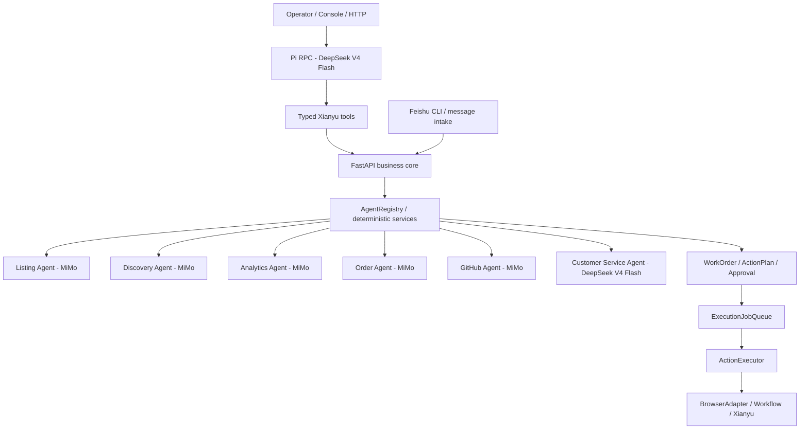

# Xianyu Pi Agent One-Person Company Project Plan

> Last updated: 2026-08-25
> Workspace: `E:\闲鱼\xianyu`
> Primary goal: land a realistic Pi-operated Xianyu business with current account evidence, deterministic commercial gates, auditable approvals, execution evidence, order fulfillment, and realized-profit review.

## Current Architecture

Pi is the sole primary natural-language entrypoint. A persistent project-local Pi RPC process uses DeepSeek V4 Flash and can call only the typed Xianyu tools in `.pi/extensions/xianyu-ops.ts`. The local FastAPI service remains the deterministic business core and source of truth.

Xianyu and cross-border ecommerce remain parallel, isolated projects. They do not share candidates, accounts, databases, approvals, or execution queues. The Xianyu migration does not silently modify the ecommerce project; ecommerce should receive its own Pi runtime in its own workspace when migrated.



The former `OpenClawRouter` and `/agents/openclaw/message` route remain only as a temporary rollback path. New operator traffic uses `/agent/message` or `/agents/pi/message`. Historical OpenClaw phases below are retained as implementation history, not as the current target architecture. The migration runbook is `docs/ops/pi-migration.md`.

## Current Landing Target (2026-08-23)

Goal: make the Xianyu/Pi project usable as a daily one-person-company operator cockpit.

The system should answer these questions in under five minutes each day:

- Which account has pending approvals?
- Which approved actions are waiting in the execution queue?
- Which executions failed and need retry/cancel?
- Which buyer replies are still draft approvals?
- Which accounts are missing prompt configuration, inventory context, or adapter sync readiness?

Newly implemented for this target:

- `xianyu_agent/account_ops_queues.py`
- `xianyu_agent/account_attribution.py`
- `GET /dashboard/account-queues`
- `POST /dashboard/account-queues/repair-attribution`
- `xianyu_agent/sync_persistence.py`
- `POST /adapter/sync-persist`
- account sync freshness in `account_sync_state` and `/dashboard/account-queues`
- OPC console account queue drilldown in `web/app.js` and `web/style.css`
- OPC console first-account bootstrap form backed by `POST /accounts`
- hardened `POST /accounts` with trim, blank-value rejection, default enabled status, and sanitized response
- OPC console sync buttons and freshness badges for account queue cards
- OPC console prompt-profile shortcut on account profile cards
- OPC console prompt bootstrap shortcut backed by `POST /accounts/{cookie_id}/prompt-profile/bootstrap`
- OPC console conversation-summary shortcut on account profile cards
- `GET /dashboard/first-run-readiness`
- OPC console first-run readiness gates for the controlled real-account loop
- OPC console first-run gate action buttons for account import, Prompt bootstrap, account sync, attribution repair preview, and daily snapshot generation
- `POST /dashboard/daily-review`
- daily review snapshots combining `/dashboard/opc-daily` and `/dashboard/account-queues`
- `docs/research/local-xianyu-tools-audit.md`
- local Xianyu tool audit distilled into the next runtime-readiness roadmap
- `tests/test_account_ops_queues.py`
- `tests/test_account_attribution.py`
- `tests/test_sync_persistence.py`
- `tests/test_daily_review_snapshot.py`
- two-stage current-browser seller-account import through
  `POST /accounts/browser-import/preview` and
  `POST /accounts/browser-import/commit`
- a browser-first console account flow with manual Cookie import retained only
  as a collapsed recovery path
- account-bound browser sessions that read credentials from the account
  database before legacy files or environment fallback
- CDP loopback requests that ignore environment proxies and derive their URL
  from the configured browser debug port

Account attribution behavior:

- New WorkOrders default to the sole configured account when the request omits `cookie_id`.
- Ecommerce listing-draft approvals carry `cookie_id` in WorkOrder context, approval payload, and approval snapshot.
- Inbound buyer-message intake carries `cookie_id` in WorkOrder context, approval payload, approval snapshot, and message-intake ledger records.
- WorkOrder approvals inherit `cookie_id` from WorkOrder context when action params omit it.
- Existing unassigned WorkOrders can be previewed and repaired locally through the account queue repair endpoint and console controls.

Adapter sync persistence behavior:

- `/adapter/sync-preview` remains read-only and does not mutate local state.
- `/adapter/sync-persist` calls the active adapter's provider-neutral order/listing sync methods and saves a local snapshot.
- Synced orders are persisted to `orders`; synced listings are persisted to `items`.
- `account_sync_state` stores per-account freshness metadata for `orders` and `listings`.
- `/dashboard/account-queues` now includes `sync_freshness` so stale account data can be surfaced as an operator action.
- Sync responses return counts and freshness only; raw cookies, buyer IDs, delivery payloads, and adapter raw payloads are not returned.
- The console can call `/adapter/sync-persist` per account and then refresh the OPC dashboard.
- `/dashboard/daily-review` writes a local daily Markdown snapshot containing OPC daily metrics plus account queues and sync freshness.
- The console account profile panel can import the first seller account through `POST /accounts`; the response does not echo the cookie value.
- Account imports reject blank `cookie_id` or blank cookie values, trim operator input, and explicitly mark the new account enabled.
- Account profile cards can call `/accounts/{cookie_id}/prompt-profile` and show ready/missing Prompt configuration without exposing prompt bodies or API keys.
- Account profile cards can call `/accounts/{cookie_id}/prompt-profile/bootstrap` to preserve existing settings, fill missing required Prompt keys, enable AI reply, and return only a sanitized profile.
- Account profile cards can call `/accounts/{cookie_id}/conversation-summary?chat_id=...` and show turns, last intent, bargain count, risk flags, recent redacted messages, and next operator action.
- `/dashboard/first-run-readiness` turns the first real-account loop into explicit gates: account configured, adapter ready, sync capabilities, Prompt ready, inventory context, current sync, and no unassigned blockers.
- The OPC console now renders action buttons inside failed first-run gates and routes them to the existing safe operator flows: focus account import, bootstrap Prompt, sync the primary account, preview attribution repair, refresh readiness, or generate the daily snapshot.

Current implementation target:

1. Phase R4 runtime readiness is complete and integrated with authenticated adapter sync.
2. First-run readiness now selects one account and requires that same account to satisfy Prompt, inventory, order/listing sync, runtime freshness, and verification gates.
3. Stub adapter state no longer qualifies as readiness for a real-account run.
4. Failed sync resources no longer receive false freshness timestamps.
5. Multi-account listing drafts require an explicit enabled account and preserve that account through WorkOrder, Approval, ExecutionJob, and ActionExecutor.
6. Legacy mutating routes now create WorkOrders and Approvals instead of executing platform actions directly.
7. Follow `docs/ops/commercial-alpha-runbook.md` to run one 14-day, one-account, one-category controlled commercial experiment.

## Pi Skill And Queue Milestone (2026-08-23)

The project now has eight Pi-discoverable business skills. Two new skills were
adapted from licensed GitHub references instead of installing their scripts:

- `xianyu-competitor-evidence`: separates observable listing evidence from
  inference and prepares an evidence-backed competitor baseline.
- `xianyu-commercial-experiment`: predeclares one-variable, low-volume tests
  with a primary metric, guardrails, observation window, and inconclusive exit.

The Pi extension also exposes `xianyu_market_search`, a bounded read-only tool
that calls the existing local search adapter. It accepts a keyword, one or two
pages, and optional price bounds; it returns observable listing fields, a
displayed-price summary, and evidence limitations. It cannot publish, send a
message, approve work, or mutate business records.

Source revisions, licenses, retained ideas, and rejected candidates are tracked
in `docs/PI_SKILL_PROVENANCE.md`. No upstream API clients, broad-shell helpers,
credentials, or external-action scripts were imported.

Operational cleanup is also complete for the first-account gate:

- The account-attribution preview found 15 old listing WorkOrders referencing
  the nonexistent account IDs `a1` or `acct_1`.
- All 15 were recommended for quarantine, had no execution jobs or message
  intake, and were individually selected under preview token
  `13bd73f579aa380883de24444176f68e5418788553bf9ab2f775eb254a4d204a`.
- The audited repair retained every WorkOrder, changed the pending approvals to
  rejected, added one quarantine event per WorkOrder, and performed no platform
  action.
- `/dashboard/account-queues/unassigned-work` now returns zero and the
  `no_unassigned_work` first-run gate passes.

The next commercial blocker is no longer code or historical queue noise. It is
the absence of a real seller account. After one account is imported by the
operator, the exact order is: verify runtime and login evidence, persist fresh
order/listing sync, bootstrap the account Prompt, record account/category
commercial terms, complete supplier and unit-economics evidence for one
candidate, then run the Day-0 launch preview. No real listing should be claimed
before those gates pass.

Verification for this milestone:

- Xianyu isolated full suite: 882/882 passed; all 13 pre-existing files under
  `data/live` retained identical SHA-256 hashes during the test run.
- Cross-border sandbox regression: 37/37 script groups passed; its production
  database remained at SHA-256
  `E752E5B176D9C9C27049E69C6A263F9ADA91C4AA147B398458ED5D6BDB3B371A`.
- Both formal services were restarted after regression. Xianyu reports Pi with
  11 tools and eight skills; cross-border reports Pi with 11 tools and ten
  skills. Both report `external_action_tools=false`.

## Model Policy

- `customer_service`: DeepSeek V4 Flash only.
- `listing`, `discovery`, `order`, `github`, `analytics`: MiMo.
- Ollama must not be used or advertised.
- Do not restore `OLLAMA_BASE_URL`, `OLLAMA_MODEL`, or `/api/generate` execution paths.

## Feishu Policy

- Feishu is connected through Feishu CLI long connection.
- Feishu CLI handles login, app binding, long-lived event subscription, and local event bridging.
- The local FastAPI route `/feishu/events` remains the event handling entrypoint.
- Do not require public webhook URLs, tunnel setup, `YOUR_PUBLIC_TUNNEL`, or `FEISHU_WEBHOOK_URL`.
- `FEISHU_VERIFICATION_TOKEN` may remain if event verification is still used by `/feishu/events`.

## Safety Policy

- Never bypass captchas, human verification, or platform risk-control prompts.
- High-risk actions must go through approval:
  - `publish_listing`
  - `fulfill_order`
  - `send_message`
  - `delete_item`
  - `refund_order`
  - sensitive customer replies
- Approved actions enter the execution queue before running.
- Executions must be idempotent:
  - completed approvals cannot re-execute
  - running approvals cannot re-execute
  - active jobs block duplicate jobs
- Every state transition must be written to the relevant events/history file.

## Completed Phases

### Phase 1: OpenClaw Entry

- Replaced Hermes as the default orchestrator with `OpenClawRouter`.
- Kept `/agents/hermes/message` only as a compatibility alias.
- Registered six internal specialist agents through `AgentRegistry`.

### Phase 2: Agent Collaboration

- Added agent-to-agent messages.
- Added multi-agent roundtable discussions.
- Persisted collaboration history to `data/agent_collaboration.jsonl`.
- Added console collaboration feed.

### Phase 3: Realistic Work Orders

- Added `WorkOrder`, `ActionPlan`, and `Approval`.
- Persisted work orders to `data/work_orders.json`.
- Collaborative listing creates a work order and action plan.
- Risky actions require human approval.

### Phase 4: Approval Center

- Added approval decision APIs.
- Added approval center UI.
- Added approval snapshots.
- Added idempotency protection for execution.

### Phase 5: Action Executor

- Added `ActionExecutor`.
- Moved action-specific execution out of route handlers.
- Implemented `publish_listing` execution.
- Added stubs for future actions.

### Phase 6: Execution Queue

- Added `ExecutionJobQueue`.
- Persisted execution jobs to `data/execution_jobs.json`.
- Added queued, running, completed, failed, cancelled states.
- Added retry and cancel operations.

### Phase 7: Order Fulfillment

- Implemented `fulfill_order` action handler.
- Added `/workflows/orders/{order_id}/fulfill`.
- Created order fulfillment work orders, approvals, snapshots, and queue execution.

### Phase OPC-1: OPC Operating Artifacts and Xianyu Playbooks

Status: complete.

What changed:

- Added project boundary note confirming two-project architecture (Xianyu + Ecommerce under OpenClaw).
- Created OPC operating artifacts under `docs/ops/opc/`:
  - `resource-audit.md` — inventory of accounts, suppliers, skills, assets, constraints.
  - `niche-positioning.md` — Three Rings analysis, candidate scoring, positioning statement.
  - `mvp-validation.md` — listing test cycle, success criteria, decision framework.
  - `conversion-loop.md` — full discovery-to-repeat path with metrics.
  - `weekly-review.md` — review template, cadence, decision framework.
- Created Xianyu strategy playbooks under `docs/ops/xianyu/`:
  - `product-selection-playbook.md` — scoring model, selection methods, candidate categories.
  - `listing-playbook.md` — structured draft format, low-price entry, city selection.
  - `conversion-reply-playbook.md` — intent classification, reply templates, safety rules.
  - `fulfillment-after-sales-playbook.md` — pre-fulfillment checklist, after-sales scenarios, refund framework.

Safety boundary:

- Playbooks are reference documents for agents and dashboards, not runtime code.
- They do not bypass WorkOrder, Approval, or ExecutionJobQueue.

What changed (code):

- Added `ProductScorer` to `xianyu_agent/resale.py` with 7-dimension scoring and test/watch/weak/reject recommendations.
- Integrated scoring into `create_candidate`, added `score_candidate` and `list_by_recommendation` methods.
- Added strategy discovery modes to `xianyu_agent/agents/discovery.py` (raw_material, high_ticket, batch_demand, regional).
- Added `classify_intent` to `xianyu_agent/agents/customer_service.py` with 7 intent types and playbook reply strategies.
- Added `check_fulfillment` and `classify_after_sale` to `xianyu_agent/agents/order.py`.
- Updated `xianyu_agent/openclaw_router.py` with strategy command routing.
- Updated `xianyu_agent/product_discovery.py` with scoring integration in `analyze_product`.
- Added `tests/test_product_scoring.py` (17 tests passing).

Tracking plan:

- `docs/superpowers/plans/2026-05-26-openclaw-opc-xianyu-operations-plan.md`

## Current Phase

### Phase 8: Cleanup and Integration Alignment

Priority: high.

Goals:

- Remove Ollama usage and documentation.
- Make `customer_service` use DeepSeek V4 Flash.
- Update Feishu docs/config/manifest to Feishu CLI long connection.
- Preserve the five MiMo specialist agents.

### Phase 9: Ecommerce Safe Bridge

Status: implemented as the first safe merge slice.

What changed:

- Added `POST /integrations/ecommerce/listing-drafts`.
- Ecommerce candidates create `ecommerce_candidate` WorkOrder records.
- The created action is `publish_listing`, which remains approval-gated.
- Ecommerce dashboard can approve or reject the pending Xianyu Approval through the safe bridge.
- `/execution-jobs/run-next` now passes `workflow` into `ActionExecutor` context so approved queued actions can use the existing adapter path.

Safety boundary:

- Intake does not publish listings.
- Intake does not send buyer messages.
- Intake does not create supplier orders, payments, refunds, delete actions, or captcha/risk-control bypasses.
- Approval decision does not enqueue or run execution jobs automatically.
- Ecommerce remains the business backend; Xianyu remains the channel execution adapter.
- Preserve WorkOrder, Approval, ActionExecutor, and ExecutionJobQueue behavior.

Tracking plan:

- `docs/superpowers/plans/2026-05-20-deepseek-feishu-cli-migration.md`

### Phase 11: Operations Dashboard

Status: implemented as the daily operator cockpit slice.

What changed:

- Added console filters for WorkOrder status, type, owner, and risk.
- Added console filtering for execution jobs by status.
- Added approval count badges for pending, approved, queued, and failed execution states.
- Added a compact event timeline to each WorkOrder card.
- Added explicit `run-next` and `run-pending` queue controls with confirmation dialogs.
- Added `POST /execution-jobs/run-pending` as the explicit queue runner alias.

Safety boundary:

- Queue controls still only execute already queued jobs.
- Approvals still require human decision before enqueue.
- No publish, message, fulfillment, payment, refund, or destructive action is triggered directly from intake.

### Phase 12: Delete and Refund Workflows

Status: implemented as the destructive/financial action safety slice.

What changed:

- Added `POST /workflows/items/{item_id}/delete`.
- Added `POST /workflows/refunds/{order_id}/refund`.
- Added `POST /workflows/disputes/{dispute_id}/reply`.
- Added real `ActionExecutor` handlers for `delete_item`, `refund_order`, and `sensitive_reply`.
- Added safe console snapshots for delete, refund, and dispute reply approvals.
- Added stub-adapter refund outbox support so local execution can be logged without touching a live platform.

Safety boundary:

- Delete, refund, and dispute reply intake only creates WorkOrder/Approval records.
- No destructive or financial action is executed from the intake routes.
- Human approval is still required before creating an ExecutionJob.
- Execution still flows through ExecutionJobQueue and ActionExecutor.
- UI snapshots show decision context, but the full dispute reply stays in the approval payload.

### Phase 10: Automatic Message Intake

Status: implemented as the inbound buyer-message draft slice.

What changed:

- Added `POST /workflows/messages/inbound`.
- Feishu CLI structured buyer-message events are detected inside `/feishu/events` and converted into `customer_message` WorkOrders.
- The customer-service workflow generates a reply candidate, which becomes a `send_message` Approval instead of being sent directly.
- Added risk classification across both the inbound buyer text and the generated reply candidate.
- Preserved conversation context in the WorkOrder and execution payload while keeping UI snapshots limited to summaries.
- Changed the Xianyu WebSocket message processor so generated replies are emitted as draft callbacks by default instead of being sent directly.
- Added console rendering for inbound-message snapshots.

Safety boundary:

- Inbound intake never sends a buyer message directly.
- Feishu and Xianyu IM intake only create visible WorkOrders and pending Approvals.
- Approved replies must still be queued through ExecutionJobQueue before ActionExecutor can send them.
- Full inbound context is preserved for review, but console snapshots show only summaries and counts.

### Phase 13: Production Message Intake Hardening

Status: implemented as the inbound-message observability and dedupe slice.

What changed:

- Added persistent `MessageIntakeLedger` storage at `data/message_intake.json`.
- Added duplicate suppression using `message_id` when present, otherwise a stable source/chat/buyer/message hash.
- Added `GET /message-intake/metrics`.
- Added `GET /message-intake/recent`.
- Add a small operator view for recent inbound-message intake results.
- Added explicit Feishu CLI structured buyer-message examples to `docs/openclaw_feishu_workflow.md`.
- Added metrics for duplicate events, pending approvals, manual-reply fallbacks, generation failures, and risk-flagged intakes.

Safety boundary:

- Duplicate suppression prevents duplicate WorkOrder creation, but never approves or executes a message.
- Metrics and recent intake views show summaries and identifiers, not secret material.
- Manual-reply and generation-failure fallbacks remain operator-visible WorkOrders, not automated sends.

## Next Phases

### Phase 14: Message Intake Alerting and Retention

Status: implemented as the long-running intake maintenance slice.

What changed:

- Added retention pruning for `message_intake.json` by age and maximum record count.
- Added `GET /message-intake/health` with Feishu CLI bridge freshness, generation-failure alerts, and duplicate-rate alerts.
- Added `POST /message-intake/retention/prune` for explicit operator-triggered ledger cleanup.
- Added `POST /message-intake/{intake_id}/retry` to regenerate a draft reply for manual-reply or generation-failure fallback records after model recovery.
- Added console health, alert, retention, and retry controls to the message-intake panel.

Safety boundary:

- Retry only creates a new pending `send_message` Approval on the original WorkOrder.
- Retry does not approve, enqueue, execute, or send buyer messages.
- Retention pruning only touches message-intake observability records, not WorkOrders, Approvals, or ExecutionJobs.
- Alerts are operator-facing summaries; they do not trigger automated platform actions.

### Phase 15: Bridge Runbooks and Recovery Automation

Status: implemented as the bridge recovery and incident export slice.

What changed:

- Added `GET /message-intake/runbooks` for stale Feishu CLI bridge, high duplicate rate, generation failure, and model recovery procedures.
- Added `GET /message-intake/incident-bundle` to export a diagnostic bundle with health, metrics, alerts, runbooks, and sanitized recent intake summaries.
- Added `POST /message-intake/health-check/dry-run` to preview scheduled health checks and local notification hooks without sending notifications or mutating business state.
- Added console controls for dry-run health checks, incident bundle export, and inline runbook hints in the message-intake panel.

Safety boundary:

- Incident bundles omit raw event keys, approval IDs, raw payloads, and buyer/chat identifiers; buyer, chat, item, and work-order references are hashed.
- Dry-run health checks do not mutate WorkOrders, Approvals, ExecutionJobs, or the message-intake ledger.
- Notification hooks are preview-only in this endpoint; they do not send buyer messages or external notifications.
- Runbooks are operator guidance only and do not approve, enqueue, execute, or send anything.

### Phase 16: Intake Recovery Scheduling and Operator SLAs

Goal: make recovery checks routine without adding autonomous platform actions.

Scope:

- Add a local scheduler entry for periodic message-intake dry-run health checks.
- Persist health-check snapshots separately from message intake records.
- Add operator SLA indicators for stale bridge duration, unresolved generation failures, and retry backlog.
- Keep all recovery actions manual and approval-gated.

### Phase 17: Commercial Alpha Execution Integrity

Status: implemented as the real-account preflight and single-execution-path slice.

What changed:

- First-run readiness evaluates account-scoped gates on one selected account instead of combining partial readiness across accounts.
- Both order and listing sync must be fresh; runtime heartbeat and credential evidence must be recent.
- Successful authenticated sync updates account runtime evidence, while failed resources do not receive fresh sync timestamps.
- Authentication failures create an operator-visible runtime blocker.
- Agent `reject` recommendations require an explicit override reason before manual approval.
- Browser publishing detects manual verification, unsupported category, missing condition, and missing image blockers.
- Multi-account resale listing drafts require an explicit enabled `cookie_id` and carry it into WorkOrder, Approval payload, approval snapshot, and execution.
- Publish execution uses the approved account instead of the hard-coded `default` account.
- Legacy `/listings`, `/orders/paid`, `/opportunities/{id}/list`, and browser write routes create approvals rather than directly mutating the platform.
- Live runtime data now uses `data/live`; the isolated test runner writes all global test state to a disposable system temp directory.
- The service launcher pins `deepseek-v4-flash` and polls startup health to avoid false slow-start failures.
- Added `docs/ops/commercial-alpha-runbook.md` with the exact 14-day operating sequence, evidence requirements, SLAs, and stop conditions.

Next target:

- Fulfilled by Phase 19. The remaining milestone is an operator-approved Commercial Alpha run against one real seller account and a real buyer order.

### Phase 18: Evidence-based Commercial Publish Preflight

Status: implemented.

What changed:

- Added a pure module `xianyu_agent/commercial_preflight.py` that evaluates publish gates in exact business order: explicit configured/enabled account; account-scoped readiness (enabled, prompt, sync, runtime connected/fresh/unblocked — inventory NOT required); candidate not blocked/high risk; supplier verified with note; supplier quote and stock checked within 24h; gross profit and margin floors from settings; fulfillment verified with note; at least one image; valid image rights type; image rights evidence; title/category/specifications complete.
- Preflight results are sanitized and deterministic: `ready`, ordered gates with stable codes/status/message/evidence, ordered `next_step`, `checked_at`, and a compact `snapshot` intended for the approval payload. Cookie values, auth headers, prompts, secrets, and raw runtime payloads are never exposed.
- Candidate defaults and verification handling extended compatibly with `supplier_quote_checked_at`, `stock_checked_at`, `fulfillment_verified`, `fulfillment_verification_note`, `image_rights_type`, and `image_rights_evidence`. Old records remain readable and fail preflight until re-verified.
- Added read-only `GET /resale/candidates/{candidate_id}/publish-preflight?cookie_id=...` returning a sanitized result; missing/ambiguous/unknown/disabled accounts yield a blocked result consistent with the dashboard readiness convention.
- `POST /resale/candidates/{candidate_id}/listing-draft` now runs strict preflight BEFORE any draft/workorder/approval side effect. Missing/ambiguous/unknown/disabled account or any failed gate returns HTTP 409 with sanitized preflight detail. Manager-level `create_listing_draft` keeps legacy behavior.
- Approval payloads carry only a compact preflight snapshot (`checked_at` + gate/evidence summary).
- Console candidates gained a 发布前检查 action and clear 409 detail rendering for the existing listing-draft action.

### Phase 19: Evidence-derived Commercial Alpha Batch

Status: implemented and verified locally.

What changed:

- Added `xianyu_agent/commercial_trial.py` with an atomic JSON-backed `CommercialTrialStore` and a pure ten-stage reconciliation model.
- Replaced the operator-facing manual TrialRun checklist with account-, candidate-, platform-item-, order-, and time-scoped evidence from commercial preflight, WorkOrders, publish Approvals, ExecutionJobQueue results, MessageIntake, OrderRuntime, and ResaleOrders.
- Real publish evidence requires a completed `publish_listing` job with a successful nonblank `external_id`; `stub_*` simulator IDs do not count.
- Added bounded controls for candidate pool, publish commitments, procurement cash budget, realized loss, after-sales rate, inquiry target, paid-order target, and monitor period.
- Publish Approvals reserve capacity before execution. The same candidate cannot reserve a second publish slot, and concurrent batch draft checks use one lock around validation plus WorkOrder creation.
- Procurement exposure is calculated from supplier cost plus supplier shipping, not sales revenue. Missing reconciled orders fall back to the candidate's supplier cost evidence.
- Profit reconciliation accepts both Unix and ISO timestamps and requires an exact Xianyu order ID plus batch candidate match.
- Operational pause/continue decisions do not satisfy final review. Final review becomes eligible after the monitor window, a stop condition, a completed target profit reconciliation, or an explicit terminal stop decision.
- Added Commercial Alpha list/active/detail, candidate attach, decision, report, and gated listing-draft endpoints. The original direct `POST /commercial-trials` setup route was retired by Phase 24 so an active batch cannot bypass Day-0 launch gates. Legacy `/trial-run/*` endpoints remain compatibility-only and are marked deprecated.
- Added an OPC console section with enabled-account selection, all commercial controls, multiple active account batches, stage evidence, procurement metrics, stop alerts, candidate attachment, gated draft creation, lifecycle decisions, and report generation.
- Added paid-order fulfillment handoff and release endpoints. A handoff requires exact batch order evidence plus four operator confirmations, reserves an idempotent OrderRuntime fulfillment lock, checks projected procurement cash, and creates a high-risk `prepare_purchase_draft` Approval without paying or submitting a supplier order.
- PurchaseDraft, PurchaseTask, and ResaleOrder now retain the Commercial Alpha trial, Xianyu order, account, item, sale amount, and lock linkage needed for end-to-end audit and profit reconciliation. Duplicate handoff and duplicate Xianyu-order reconciliation are blocked.
- OrderRuntime explicitly separates synthetic `fake/stub/mock/test/demo` sources from operational orders. Synthetic records remain auditable but cannot create paid-order, fulfillment, after-sales, dashboard action, or Commercial Alpha progress evidence.
- Added `docs/ops/commercial-alpha-batch.md` with the exact operating order from account preparation through paid order, fulfillment, profit reconciliation, and stop handling.

Verification:

- `831` isolated unittest cases passed on 2026-08-11 after fulfillment-handoff, rejected-approval recovery, and synthetic-order isolation coverage.
- `node --check web/app.js` passed.
- Phase 19 focused tests cover cross-account/history isolation, duplicate intake exclusion, `stub_*` rejection, ISO profit timestamps, target counts, procurement exposure, publish reservation, paid-order handoff idempotency, four-confirmation and budget gates, fulfillment-lock release, order-link propagation, stop rules, API routes, and zero-side-effect blocking.

Next target:

- Start one real batch from the console against an enabled seller account.
- Attach one fully evidenced candidate for the first batch; expand only after the first-order evidence chain closes.
- Approve and publish one candidate, then preserve the real platform item ID.
- Observe buyer inquiries, the first paid order, fulfillment, and final profit evidence before deciding whether to repeat or stop.

### Phase 20: Published-item Observation and Single-variable Decisions

Status: implemented and verified locally.

What changed:

- Browser listing parsing now preserves `browseCount` and `wantCount` only when both counters are actually present and valid. Missing or malformed fields remain `metrics_available=false`; they are never converted into zero-traffic evidence.
- The account listing snapshot schema now stores metric availability, cumulative browse/want counts, and observation time. Existing SQLite databases receive an additive migration and retain item creation time across sync updates.
- Successful listing sync captures adapter traffic snapshots for active Commercial Alpha batches only when account, real platform item ID, candidate, and publish time match.
- Added operator traffic snapshots as a fallback. They require an evidence note, enforce `0 <= wants <= views`, reject cumulative counter regression, and bind evidence to trial, account, item, candidate, source, and local date.
- Added a daily item-performance funnel: browse -> want -> inquiry -> paid order. Inquiry and paid counts remain system-derived from MessageIntake and OrderRuntime rather than operator input.
- Added configurable observation interval, minimum browse diagnosis threshold, and experiment duration controls. These are batch decision guards, not hard-coded platform promises.
- Added single-variable experiments for title, cover, price, description, location, or shipping promise. Experiments require a baseline, prevent overlapping experiments for one item, preserve a separate post-change snapshot, and require evidence before keep/revert/stop decisions.
- Added traffic observation and experiment controls to the Commercial Alpha console, report output, and operating runbook.

Verification:

- `836` isolated unittest cases passed on 2026-08-11.
- New tests cover missing-vs-real-zero metric parsing, SQLite metric persistence without raw adapter payloads, monotonic daily snapshots, experiment baseline preservation, funnel recommendations, and API item linkage.
- `node --check web/app.js` and Python bytecode compilation passed.

Next target:

- Connect one enabled seller account and confirm whether its current listing response exposes valid browse/want counters.
- Create the first real batch, publish one item, and preserve the first adapter or operator baseline snapshot.
- Run one complete observation window before changing a listing field; then execute and decide one single-variable experiment.
- Continue through real inquiry, paid order, fulfillment, and profit reconciliation without expanding to another account.

### Phase 21: Evidence-confirmed Listing Experiment Execution

Status: implemented and verified locally.

What changed:

- A single-variable experiment now starts as `proposed`, creates a high-risk `edit_listing` WorkOrder and Approval, and keeps `started_at=0` until platform-side evidence is confirmed.
- The ActionExecutor can submit one approved title or price edit through the browser adapter. The adapter reports `submitted=true` and `confirmed=false`; it cannot claim the platform value changed before a later listing sync.
- Activation requires an enabled active trial, an approved edit, an exact post-proposal item sync, and an item still present in that account's latest listing snapshot. Title and price must match the proposed value.
- Cover, description, location, and shipping-promise experiments use a manual evidence path with an explicit confirmation, evidence note, and evidence reference. A manually completed edit is recorded on the approval audit trail.
- Cancelling an unexecuted proposal rejects its approval and cancels queued edit jobs. Running or successfully submitted edits cannot be silently cancelled, and stale cancelled experiments are blocked by the ActionExecutor before platform mutation.
- The Commercial Alpha console now distinguishes pending approval, pending execution, pending sync confirmation, active timing, and final decision states. Trial reports include approval, execution, start time, and activation evidence.

Verification:

- `841` isolated unittest cases passed on 2026-08-11.
- Focused unittest coverage validates proposal-before-activation timing, exact real-item linkage, post-sync manual fallback, cancelled-job cleanup, stale-experiment execution blocking, and audited manual completion.
- `node --check web/app.js` and Python bytecode compilation passed.

Next target:

- Connect one enabled seller account and complete the first real publish, baseline snapshot, approved single-variable change, evidence-confirmed activation, and result snapshot.
- Continue the same item through a real inquiry and paid-order fulfillment before increasing item or account count.

### Phase 22: First-order Evidence Closure

Status: implemented and verified locally.

What changed:

- Added an `inquiry_responded` stage after inquiry intake. A real inquiry no longer advances the response stage unless a successful `send_message` execution job is linked to that exact intake approval, account, published item, and post-publish time window.
- Paid-order fulfillment now requires the Commercial Alpha handoff, approved purchase action, linked purchase task/draft, exact trial/account/item/order linkage, supplier order ID, supplier tracking, Xianyu tracking, and a shipped-or-completed local order.
- Profit reconciliation now requires platform delivery evidence, a strongly linked completed ResaleOrder, actual sale/cost/shipping/platform-fee values, a financial evidence note/reference/time, and a system-recomputed profit matching the formula.
- Commercial order transitions are ordered: a linked order must reach `purchased -> shipped -> completed`; completion before platform delivery or without financial evidence returns HTTP 409 with exact gap codes.
- Positive profit is counted only after full evidence closure. Linked recorded losses use a conservative stop-loss basis even when other completion evidence is still missing.
- Trial reports and the console now expose inquiry response counts, fulfillment evidence gaps, profit evidence gaps, and the risk stop-loss profit basis.
- Added a cross-manager first-order E2E test that uses real local stores for candidate evidence, trial, WorkOrders, approvals, execution jobs, message intake, paid-order runtime, purchase task, dual tracking, and financial reconciliation. It verifies every Commercial Alpha stage and checks that buyer/chat/message data does not leak into the reconciled trial.

Verification:

- `845` isolated unittest cases passed on 2026-08-12 with no failures.
- `node --check web/app.js` and `git diff --check` passed.
- Firefox browser QA passed at desktop (`1280px`) and mobile (`390px`) widths with no document-level horizontal overflow and no console errors or warnings.
- The live-data screen correctly blocks the run because no seller account is connected. A browser-only mock verified the first-order evidence-gap rendering without writing demo records to the service.
- QA artifacts: `output/playwright/phase22-commercial-alpha-no-account-desktop.png`, `output/playwright/phase22-first-order-audit-desktop.png`, and `output/playwright/phase22-first-order-audit-mobile.png`.

Next target:

- Import and enable one real seller account, clear first-run readiness, and run this exact evidence chain against one real item and one real order.
- Treat the first real account/item/order evidence as the only remaining proof needed for Commercial Alpha completion; do not expand account or item count before it passes.

### Phase 23: Historical Work Isolation

Status: implemented and verified locally.

What changed:

- Replaced implicit single-account attribution repair with a versioned review flow. Missing account IDs and IDs that do not belong to a currently configured seller account are both treated as unresolved.
- Added a sanitized `GET /dashboard/account-queues/unassigned-work` review. It exposes work-order IDs, actions, age, queue state, and a resolution recommendation without returning cookies, buyer IDs, chat IDs, or message text.
- Applying a resolution now requires an explicit `claim` or `quarantine` mode, exact `work_order_ids`, the current `preview_token`, and a quantity-bound confirmation phrase such as `QUARANTINE 2`. Empty selections, stale previews, unknown accounts, and mixed/actively executing work are rejected.
- Claiming work replaces stale logical account identifiers throughout the selected WorkOrder and its approvals. It never defaults all old work to the only configured account.
- Quarantining work preserves history while rejecting unexecuted approvals, cancelling queued or failed execution jobs, closing pending message-intake records, and recording audit events. Running or completed execution is left for manual platform audit.
- The OPC console now renders each unresolved work order with its current logical account, platform action, age, pending approval count, and recommendation. Operators must select individual rows; claim is disabled until an enabled real account exists.
- First-run readiness and the Commercial Alpha runbook now place historical-work review before seller-account activation and real publishing.

Verification:

- `848` isolated unittest cases passed on 2026-08-12 with no failures.
- The live read-only review found `15` unresolved historical publishing approvals and recommended quarantine for all `15`; no record was mutated during QA.
- Firefox browser QA passed at desktop (`1280px`) and mobile (`390px`) widths with no horizontal overflow and no console errors or warnings.
- QA artifacts: `output/playwright/phase23-unassigned-review-desktop.png` and `output/playwright/phase23-unassigned-review-mobile.png`.

Next target:

- Prepare a deterministic Day-0 launch session so the operator can import one account, clear readiness in business order, select one evidence-qualified candidate, and create exactly one Commercial Alpha batch without navigating unrelated controls.
- Keep historical work quarantined or unresolved; only newly created, explicitly account-scoped WorkOrders may enter the first live batch.

### Phase 24: Atomic Day-0 Commercial Launch

Status: implemented and verified locally.

What changed:

- Added a pure, deterministic `xianyu_agent/commercial_launch.py` decision model with 19 stable gates in the actual operating order: historical-work resolution; explicit enabled account; live adapter and sync capabilities; Prompt, sync, and runtime readiness for that same account; one selected and manually approved candidate; candidate publish preflight; valid controls; known procurement cost; sufficient one-unit cash budget; one-item scope; and no existing active trial.
- Added read-only `POST /commercial-launch/preview`. It returns sanitized gate evidence, the first blocking action, exact one-candidate/one-publish controls, `START 1` confirmation, and a SHA-256 preview token. Previewing does not create a trial, WorkOrder, Approval, execution job, listing, message, or order.
- The preview token versions candidate decision/cost data, every publish-preflight gate and evidence summary, account Prompt/sync/runtime timestamps and flags, adapter capabilities, unresolved historical-work token and queue counts, active-trial state, and launch controls. A changed quote, runtime heartbeat, preflight evidence, historical queue, candidate decision, or active batch invalidates the token.
- Added atomic `POST /commercial-launch/start`. Under the existing trial action lock it recomputes all evidence, rejects stale or blocked previews with HTTP 409, and creates exactly one Day-0 trial only after the current token and exact `START 1` confirmation match.
- Launch metadata is persisted with the trial. Repeating the exact start request after a network retry or service restart returns the original trial instead of creating a duplicate.
- Retired direct active-batch creation through `POST /commercial-trials`; it now returns `strict_commercial_launch_required`. Internal tests that need a fixture use `CommercialTrialStore` directly, while real API callers must use preview then start.
- Replaced the console's free-form batch create form with account and candidate selectors plus the bounded commercial controls. The operator first checks the launch gates, sees every pass/block and the exact next action, and only sees `启动 1 个商品批次` when all 19 gates pass.
- Starting a trial still does not publish. It only establishes the auditable operating boundary; the next side effect remains a separately generated listing draft followed by Approval, ExecutionJobQueue, and ActionExecutor.

Verification:

- `856` isolated unittest cases passed on 2026-08-13 with no failures.
- Focused coverage verifies exact gate order, single-item controls, manual approval and budget gates, state-fingerprint changes, read-only preview, stale-preview zero side effects, unresolved-history blocking, atomic creation, post-restart idempotency, and rejection of the retired direct-create route.
- Live read-only QA reported `15` unresolved historical work orders, `0` seller accounts, `0` active trials, and `1` candidate. The unresolved count and review token were unchanged before and after preview; the first failed gate was `historical_work_resolved`.
- Firefox browser QA passed at desktop (`1440px`) and mobile (`390px`) widths with 19 rendered gates, no document/panel horizontal overflow, and no console errors or warnings. The mobile ready state was DOM-only visual QA and did not create service records.
- QA artifacts: `output/playwright/phase24-day0-blocked-desktop.png` and `output/playwright/phase24-day0-ready-mobile.png`.

Next target:

- In the console, review and explicitly quarantine or claim the 15 historical work orders; do not bind them implicitly to a new account.
- Import and enable one real seller account, initialize its Prompt, complete real order/listing sync, and confirm a fresh unblocked runtime.
- Replace the placeholder candidate with one commercially evidenced and manually approved item, then obtain a real 19/19 preview and start exactly one batch.
- Generate one listing draft from that batch and continue through approval, real publish ID, inquiry response, paid-order handoff, dual tracking, delivery, and actual-profit reconciliation before adding a second item or account.

### Phase 25: Account Commercial Terms and Activation Work Order

Status: implemented and verified locally.

What changed:

- Added `AccountCommercialTermsStore`, an atomic JSON store scoped by exact `cookie_id + category`. It stores only sanitized operator attestations, current fee numbers, evidence timestamps/references, and a content-hash version; it rejects credentials, phone numbers, identity numbers, future timestamps, and invalid money/rate values.
- Added 12 ordered commercial-terms sub-gates covering snapshot presence/scope/freshness, account ownership or authorization, business-seller identity, current seller agreement, payment readiness, category publishability, buyer protection and return handling, guarantee/buyer-protection funding, fee evidence, and candidate-version alignment.
- Added `GET/POST /accounts/{cookie_id}/commercial-terms`. Saving a snapshot can bind one candidate, recompute its economics from `sale_price * account_category_rate + per_order_fixed_fee`, persist the terms version, and return the post-repricing readiness result.
- Kept the existing 8% candidate-entry value as a rough estimate only. Both real listing-draft routes and Day-0 launch now require a current account/category snapshot and exact candidate version match, so the estimate cannot authorize a real publish.
- Replaced the universal `非质量问题不退换` listing claim. Drafts now use the verified seven-day policy, a recorded lawful category exception, or a conservative platform-rules fallback. The selected return policy and terms version are carried in structured after-sales fields.
- Expanded the Day-0 model from 19 to 20 high-level gates by adding `account_commercial_terms_ready` before candidate preflight. Terms evidence and its sub-gate states enter the SHA-256 preview token, so a fee, guarantee, return-policy, account, category, or version change invalidates an old start request.
- Added a deterministic 20-step activation work order. Every step names the real operating stage, human/system owner, required evidence, acceptance check, and executable next action; the console renders only remaining work while retaining all steps in the API.
- Added a console commercial-terms form with account/category/candidate locking, business identity, payment, category, return, after-sales, guarantee, fee, timestamp, and evidence fields. Saving reprices the candidate and immediately reruns the launch preview.
- Enforced project isolation at every Alpha entry point: the candidate picker only offers `sales_platform=xianyu` and `market_scope=domestic` records, the terms API rejects cross-channel candidates, and both publish preflight and the 20-gate launch preview block them with auditable channel evidence.
- Added the official-rule evidence record at `docs/research/xianyu-official-commercial-rules-2026-08-18.md` and updated the Commercial Alpha runbook. Platform pages observed on the execution day remain authoritative; no universal fee or guarantee assumption is encoded.
- Fixed a pre-existing test-isolation gap discovered during live QA: five route tests were writing WorkOrders through the production global manager. The ten records produced by this Phase's two verification runs were identified by exact ID/time/title/account/state, backed up, and removed; the original 15 historical records were preserved. Both affected fixtures now use temporary WorkOrderManagers.

Verification:

- `869` isolated unittest cases passed on 2026-08-18 with no failures, including explicit cross-channel rejection at commercial-terms, publish-preflight, launch-preview, and console-selection boundaries.
- A second full run compared SHA-256 hashes for every file under `data/live` before and after testing: 10 files before, 10 files after, `0` changed files.
- `node --check web/app.js`, Python bytecode compilation, and `git diff --check` passed.
- Service health passed at `http://127.0.0.1:8788`; current read-only live state is `15` unresolved historical WorkOrders, `0` seller accounts, `1` placeholder candidate, and `0` active trials. Preview returns 20 launch gates, 20 activation steps, and 12 commercial-terms sub-gates without creating records.
- Edge/Playwright browser QA passed at desktop (`1280x720`) and mobile (`390x844`) widths. The activation panel and modal had no document, panel, modal, or visible-control horizontal overflow; browser console reported 0 errors and 0 warnings. The final live panel exposed only the one domestic Xianyu placeholder candidate, no seller-account option, and the commercial-terms action in the correct operating order. The mobile modal scrolled to its final save action.
- QA artifacts: `output/playwright/phase25-activation-plan-desktop.png`, `output/playwright/phase25-activation-plan-mobile.png`, `output/playwright/phase25-commercial-terms-modal-desktop.png`, `output/playwright/phase25-commercial-terms-modal-mobile.png`, `output/playwright/phase25-commercial-terms-modal-mobile-bottom.png`, `output/playwright/phase25-final-commercial-alpha-desktop.png`, and `output/playwright/phase25-final-commercial-alpha-mobile.png`.
- Recovery backup: `output/recovery/work_orders.before-phase25-test-cleanup-20260818T0134.json`.

Next target:

- The remaining blockers are real-world evidence, not missing local code: review and explicitly quarantine or claim the 15 historical WorkOrders; import one owned/authorized seller account; complete Prompt, order/listing sync, runtime and any platform verification; replace the placeholder candidate with a real supplier-evidenced item.
- For that exact account and candidate, open the current category publish/fee page and record business identity, payment, buyer-protection/return policy, guarantee requirement, actual percentage/fixed fees, and a sanitized local evidence reference. Let the system reprice before manual approval.
- Obtain a real 20/20 preview, start exactly one batch, and continue through listing approval, real publish ID, inquiry response, paid-order handoff, dual tracking, delivery, and actual-fee profit reconciliation before adding another item or account.

### Phase 26: Verified Browser Account Onboarding

Status: implemented and verified locally. A real operator login remains the
external acceptance step; it is not represented as completed evidence.

What changed:

- Added a two-stage account boundary. `POST /accounts/browser-import/preview`
  connects to the dedicated Edge CDP session, reads only Goofish/Taobao account
  cookies, checks the minimum session-cookie set, probes the current platform
  login, identifies the actual `unb` account, and returns only sanitized
  evidence plus a five-minute preview token.
- Added `POST /accounts/browser-import/commit`. It requires the exact one-time
  `BIND <token-prefix>` phrase, rechecks the same browser account and session
  fingerprint, then creates or refreshes exactly that account. Repeated commit
  requests are idempotent for five minutes.
- Account refresh preserves existing enabled and auto-confirm controls. A new
  account starts enabled, while the browser credential itself never appears in
  an HTTP response, Pi prompt, console result, screenshot, or test fixture.
- Made the account database the BrowserAdapter credential source of truth.
  Switching account IDs closes the prior Playwright session before loading the
  next account, preventing one account's browser context from being reused for
  another account.
- Fixed the local CDP transport so `127.0.0.1` traffic does not inherit system
  proxy variables. `BROWSER_CDP_URL` now derives from `BROWSER_DEBUG_PORT` when
  omitted; the local `.env` mismatch was backed up and corrected from port 9222
  to the actual 9223 listener.
- Replaced the default raw-Cookie form in the console with the real operating
  sequence: open login browser, detect current account, inspect the sanitized
  preview, and explicitly confirm binding. Manual Cookie import remains in a
  collapsed recovery section.
- Updated the Pi `commercial-alpha` skill so Pi directs this sequence but never
  asks for or handles the raw Cookie.

Commercial acceptance order:

1. Explicitly quarantine or claim historical unassigned WorkOrders.
2. Start the dedicated login browser and complete platform login manually.
3. Preview and confirm the actual browser account; do not type an invented ID.
4. Bootstrap that account's Prompt.
5. Run real listing and order sync and obtain fresh runtime evidence.
6. Record current account-and-category commercial terms.
7. Evidence and approve one candidate, then obtain a real 20/20 launch preview.

Reference and implementation audit:

- `docs/research/browser-account-onboarding-reference-2026-08-25.md`
- `tests/test_browser_account_import.py`
- `tests/test_browser_control.py`
- `tests/test_settings_env.py`
- `tests/test_console_ui_contract.py`

Verification:

- `897` isolated unittest cases passed on 2026-08-25 with no failures.
- SHA-256 manifests contained `13` files under `data/live` before and after the
  full run, with `0` changed files.
- Python compilation, `node --check web/app.js`, and `git diff --check` passed.
- The service is healthy at `http://127.0.0.1:8788`, Pi RPC is running with 11
  typed tools, and the active execution adapter is `browser`.
- With no dedicated login browser running, live preview returned HTTP 409
  `browser_cdp_unavailable`; seller-account count remained `0`.
- Current read-only commercial state is `15` quarantined historical WorkOrders,
  `0` unresolved WorkOrders, `0` seller accounts, `1` unevidenced candidate,
  and `0` active Commercial Alpha trials. The first failed readiness gate is
  `account_configured`.
- Playwright/Edge QA passed at desktop `1280x720` and mobile `390x844`. The
  default panel, sanitized preview, confirmation action, and expanded manual
  fallback had no document or panel horizontal overflow. An idle console had
  `0` errors and `0` warnings. A browser-only mocked preview was used for layout
  QA and did not call the commit endpoint or write service data.
- QA artifacts:
  `output/playwright/phase26-account-onboarding-desktop.png`,
  `output/playwright/phase26-account-preview-desktop.png`,
  `output/playwright/phase26-account-preview-mobile.png`, and
  `output/playwright/phase26-manual-fallback-mobile.png`.

### Phase 27: Versioned One-Product Activation Packet

Status: implemented and verified locally. Real supplier evidence and the first
seller account remain external business inputs; they are not claimed complete.

What changed:

- Added `xianyu_agent/candidate_activation.py`, a deterministic 12-gate packet
  in real operating order: channel, product/SKU identity, supplier source and
  verification, current quote/MOQ, current stock, fulfillment/returns/damage,
  image assets and rights, current comparable-listing baseline, unit economics,
  and a manual decision bound to the current evidence fingerprint.
- Quote and stock observations expire after 24 hours; market observations expire
  after 72 hours. Future timestamps, placeholder/example domains, generic
  evidence references, duplicate competitor URLs, missing SKU/specs, and
  sensitive values fail closed.
- Expanded candidate persistence with exact supplier/SKU, evidence references,
  MOQ, stock quantity/status, dispatch/return/damage terms, image-rights
  reference, competitor observation evidence, evidence revision, approval
  fingerprint, and explicit invalidation reason/time.
- Any material candidate or account/category fee change recalculates economics
  and scoring, increments the evidence revision, and invalidates old approval.
  An identical save preserves approval. Once a listing draft exists, source
  facts cannot be rewritten in place.
- Added read-only `GET` and versioned `PATCH`
  `/resale/candidates/{id}/activation-packet`. Candidate lists include only a
  compact activation summary; evidence fingerprints are not exposed there.
- Publication preflight now contains `candidate_activation_ready` and snapshots
  the packet revision/fingerprint. Existing individual checks remain as a
  second layer for legacy records.
- Added `xianyu_candidate_activation_packet` to the Pi extension and strict
  Python allowlist. A contract test now requires every registered Xianyu tool to
  match the allowlist, preventing a tool from appearing in source but being
  unavailable to the live model.
- Rebuilt the console verification modal as `一品启动包`: 36 controls, all 12
  gates, first blocker, progress, revision, validation, and an explicit notice
  when saving changed facts invalidates a prior decision.
- Updated product-selection and commercial-alpha Pi skills, the migration guide,
  this plan, project status, research audit, and the Commercial Alpha runbook.

Commercial order now enforced:

1. Bind and verify one seller account; complete Prompt, sync, and runtime gates.
2. Complete one exact candidate packet through evidence-ready state.
3. Record current account/category terms and let the system reprice the candidate.
4. Review the repriced revision, then manually approve that exact fingerprint.
5. Require packet 12/12, account-scoped publish preflight, and Day-0 launch 20/20.
6. Start one batch, then separately draft, approve, execute, and confirm one
   real platform publication before accepting inquiry/order evidence.

Verification:

- `912` isolated unittest cases passed with no failures.
- All `13` files under `data/live` retained identical SHA-256 hashes across the
  full test run. The deliberate live Pi acceptance later changed only its
  append-only Pi session JSONL; no candidate, WorkOrder, order, trial, account,
  or other business ledger changed.
- Python compilation, `node --check web/app.js`,
  `node --check .pi/extensions/xianyu-ops.ts`, and `git diff --check` passed.
- Hidden-window service startup passed at `http://127.0.0.1:8788`; Pi reports 12
  allowlisted tools and `external_action_tools=false`.
- A real DeepSeek-backed Pi turn called only
  `xianyu_candidate_activation_packet`, returned `1/12` and first blocker
  `product_identity` for `rc_e54c573384a7`, and reported no external action.
- Edge/Playwright QA passed at desktop `1280x720` and mobile `390x844`: 36
  controls, 0 horizontal overflow, reachable save action, and 0 console errors
  or warnings. No packet was saved during QA.
- QA artifacts:
  `output/playwright/phase27-candidate-activation-desktop.png` and
  `output/playwright/phase27-candidate-activation-mobile.png`.

### Phase 28: Candidate-Bound Evidence Archive

Status: implemented and verified locally. No real supplier evidence was
invented or uploaded; the live archive correctly remains empty.

What changed:

- Added `xianyu_agent/candidate_evidence_store.py`, a content-addressed archive
  for supplier quote, stock, fulfillment, image-rights, and market-baseline
  evidence. Each artifact is immutable, candidate- and kind-bound, and backed
  by a SHA-256 verified blob plus a public metadata record.
- Added pending, active, superseded, and orphaned lifecycle states. A newer
  artifact supersedes rather than deletes the prior artifact; cross-candidate
  lookup, old-byte reactivation, file tampering, disguised executable content,
  oversized files, future timestamps, and sensitive text fail closed.
- Added raw-byte upload, metadata listing, and integrity-checked download routes
  under `/resale/candidates/{id}/evidence-artifacts`. The API exposes no
  absolute path, blob key, mutation endpoint, or delete endpoint.
- Production activation, publication preflight, and Commercial Alpha preview
  now require five canonical active artifact references. A hand-entered path or
  URL, wrong candidate/kind, non-active state, timestamp mismatch, missing file,
  or SHA-256 mismatch cannot satisfy a gate.
- Evidence upload updates the candidate through the versioned mutation path and
  invalidates any prior decision. Upload is forbidden after a listing draft;
  evidence changes then require a new candidate revision.
- Added the read-only Pi tool `xianyu_candidate_evidence`. Pi can inspect
  artifact metadata and integrity but cannot upload, replace, download,
  approve, or execute anything.
- Added a complete console upload surface. Five activation reference fields are
  read-only; file upload generates their values. Desktop and mobile show the
  current activity state, original filename, observed time, byte size, hash
  prefix, and integrity.
- Hardened Windows start/stop scripts so a stale `.server.pid` cannot terminate
  an unrelated process. Active Pi startup now falls back to a bounded passive
  status poll when the first model handshake is slow.
- Added `docs/ops/xianyu/candidate-evidence-archive.md` and updated the Alpha
  runbook, Pi migration guide, README, and project status with the exact human
  collection and recovery procedure.

Commercial order now enforced:

1. Create one exact candidate and record its SKU and supplier facts.
2. Collect and redact five current files from the actual source.
3. Upload each file to that candidate and verify `active` plus intact SHA-256.
4. Complete candidate facts and current account/category terms; allow all
   evidence changes to invalidate older decisions.
5. Review and approve only the current evidence fingerprint, then require
   activation 12/12 and launch preview 20/20 before creating one batch.

Verification:

- `926` isolated unittest cases passed with no failures.
- Python compilation, JavaScript syntax checks, and repository whitespace
  validation passed for the implemented Phase 28 code.
- The hidden-window service reports Pi as running with `13` allowlisted tools
  and no external-action Pi tools.
- A live DeepSeek-backed Pi turn called only `xianyu_candidate_evidence`; it
  correctly returned zero archived artifacts and all five missing evidence
  types for the placeholder candidate, without creating business records.
- Edge/Playwright QA passed at desktop `1280x720` and mobile `390x844`: five
  generated read-only reference fields, no horizontal overflow, reachable
  controls, and zero console errors or warnings. The browser made no POST call.
- QA artifacts:
  `output/playwright/phase28-candidate-evidence-desktop.png` and
  `output/playwright/phase28-candidate-evidence-mobile.png`.

Current real blockers and next target:

- Global first blocker: `account_configured`; seller accounts remain 0.
- Candidate first blocker: `product_identity`; the sole live candidate is the
  placeholder `T`, packet `1/12`, and must not be represented as qualified.
- Next human input is a real platform login/bind plus one exact supplier-backed
  item. After those inputs exist, complete the packet and current account terms,
  obtain 12/12 and 20/20, then execute exactly one first-order loop.

## Hard No List

- Do not reintroduce Ollama.
- Do not directly execute risky actions from natural-language commands.
- Do not bypass browser, captcha, or platform risk controls.
- Do not store secrets in UI snapshots.
- Do not copy third-party product images or seller copy as if owned.
- Do not make all agents free-chat without task ownership.
- Do not bury action execution logic inside `server.py`; use `ActionExecutor`.
- Do not add new workflows that skip WorkOrder, Approval, and ExecutionJobQueue.

## Verification Baseline

Before claiming completion for any phase:

```powershell
cd E:\闲鱼\xianyu
powershell -ExecutionPolicy Bypass -File .\scripts\run_tests_isolated.ps1
node --check web\app.js
```

For service-level changes:

```powershell
powershell -ExecutionPolicy Bypass -File .\scripts\stop_xianyu_workflow.ps1
powershell -ExecutionPolicy Bypass -File .\scripts\start_xianyu_workflow.ps1
Invoke-RestMethod http://127.0.0.1:8788/health
```

## Project Boundary (2026-05-26)

Confirmed operating model:

1. **Two-project architecture**: Xianyu (`019e4d30-e8d3-71d2-a93c-32978635a896`) and Cross-Border Ecommerce (`019dcbe3-ade2-70d0-b87f-c98788b896c4`) run as parallel projects under one OpenClaw control layer. They do NOT merge into one codebase or one database.

2. **OPC is operating method, not runtime code**: The One-Person Company methodology (`E:\GitHub上下载的\一人公司方法论`) guides agent behavior through lightweight Markdown playbooks and review artifacts. It does not introduce runtime automation code or bypass the existing WorkOrder/Approval/ExecutionJobQueue architecture.

3. **Xianyu strategy layer**: Discovery, listing, customer-service, and order agents are guided by strategy playbooks extracted from operational experience (product selection scoring, structured listing drafts, conversion-safe reply patterns, pre-fulfillment checklists). Strategy playbooks live under `docs/ops/`.

4. **Bridge with ecommerce**: Xianyu and ecommerce share candidates, decisions, and review summaries through idempotent bridge APIs. Each side keeps its own data store. Bridge intake creates WorkOrders but does not execute high-risk platform actions.

## Handoff Notes for Claude Code

When continuing:

1. Read this file first.
2. Read the active implementation plan under `docs/superpowers/plans/`.
3. Use TDD.
4. Keep changes scoped to the active phase.
5. Do not rewrite unrelated architecture.
6. Update this plan when a phase is completed or reprioritized.
