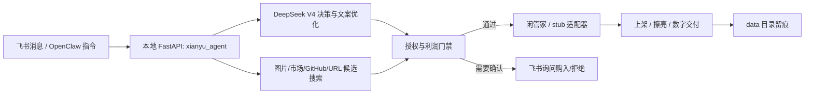

# OpenClaw + 飞书 + 闲鱼 Agent 工作流

更新时间：2026-04-30

## 总体链路



## OpenClaw 挂载

配置文件：

```text
E:\闲鱼\xianyu\openclaw\xianyu-commerce-agent.openclaw.yaml
```

Skill 目录：

```text
E:\闲鱼\xianyu\skills\xianyu-commerce-agent
```

当前已同步到这个 OpenClaw 源码目录：

```text
E:\openclaw\openclaw-main\skills\xianyu-commerce-agent
E:\openclaw\openclaw-main\.agents\skills\xianyu-commerce-agent
```

后续重新同步：

```powershell
powershell -ExecutionPolicy Bypass -File E:\闲鱼\xianyu\scripts\install_openclaw_integration.ps1 -OpenClawRoot E:\openclaw\openclaw-main
```

OpenClaw 全局配置已写入：

```text
C:\Users\轻音\.openclaw\openclaw.json
```

当前默认模型和技能：

```text
agents.defaults.model.primary = deepseek/deepseek-v4-pro
agents.defaults.model.fallbacks = ["deepseek/deepseek-v4-flash"]
agents.defaults.skills = ["xianyu-commerce-agent"]
skills.load.extraDirs = ["E:/闲鱼/xianyu/skills"]
```

配置片段备份在：

```text
E:\闲鱼\xianyu\openclaw\openclaw-config-snippet.jsonc
```

OpenClaw 侧只需要保持三件事：

1. 读取 `DEEPSEEK_API_KEY`、`DEEPSEEK_BASE_URL`、`DEEPSEEK_MODEL`。
2. 挂载 `skills/xianyu-commerce-agent/SKILL.md`。
3. 把工具请求转发到本地 `http://127.0.0.1:8788`。

验证命令：

```powershell
node E:\openclaw\openclaw-main\openclaw.mjs config validate
node E:\openclaw\openclaw-main\openclaw.mjs skills check
node E:\openclaw\openclaw-main\openclaw.mjs models list --provider deepseek
```

## 飞书指令格式

普通上架：

```text
上架：蓝牙耳机，库存20，售价59，适合通勤运动，自动发货内容：https://example.com/card
```

虚拟产品比价：

```text
比价：AI 提示词资料包，源售价99，计划卖39，已有供应商转售授权
```

URL 抓取评估：

```text
crawl: https://example.com/product
```

审批回复：

```text
购入 机会ID
拒绝 机会ID 原因
```

## 飞书 CLI 买家消息桥接

飞书 CLI 长连接收到闲鱼买家消息后，可以把结构化事件桥接到本地入口：

```text
POST http://127.0.0.1:8788/feishu/events
```

推荐 `event.message.content` 内部使用 JSON 字符串，保留稳定的 `message_id` 方便去重：

```json
{
  "event": {
    "message": {
      "content": "{\"xianyu_event\":\"buyer_message\",\"message_id\":\"msg_20260522_0001\",\"source\":\"feishu_cli\",\"buyer_id\":\"buyer_123\",\"buyer_name\":\"Ada\",\"message\":\"这个还在吗？\",\"chat_id\":\"chat_123\",\"item_id\":\"item_123\",\"cookie_id\":\"seller_a\"}"
    }
  }
}
```

等价的内容对象字段如下：

```json
{
  "xianyu_event": "buyer_message",
  "message_id": "msg_20260522_0001",
  "source": "feishu_cli",
  "buyer_id": "buyer_123",
  "buyer_name": "Ada",
  "message": "这个还在吗？",
  "chat_id": "chat_123",
  "item_id": "item_123",
  "cookie_id": "seller_a"
}
```

本地服务只会创建 `customer_message` 任务单和待审批回复，不会从入站事件直接发送消息。生产观察接口：

```text
GET /message-intake/metrics
GET /message-intake/recent
GET /message-intake/health
POST /message-intake/retention/prune
POST /message-intake/{intake_id}/retry
GET /message-intake/runbooks
GET /message-intake/incident-bundle
POST /message-intake/health-check/dry-run
```

`/message-intake/health` 会返回 Feishu CLI 桥接新鲜度、重复率、生成失败告警；`/message-intake/retention/prune` 用于按保留天数和最大记录数裁剪 `data/message_intake.json`；`/message-intake/{intake_id}/retry` 只允许对 `manual_reply` / `generation_failed` 类记录重新生成草稿，并且仍然只创建待审批回复，不会直接发送消息。

`/message-intake/runbooks` 会返回桥接 stale、重复率过高、生成失败、模型恢复的本地处置步骤；`/message-intake/incident-bundle` 导出脱敏诊断包，只包含 hash 后的买家/会话引用和摘要，不包含 raw event key、审批 ID、原始 payload 或密钥；`/message-intake/health-check/dry-run` 会预览本地通知 hook 和恢复建议，不会修改 WorkOrder、Approval、ExecutionJob，也不会发送买家消息。

## 自动任务

服务启动后会自动运行：

- 每日擦亮：读取 `.env` 的 `POLISH_AT`，默认 `09:30`。
- 每日 GitHub 机会雷达：读取 `GITHUB_DISCOVERY_ENABLED` 和 `GITHUB_DISCOVERY_AT`，默认开启，时间 `10:30`。

GitHub 雷达只生成商业化建议，不会自动下载、购买、发布。推荐售卖方向是部署、定制、培训、托管、行业配置和原创衍生 agent，不是原封不动倒卖仓库。

## 真实发布切换

测试阶段：

```text
XIANYU_ADAPTER=stub
```

拿到闲管家授权接口后：

```text
XIANYU_ADAPTER=xianguanjia
XIANGUANJIA_BASE_URL=https://hy.ziyuanting.com
XIANGUANJIA_APP_ID=你的 appid
XIANGUANJIA_API_KEY=你的 apikey
```

如果你拿到的是 bearer token 风格接口，也可以填：

```text
XIANGUANJIA_TOKEN=你的 token
```

## 合规门禁

- 相似商品图片只作为参考候选；默认不用于发布。
- 卖家的文案和宣传图不会被直接复制。
- 课程、资料包、软件、agent、GitHub 项目必须有转售权或可商业使用许可。
- URL 爬虫默认只提取候选，不下载；只有确认授权后才会下载。
- 遇到验证码、人机验证、滑块、风控文案时暂停，并通知人工处理。

## 一键命令

启动：

```powershell
powershell -ExecutionPolicy Bypass -File E:\闲鱼\xianyu\scripts\start_xianyu_workflow.ps1
```

打开控制台：

```powershell
powershell -ExecutionPolicy Bypass -File E:\闲鱼\xianyu\scripts\open_xianyu_console.ps1
```

停止：

```powershell
powershell -ExecutionPolicy Bypass -File E:\闲鱼\xianyu\scripts\stop_xianyu_workflow.ps1
```

端到端烟测：

```powershell
powershell -ExecutionPolicy Bypass -File E:\闲鱼\xianyu\scripts\run_full_flow_smoke.ps1
```

## 记忆

本地长期记忆保存在：

```text
E:\闲鱼\xianyu\data\memory\profile.json
```

可通过三种方式写入：

- 控制台右侧“记忆”区域。
- 控制台或飞书发送 `记忆：你的偏好`。
- API：`POST /memory`。

记忆会进入 DeepSeek V4 的商品草稿提示词，影响标题、描述、FAQ、授权检查和运营偏好；但不会覆盖合规规则。

