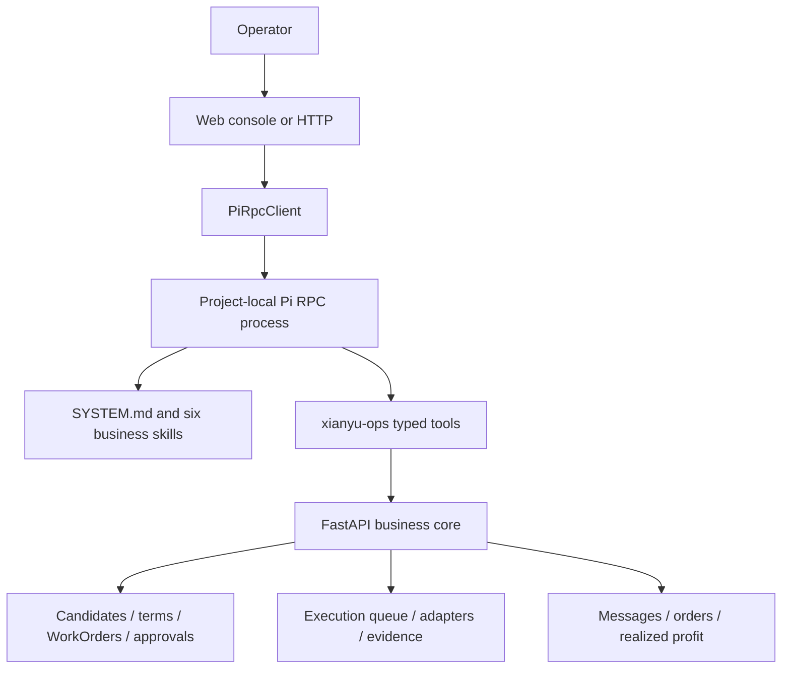

# Pi Runtime Migration Runbook

Last verified: 2026-08-26

## Decision

Pi replaces OpenClaw as the Xianyu project's primary operator harness. This is
an orchestration migration, not a rewrite of the business core.

- Pi owns natural-language interpretation, session context, skill selection,
  and typed-tool calls.
- FastAPI owns business truth, validation, evidence, state transitions,
  approvals, execution, account attribution, order state, and finance.
- Specialist Python agents remain callable behind FastAPI. They are not
  duplicated as Pi subprocesses.
- OpenClaw remains temporarily available only at the explicitly deprecated
  `/agents/openclaw/message` and `/agents/hermes/message` routes.

## Runtime Topology



The Pi child process runs with:

- a stable project session ID;
- session files under `DATA_DIR/pi_sessions`;
- an isolated Pi agent directory under `DATA_DIR/pi_agent`;
- project trust explicitly enabled for `.pi` resources;
- startup update checks and telemetry disabled;
- a strict tool allowlist.

## Enabled Tool Surface

| Tool | Effect |
|---|---|
| `read` | Read project playbooks and local documentation |
| `xianyu_business_snapshot` | Read accounts, candidates, unresolved work, readiness, and next actions |
| `xianyu_market_search` | Read a bounded current listing search and observable price summary |
| `xianyu_candidates` | Read domestic Xianyu candidates and economics |
| `xianyu_candidate_activation_packet` | Read the 12 ordered evidence and current-decision gates for one exact candidate |
| `xianyu_candidate_evidence` | Read candidate-bound evidence metadata, active/superseded state, timestamps, hashes, and integrity; never upload or download files |
| `xianyu_work_orders` | Read WorkOrder and approval state |
| `xianyu_commercial_terms` | Read account-and-category terms and version match |
| `xianyu_publish_preflight` | Run read-only publication evidence gates |
| `xianyu_commercial_launch_preview` | Run the read-only 20-gate launch preview |
| `xianyu_review_candidate` | Create an internal specialist review only |
| `xianyu_prepare_listing` | Create a local draft and approval WorkOrder only |
| `xianyu_prepare_customer_reply` | Create a reply draft only; never send it |

Pi does not receive `bash`, `edit`, `write`, approval, execution, platform
message, delete, refund, or fulfillment tools. The deterministic execution path
remains `WorkOrder -> Approval -> ExecutionJobQueue -> ActionExecutor`.

## Skills

Project skills live under `.pi/skills`:

1. `commercial-alpha`: one-account, one-candidate controlled launch.
2. `product-selection`: evidence and seven-dimension candidate scoring.
3. `listing`: structured draft and publication preflight.
4. `buyer-conversion`: inquiry classification and reply-draft workflow.
5. `fulfillment`: paid-order, procurement, tracking, and after-sales sequence.
6. `weekly-review`: funnel, bottleneck, stop-loss, and asset review.

These skills point to the detailed playbooks already maintained under
`docs/ops`. They summarize operating order; they do not replace evidence gates.

## Ecosystem Review

The migration uses the official Pi runtime and a local extension first:

- Official Pi: <https://github.com/earendil-works/pi>
- Official RPC documentation:
  <https://github.com/earendil-works/pi/blob/main/packages/coding-agent/docs/rpc.md>
- Official SDK documentation:
  <https://github.com/earendil-works/pi/blob/main/packages/coding-agent/docs/sdk.md>
- Official skill documentation:
  <https://github.com/earendil-works/pi/blob/main/packages/coding-agent/docs/skills.md>
- Pi skill examples: <https://github.com/badlogic/pi-skills>

The following community packages are useful references but are deliberately
deferred until the primary runtime completes real operating acceptance:

| Project | Useful idea | Why deferred |
|---|---|---|
| `nicobailon-pi-subagents` | Isolated specialist contexts and delegated turns | Existing Python specialists already own domain workflows; adding a second delegation layer now would duplicate state and cost |
| `nicobailon-pi-mcp-adapter` | Reuse MCP servers as Pi tools | The local typed HTTP extension is smaller, auditable, and sufficient for the current business core |
| `pi-agent-browser-native` | Browser-native Pi tools | Existing `BrowserAdapter` and execution evidence model already control platform actions; a second browser path would violate the single execution path |

Reference URLs:

- <https://github.com/pi-packages/nicobailon-pi-subagents>
- <https://github.com/pi-packages/nicobailon-pi-mcp-adapter>
- <https://github.com/fitchmultz/pi-agent-browser-native>

## Start And Verify

Requirements:

- Python environment installed from `requirements.txt`;
- Node.js 22.19 or newer;
- `npm install` completed at the project root;
- `DEEPSEEK_API_KEY` configured in `.env`;
- FastAPI bound to the same URL configured by `XIANYU_API_BASE_URL`.

```powershell
npm install
powershell -ExecutionPolicy Bypass -File .\scripts\start_xianyu_workflow.ps1
Invoke-RestMethod http://127.0.0.1:8788/agents/pi/status?active=true
```

The start script verifies Python, Node, the pinned project-local Pi CLI, the
FastAPI health endpoint, and a live Pi RPC `get_state` handshake.

Read-only operating smoke test:

```powershell
Invoke-RestMethod -Method Post http://127.0.0.1:8788/agents/pi/message `
  -ContentType 'application/json; charset=utf-8' `
  -Body '{"message":"只读取当前经营状态，报告账号数、候选数和未处理工单数，不创建任何记录。","publish":false}'
```

Acceptance requires all of the following:

1. Response `entrypoint` is `pi`.
2. Pi calls `xianyu_business_snapshot`.
3. The answer agrees with the underlying API counts.
4. `external_action` is `false`.
5. Business data hashes are unchanged by this read-only request.
6. The isolated Python suite has no new failures.

## Current Verification Evidence

Verified on 2026-08-18 against the local service at `127.0.0.1:8788`:

| Check | Result |
|---|---|
| Project-local Pi RPC handshake | Passed with `deepseek/deepseek-v4-flash`, thinking `low` |
| Strict runtime tool allowlist | 10 tools: `read` plus nine Xianyu tools; no external-action tools |
| Real-model read-only tool call | Passed; exactly one successful `xianyu_business_snapshot` call |
| Snapshot/API agreement | `seller_accounts=0`, `domestic_xianyu_candidates=1`, `active_trials=0`, `unresolved_work_orders=15` |
| External action marker | `false` |
| Business-state integrity | 11 critical SQLite/JSON/JSONL files had identical pre/post SHA-256 and lengths |
| Browser QA | Desktop 1440px and mobile 360px; no horizontal overflow and no console errors/warnings |
| Isolated regression suite | 881 tests passed after the health-lock fix |

The first real operating blocker is business evidence, not Pi infrastructure:
there is no configured seller account. The existing 15 unresolved WorkOrders
must also be reviewed rather than treated as a clean Commercial Alpha queue.

## Migration Order

1. Run Pi and OpenClaw compatibility side by side while all new traffic uses Pi.
2. Complete the read-only real-model smoke test and one draft-only operator turn.
3. Observe session stability and tool-call audit data during Commercial Alpha.
4. Remove OpenClaw startup/configuration scripts only after no active caller uses
   the compatibility routes and rollback is no longer needed.
5. Migrate the separate cross-border ecommerce workspace independently. Do not
   share Xianyu session files, tools, databases, account state, or approvals.
