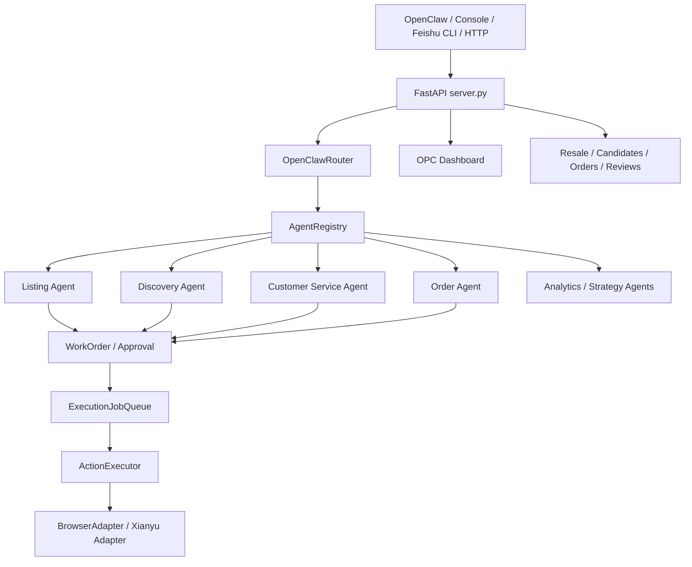
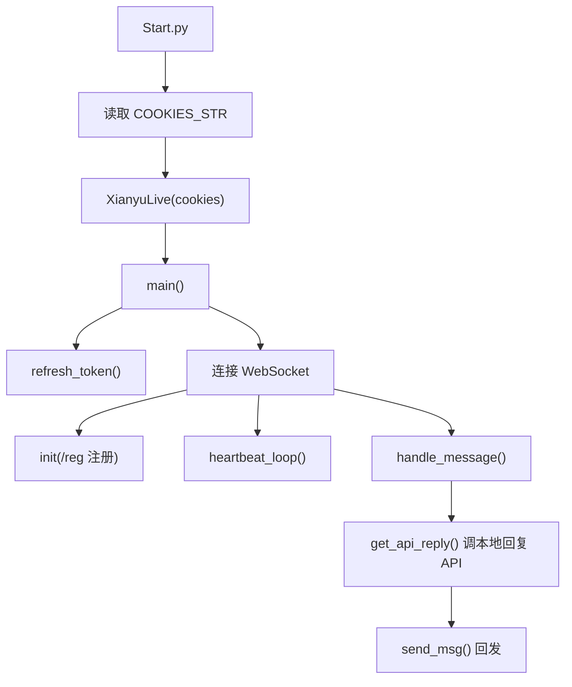
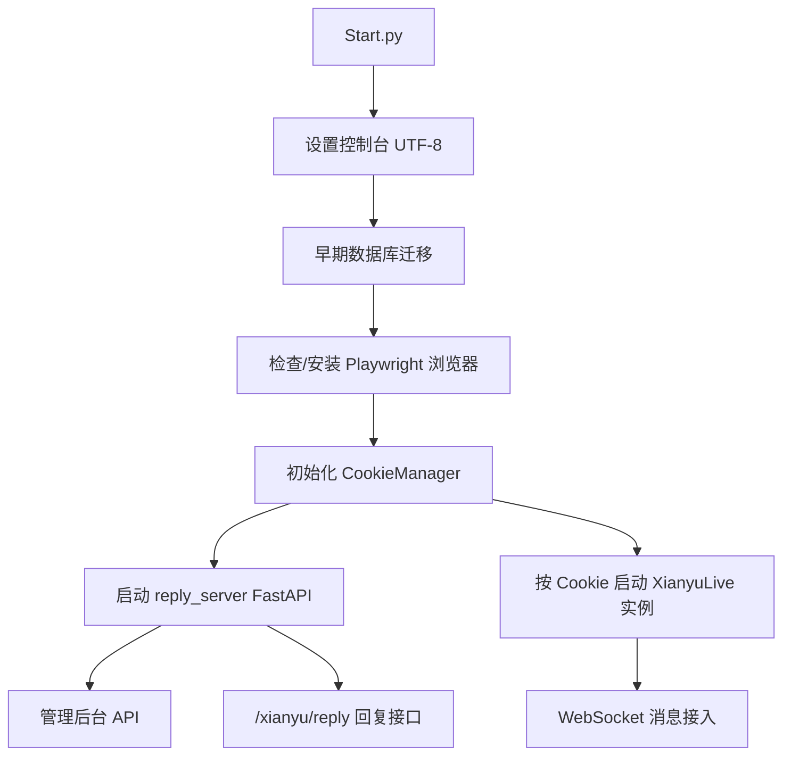
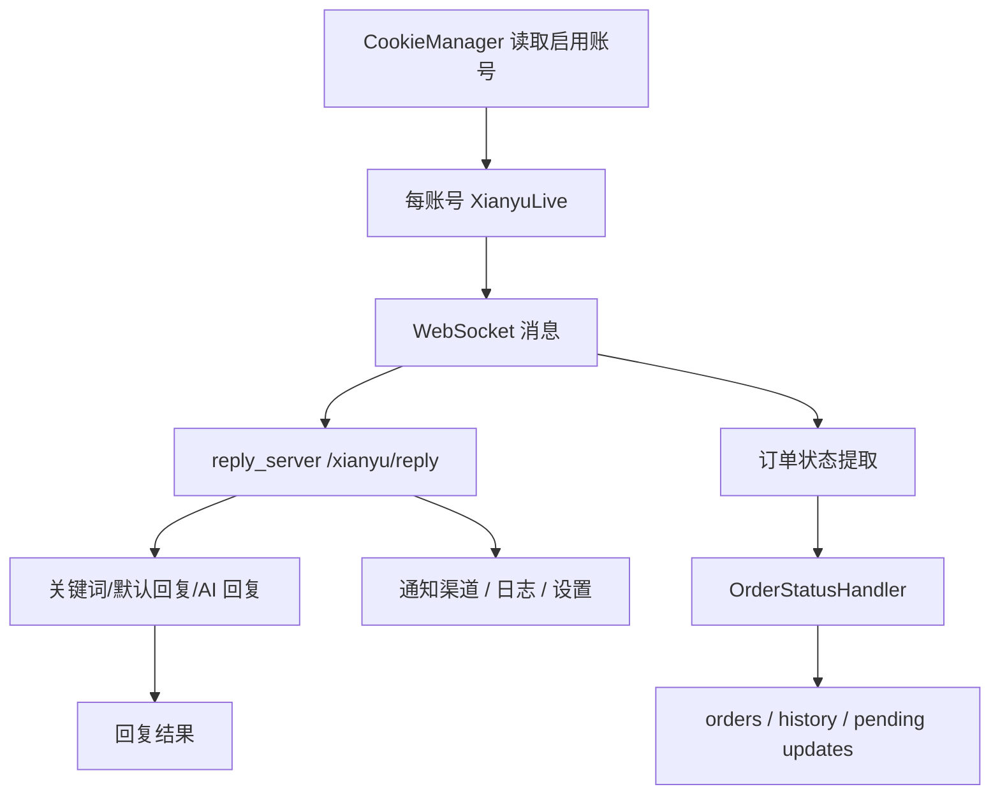
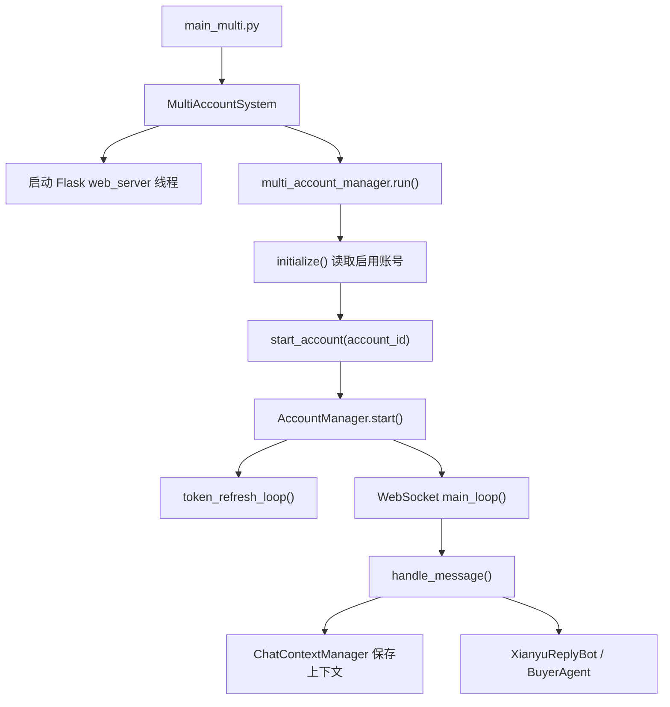
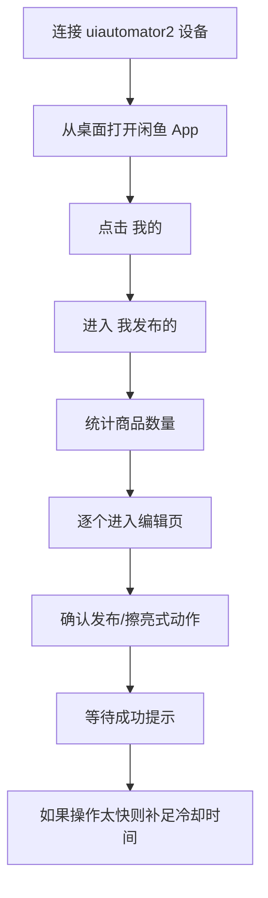
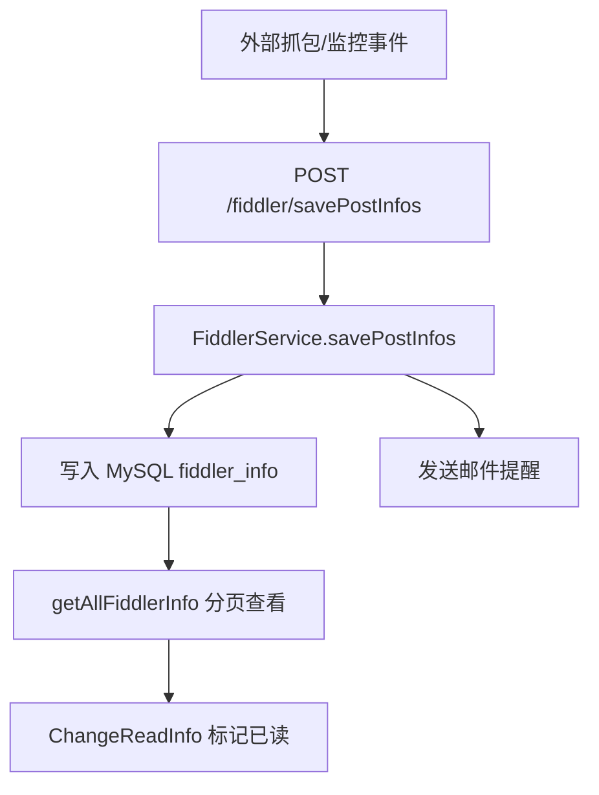
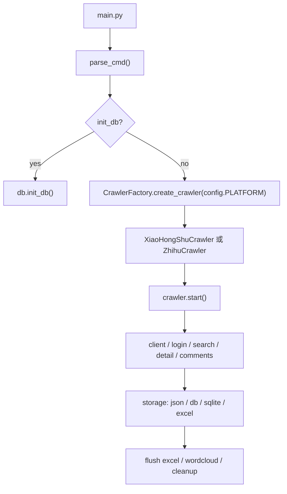
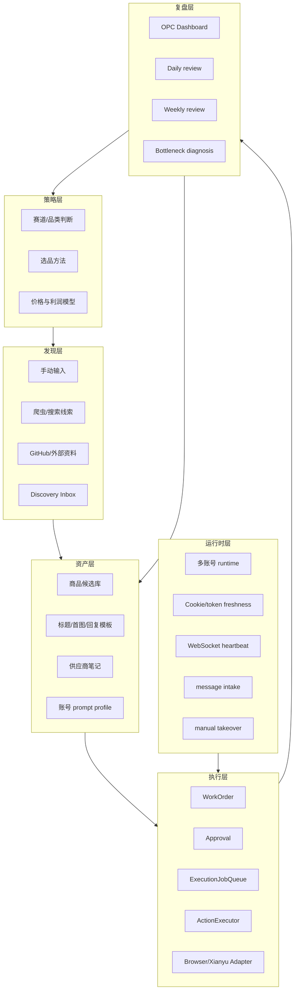

# 本地闲鱼程序结构与设计解析

Updated: 2026-06-30

Learning roadmap companion: `docs/research/local-project-learning-roadmap.md`

## 目的

这份文档把本地几个闲鱼相关 GitHub 程序拆成工程结构、运行链路、设计思想、可迁移点和不建议照搬的部分，供后续 ClaudeCode / OpenCode 继续落地当前 `E:\闲鱼\xianyu` 主项目时使用。

核心判断：

- 当前主项目 `E:\闲鱼\xianyu` 继续作为总控项目，承载 OpenClaw 路由、OPC 经营面、WorkOrder、Approval、ExecutionJobQueue、ActionExecutor、Dashboard。
- 其他本地项目不整体并入主项目，只作为参考实现库，提取运行时状态、账号管理、消息接入、回复策略、外部线索收件箱、爬虫框架、UI 自动化降级策略。
- 最值得吸收的是多账号运行时和可观测性，而不是把外部项目里的直接发送、直接发货、直接抢拍流程原样接入。

## 0. 当前主项目：`E:\闲鱼\xianyu`

### 程序定位

当前主项目是“OpenClaw 驱动的一人公司闲鱼运营系统”。它不是单纯自动回复工具，也不是单账号脚本，而是运营总控层：

- OpenClaw / 控制台 / Feishu CLI / HTTP 都可以作为入口。
- 通过 `OpenClawRouter` 把自然语言运营任务分发给 specialist agent。
- 通过 WorkOrder、Approval、ExecutionJobQueue 把高风险动作变成可审查、可追踪、可重试的任务。
- 通过 Dashboard 把候选品、发布、咨询、订单、售后、账号队列和每日复盘聚合给操作者。

### 主要目录

```text
E:\闲鱼\xianyu
├── xianyu_agent\              # 后端核心包
│   ├── server.py              # FastAPI 服务入口和 HTTP API
│   ├── openclaw_router.py     # OpenClaw 自然语言命令路由
│   ├── agent_registry.py      # Agent 注册表
│   ├── agents\                # listing / discovery / customer_service / order 等专职 agent
│   ├── work_orders.py         # WorkOrder / Approval / ActionPlan
│   ├── execution_queue.py     # 执行任务队列
│   ├── action_executor.py     # 动作执行入口
│   ├── browser_adapter.py     # 浏览器执行适配层
│   ├── xianyu_ws.py           # 闲鱼 WebSocket/消息相关适配层
│   ├── message_intake.py      # 消息接入和恢复
│   ├── resale.py              # 二手/转售机会、候选、订单、评分等业务数据
│   ├── opc_dashboard.py       # OPC 仪表板聚合
│   ├── account_profiles.py    # 账号静态配置
│   ├── account_ops_queues.py  # 账号维度待办队列
│   └── first_run_readiness.py # 首次真实账号运行前检查
├── web\                       # 本地控制台前端
│   ├── console.html
│   ├── app.js
│   └── style.css
├── docs\                      # 项目计划、运营手册、研究文档
├── prompts\                   # Agent/system prompt
└── tests\                     # 单元测试和控制台契约测试
```

### 当前系统设计



### 当前强项

- 已有审批和执行队列，agent 不必直接做不可追踪动作。
- 已有候选品评分、发现策略、上架草稿、自动回复、订单、售后等业务对象。
- 已有账号配置、账号队列、首次运行 readiness、同步持久化、Dashboard 和控制台。
- 测试覆盖较多，适合继续用 TDD 推进。

### 当前缺口

从本地参考项目看，主项目最缺的不是“更多 agent”，而是运行时层：

- 账号实时连接状态。
- Cookie/token 新鲜度。
- WebSocket 心跳状态。
- 重连次数和最后错误。
- 手动接管中的会话。
- 消息 ACK / 去重 / 最近消息时间。
- 订单履约锁和重复执行保护。
- 外部发现线索 inbox。

### 主项目后续定位

```text
一人公司操作系统
= 策略层 + 运营资产层 + 多账号运行时 + 审批执行层 + Dashboard 复盘层
```

其他程序都只作为模块设计参考，分别补强不同层。

---

## 1. `xianyuapis-main`

### 程序定位

`E:\闲鱼\xianyuapis-main` 是一个小而集中的 Python 闲鱼协议/WebSocket 参考项目。它的价值在于：把一个账号如何接入闲鱼消息、如何刷新 token、如何注册 WebSocket、如何处理聊天消息这条链路压缩在一个 `XianyuLive` 类里。

它更像“协议探针”或“最小运行样例”，不是完整运营系统。

### 主要文件

```text
E:\闲鱼\xianyuapis-main
├── Start.py                   # 启动入口
├── XianyuAutoAsync.py          # 核心 WebSocket / token / message runtime
├── config.py                  # Cookie、API URL、headers 等配置
├── requirements.txt            # requests / loguru / websockets / pyyaml
└── utils\
    ├── message_utils.py        # 消息结构处理
    ├── ws_utils.py             # WebSocket 包装工具
    └── xianyu_utils.py         # 闲鱼签名、Cookie 等工具
```

### 启动链路



### 核心类：`XianyuLive`

`XianyuAutoAsync.py` 中的 `XianyuLive` 承担了几乎所有职责：

- Cookie 解析和身份识别。
- MTop token 刷新。
- Cookie 更新。
- WebSocket 注册。
- 心跳发送和响应处理。
- 判断消息类型。
- 解析 sync package。
- 调用本地 `/xianyu/reply` 获取回复。
- 发送文本消息。
- 手动模式开关。

### 数据流

典型入站消息被整理成下面这类字段，再送到本地回复服务：

```json
{
  "msg_time": "...",
  "user_url": "...",
  "send_user_id": "...",
  "send_user_name": "...",
  "item_id": "...",
  "send_message": "...",
  "chat_id": "..."
}
```

这对当前主项目很有价值，因为它可以直接变成标准 message intake schema。

### 设计优点

- 单文件能完整看懂闲鱼 IM 接入链路。
- WebSocket 注册、心跳、消息判断、回复 API 调用链路清楚。
- 能作为 adapter contract 的参考样例。
- 字段少，适合做测试 fixture。

### 设计短板

- 单账号为主。
- 状态基本在内存里，缺少持久化恢复。
- WebSocket runtime、消息处理、回复调用、发送动作都在一个类里。
- 没有 WorkOrder / Approval / Queue。
- 发送动作可以被链路直接触发，不适合作为主项目执行面。

### 对当前项目的启示

| `xianyuapis-main` 能提供 | 迁移到当前主项目 |
| --- | --- |
| WebSocket 注册与心跳字段 | `xianyu_agent/xianyu_ws.py` 的 adapter contract |
| 入站消息 envelope | `xianyu_agent/message_intake.py` 标准化 schema |
| token/cookie 刷新时间点 | 新建 `account_runtime.py` |
| 手动模式概念 | `conversation_profiles.py` 或账号 runtime 的 manual takeover |
| 最小可运行样例 | 测试 fixture 和本地联调脚本 |

---

## 2. `xianyu-auto-reply-main`

### 程序定位

`E:\闲鱼\xianyu-auto-reply-main` 是本地几个项目里最完整的“闲鱼自动回复运营服务”。它包含：

- FastAPI 后端。
- 管理前端。
- 用户登录/注册/验证码。
- Cookie 管理。
- 多账号实例管理。
- WebSocket 消息接入。
- AI 回复。
- 默认回复。
- 关键词回复。
- 订单状态处理。
- 自动发货/卡密/规则。
- 通知渠道。
- 系统设置。

它是“完整单体运营台”，但架构上比较重、比较混合。

### 主要文件

```text
E:\闲鱼\xianyu-auto-reply-main
├── Start.py                   # 启动入口：迁移 DB、检查浏览器、启动 CookieManager 和 FastAPI
├── reply_server.py             # 巨型 FastAPI 单体：页面、认证、Cookie、回复、通知、设置等
├── XianyuAutoAsync.py          # 每个账号的闲鱼 WebSocket runtime
├── db_manager.py               # SQLite 数据访问层，表和 CRUD 很多
├── cookie_manager.py           # Cookie/账号配置管理
├── ai_reply_engine.py          # AI 回复引擎
├── order_status_handler.py     # 订单状态处理和幂等控制
├── pause_manager.py            # 暂停/人工接管相关
├── notification_manager.py     # 通知渠道
├── xianyu_login.py             # 登录流程
├── geetest\                    # 验证码相关
├── frontend\                   # 管理页面
└── requirements.txt            # FastAPI / Playwright / DrissionPage / OpenAI / SQLite 周边
```

### 启动链路



### `reply_server.py` 设计

`reply_server.py` 是一个典型单体服务，集中承载了大量职责：

- 登录、注册、修改密码、token 校验。
- 图形验证码、极验状态。
- 前端页面静态文件服务。
- `/health`、版本检查。
- `/xianyu/reply` 回复 API。
- `/send-message` 外部发消息 API。
- `/cookies` 账号 Cookie CRUD。
- 密码登录、二维码登录、验证截图。
- 默认回复、商品默认回复。
- 通知渠道、消息通知、系统设置。
- 订单/卡密/发货规则相关接口。

优点是功能全，缺点是边界混在一起：认证、业务、账号、消息、通知、前端页面都在一个文件中。

### `db_manager.py` 设计

`db_manager.py` 是系统数据中枢，使用 SQLite。表覆盖面很广：

```text
users / email_verifications / captcha_codes
cookies / keywords / cookie_status
ai_reply_settings / ai_conversations / ai_item_cache
cards / orders / item_info / delivery_rules
default_replies / item_replay / default_reply_records
notification_channels / message_notifications
system_settings / user_settings
risk_control_logs / token_cache
```

这说明真实运营工具最终都会长出这些数据域：

- 账号状态。
- 商品缓存。
- 会话上下文。
- 默认回复资产。
- 订单状态。
- 通知记录。
- 风控/异常日志。
- token cache。

当前主项目不一定要照搬表结构，但需要吸收这些数据域。

### `CookieManager` 设计

`cookie_manager.py` 更接近账号配置层：

- 添加/更新 Cookie。
- 更新关键词。
- 获取启用账号。
- 更新自动确认设置。
- 读取账号级设置。

可迁移为当前主项目的账号 profile + runtime state 组合：

```text
静态账号配置：account_profiles.py
运行时状态：account_runtime.py
账号待办队列：account_ops_queues.py
```

### `OrderStatusHandler` 设计

`order_status_handler.py` 是这个项目最值得学习的部分之一：

- 订单状态映射。
- 状态迁移校验。
- pending updates queue。
- order status history。
- 线程锁。
- 订单 ID 提取。
- 退款、投诉、发货相关消息的状态处理。
- 自动发货状态更新钩子。

对当前主项目的启示是：订单不应该只是一个字段，而应该是一个小型状态机。

### 总体数据流



### 设计优点

- 覆盖了真实运营所需的大量边角场景。
- 账号、消息、订单、通知、默认回复、商品缓存都有落点。
- 有运行状态、暂停、订单锁、历史记录等实践经验。
- 管理后台功能完整。

### 设计短板

- 单体过重，`reply_server.py` 和 `db_manager.py` 承担职责过多。
- 很多功能耦合在一个运行进程里，后续测试和替换困难。
- 直接动作路径较多，不适合当前主项目“先审批再执行”的架构。
- 外部登录、验证码、通知、自动发货等模块应作为设计参考，而不是原样迁移。

### 对当前项目的启示

| 它的模块/设计 | 当前主项目应吸收成 |
| --- | --- |
| Cookie 状态和启用账号 | `account_profiles.py` + `account_runtime.py` |
| WebSocket 账号实例 registry | `account_runtime.py` + runtime manager |
| 订单状态处理器 | 增强 `order_status_handler.py` |
| 暂停/人工接管 | `conversation_profiles.py` 的 pause/manual takeover |
| 默认回复和商品回复 | 运营资产 `data/assets` 或 memory 层 |
| 通知与日志 | Dashboard alerts / account queue blockers |
| token cache | runtime freshness gates |

---

## 3. `mulitXianYuAugent-main`

### 程序定位

`E:\闲鱼\mulitXianYuAugent-main` 是“多账号闲鱼 AI agent 系统”。它比 `xianyuapis-main` 更像运行时系统，比 `xianyu-auto-reply-main` 更轻、更接近我们要的多账号架构。

它的核心价值是多账号 runtime 拆分：

```text
MultiAccountSystem
-> MultiAccountManager
-> AccountManager per account
-> XianyuReplyBot / BuyerAgent
-> ChatContextManager
-> Flask web server
```

### 主要文件

```text
E:\闲鱼\mulitXianYuAugent-main
├── main_multi.py              # 多账号系统入口
├── multi_account_manager.py   # 多账号生命周期管理
├── account_manager.py         # 单账号 runtime
├── context_manager.py         # SQLite 上下文、账号、会话、prompt 存储
├── XianyuApis.py              # token、商品信息、MTop API
├── XianyuAgent.py             # 卖家自动回复 agent
├── BuyerAgent.py              # 买家 agent
├── web_server.py              # Flask 管理后台
├── main.py                    # 单账号/旧入口
└── requirements.txt           # OpenAI / websockets / Flask / dotenv / requests / loguru
```

### 启动链路



### `MultiAccountManager` 设计

职责比较清晰：

- 初始化所有启用账号。
- 添加/删除账号。
- 启动/停止单个账号。
- 启动/停止全部账号。
- 重载账号配置。
- 获取单账号/全部账号状态。
- 监控运行任务。
- 异常后按重试次数做 backoff。
- shutdown 清理。

这正是当前主项目需要补的 runtime manager 模型。

### `AccountManager` 设计

每个账号一个 `AccountManager`，包含：

- 账号配置。
- heartbeat task。
- token refresh task。
- heartbeat interval / timeout。
- last heartbeat time / response。
- token refresh interval。
- current token。
- manual mode conversations。
- manual mode timeout。
- message expire time。
- WebSocket 初始化。
- message ACK。
- sync package 处理。
- 聊天消息判断。
- 系统消息/订单消息判断。
- AI 回复路由。
- 发送消息。
- 当前状态快照。

这个对象的结构，基本可以作为当前主项目 `account_runtime.py` 的字段来源。

### `ChatContextManager` 设计

它用 SQLite 做一套轻量运行数据库，覆盖：

- 账号信息。
- 账号 prompt。
- 账号运行状态。
- 商品信息缓存。
- chat history。
- chat session。
- bargain count。
- buyer decision。
- product evaluation。
- 最近消息去重。
- buyer message history。

这是非常适合当前项目吸收的“运营记忆层”。

### `XianyuReplyBot` 设计

回复 agent 的结构是：

```text
XianyuReplyBot
├── IntentRouter
├── ClassifyAgent
├── PriceAgent
├── TechAgent
└── DefaultAgent
```

运行逻辑：

1. 格式化历史上下文。
2. 用 `IntentRouter` 判断消息意图。
3. 根据意图选 agent。
4. 如果是议价，读取 bargain count。
5. PriceAgent 根据议价次数调整回复策略。
6. 统一做 safe filter。

这对当前项目的 `customer_service.py` / `auto_reply.py` 有启示：不要只做意图分类，还可以保留“会话阶段 + 议价次数 + 买家类型 + 商品上下文”。

### `web_server.py` 设计

Flask 管理后台提供：

- 首页。
- 新建账号。
- 账号配置。
- 启动/停止账号。
- 删除账号。
- 账号状态 API。
- 全部启动/全部停止。
- 监控页。
- 系统设置。

这和当前 OPC console 的账号卡片、运行状态、启动/停止按钮是同一个方向。

### 设计优点

- 多账号层级清楚。
- 单账号 runtime 独立，天然适合状态快照。
- 账号 prompt 是一等对象。
- 会话上下文和议价次数有持久化。
- 有手动模式。
- 有任务监控和重试 backoff。

### 设计短板

- 买家 agent 对当前卖家运营 MVP 不是重点。
- Flask 管理层和 async runtime 的连接比较朴素。
- 发送动作在 runtime 中直接发生。
- 数据模型和当前主项目 WorkOrder/Approval 不一致。

### 对当前项目的启示

| `mulitXianYuAugent-main` 设计 | 当前主项目落地方式 |
| --- | --- |
| MultiAccountManager | 新增 runtime manager，不替代 account profiles |
| AccountManager.get_status() | `GET /accounts/runtime` |
| heartbeat/token refresh fields | `account_runtime_state` |
| per-account prompts | 已有 `account_prompt_profiles.py`，继续加强 |
| chat context / bargain count | `conversation_profiles.py` + message intake |
| manual mode timeout | 回复审批前的 pause/manual takeover gate |
| retry backoff | execution queue / runtime reconnect policy |

---

## 4. `XianyuAuto-master`

### 程序定位

`E:\闲鱼\XianyuAuto-master` 是很老的 Android UI 自动化脚本，使用 `uiautomator2` 操作手机上的闲鱼 App。它不是 API 项目，也不是 WebSocket 项目，而是“模拟人在手机上点按钮”。

它的价值不是代码复用，而是提醒我们：UI 自动化很脆弱，必须有冷却、状态检测和人工恢复。

### 主要文件

```text
E:\闲鱼\XianyuAuto-master
├── xy_main2.py       # 单文件 UI 自动化脚本
└── .gitignore
```

### 运行链路

`xy_main2.py` 中只有一个核心类 `XianYu`：



### 设计特点

- 通过设备 ID 连接手机。
- 通过 UI 文本和控件坐标定位。
- 用 sleep 等待页面变化。
- 扫描“我发布的”列表。
- 对每个商品做编辑/确认。
- 操作时间低于阈值时强制等待。

### 设计优点

- 依赖少，容易理解。
- 证明了“上架后刷新/编辑/重新发布”这类操作可以走 UI。
- 内置了一个很朴素但重要的节奏控制：操作太快要等待。

### 设计短板

- 设备 ID 硬编码。
- App 版本、控件文字、页面结构一变就失效。
- 没有持久化、没有队列、没有重试策略。
- 没有错误恢复和截图证据。
- 无法稳定区分成功、失败、风控、弹窗、登录失效等状态。

### 对当前项目的启示

这个项目应该只影响 `browser_adapter.py` / UI fallback 的设计原则：

- UI 自动化只能作为最后一层执行适配器。
- 每次 UI 动作都要有状态检查和截图/日志证据。
- 要有 cooldown。
- 要有 blocker 检测：登录失效、验证码、风控、页面结构变化。
- 执行前必须来自 `ExecutionJobQueue`，不能让脚本自己决定业务动作。

---

## 5. `fastPickUp-master`

### 程序定位

`E:\闲鱼\fastPickUp-master` 是 Java Spring Boot 项目。它不是闲鱼 seller 运营系统，更像“外部抓取事件收件箱”：Fiddler 或其他抓包/监控来源把事件 POST 进来，系统保存、标记未读、发邮件通知。

它的价值是“线索 inbox 模式”。

### 主要文件

```text
E:\闲鱼\fastPickUp-master
├── pom.xml
└── src\main\java\com\gigass\
    ├── FastpickupApplication.java       # Spring Boot 入口，启用 scheduling 和 mapper scan
    ├── controller\FiddlerController.java
    ├── service\FiddlerService.java
    ├── mapper\FiddlerInfoMapper.java
    ├── pojo\FiddlerInfo.java
    ├── pojo\FiddlerInfoExample.java
    ├── response\ResponseBean.java
    ├── response\PageRequest.java
    ├── task\SchedulerTask.java
    └── util\SendmailUtil.java
```

### API 结构

核心 controller 是 `/fiddler`：

```text
POST /fiddler/savePostInfos
POST /fiddler/ChangeReadInfo
POST /fiddler/getAllFiddlerInfo
```

### 数据流



### 设计优点

- inbox 模式简单清楚。
- 未读/已读状态适合操作者处理线索。
- 保存原始参数，后面可以再解析。
- 邮件提醒是低成本通知方式。
- Spring Boot + MyBatis 的分层清楚。

### 设计短板

- 业务语义弱，主要保存 raw params。
- 没有线索评分。
- 没有和候选品/供应商/发布测试闭环。
- SchedulerTask 大部分是空或注释逻辑。
- 对当前 Python 主项目而言，技术栈不值得迁移。

### 对当前项目的启示

不要迁 Java 代码，迁设计：

```text
external watcher
-> discovery inbox
-> raw event
-> unread/read
-> score
-> candidate
-> listing test
-> weekly review
```

当前主项目可以新增：

- `xianyu_agent/discovery_inbox.py`
- `GET /discovery/inbox`
- `POST /discovery/inbox/{id}/mark-read`
- `POST /discovery/inbox/{id}/promote-candidate`

这个 inbox 可以接收来自：

- 手动输入。
- GitHub/reference crawler。
- 小红书/知乎/搜索平台趋势。
- 闲鱼搜索结果。
- PDD/1688 供应商线索。

---

## 6. `LittleCrawler-main`

### 程序定位

`E:\闲鱼\LittleCrawler-main` 是一个异步多平台爬虫框架。本地代码实际支持的是 `xhs` 和 `zhihu`，不是现成闲鱼爬虫。

它的价值是框架设计：平台适配层、client、login、extractor、storage、proxy/cache、API/web 分离。

### 主要目录

```text
E:\闲鱼\LittleCrawler-main
├── main.py
├── pyproject.toml
├── config\
│   ├── base_config.py
│   ├── xhs_config.py
│   ├── zhihu_config.py
│   └── db_config.py
├── src\
│   ├── core\
│   │   ├── arg.py
│   │   ├── base_crawler.py
│   │   └── var.py
│   ├── platforms\
│   │   ├── xhs\
│   │   │   ├── core.py
│   │   │   ├── client.py
│   │   │   ├── login.py
│   │   │   ├── extractor.py
│   │   │   ├── field.py
│   │   │   ├── publisher.py
│   │   │   └── playwright_sign.py
│   │   └── zhihu\
│   │       ├── core.py
│   │       ├── client.py
│   │       ├── login.py
│   │       ├── help.py
│   │       └── field.py
│   ├── storage\
│   │   ├── base\
│   │   ├── xhs\
│   │   └── zhihu\
│   ├── services\
│   │   ├── cache\
│   │   └── proxy\
│   └── utils\
├── api\
└── web\
```

### 启动链路

`main.py` 的核心是 `CrawlerFactory`：



### 平台适配设计

每个平台基本都有类似结构：

```text
platforms/xhs
├── core.py       # 平台 crawler 总控
├── client.py     # HTTP/API client
├── login.py      # 登录态处理
├── extractor.py  # 从 HTML/JSON 提取结构化数据
├── field.py      # 枚举、字段、搜索类型
└── help.py/sign  # 平台辅助函数
```

这就是当前主项目未来做“市场发现爬虫”时应采用的结构：

```text
discovery/platforms/xianyu
├── core.py
├── client.py
├── login_state.py
├── extractor.py
├── fields.py
└── storage.py
```

### 存储设计

LittleCrawler 支持多种保存方式：

- JSON。
- DB。
- SQLite。
- Excel。
- MongoDB 基础类。

并在爬取结束时统一 flush excel、生成 wordcloud、清理浏览器上下文。

这说明 discovery 数据应该先落地为可复查原始数据，再由业务 agent 做评分和候选转换。

### 设计优点

- 平台适配边界清楚。
- client / crawler / extractor / storage 分层好。
- 异步模型适合批量抓取。
- 支持浏览器登录态、CDP、代理、缓存、存储后端。
- 配置和命令行入口比较统一。

### 设计短板

- 本地副本没有闲鱼平台实现。
- 平台签名、登录、代理等复杂度较高，不适合直接塞进主项目。
- 作为运营系统，它缺少候选品评分、审批、执行、复盘闭环。

### 对当前项目的启示

当前主项目如果做 discovery crawler，应按这个模式拆分：

```text
raw market data
-> extractor
-> normalized discovery event
-> discovery inbox
-> ProductScorer
-> ResaleCandidate
-> WorkOrder
-> Approval
```

不要让 crawler 直接变成上架 agent；crawler 只负责发现和结构化。

---

## 7. 六个参考程序的角色分工

| 程序 | 最像什么 | 最值得学 | 当前项目落点 |
| --- | --- | --- | --- |
| `xianyuapis-main` | 协议探针 | WebSocket、token、消息 envelope | `xianyu_ws.py`、`message_intake.py`、`account_runtime.py` |
| `xianyu-auto-reply-main` | 完整单体运营台 | 账号状态、订单状态、通知、默认回复、暂停 | runtime readiness、order state、assets、dashboard alerts |
| `mulitXianYuAugent-main` | 多账号 agent runtime | MultiAccountManager、AccountManager、prompt/context DB | account runtime、account prompt、conversation profile |
| `XianyuAuto-master` | 手机 UI 脚本 | UI 脆弱性、cooldown、fallback | browser adapter fallback、截图证据、blocker 检测 |
| `fastPickUp-master` | 外部线索收件箱 | raw event -> unread -> notify -> read | discovery inbox |
| `LittleCrawler-main` | 多平台爬虫框架 | platform/client/extractor/storage 分层 | future discovery crawler architecture |

---

## 8. 建议的目标架构

真正适合一人公司的架构不应该是“一个 agent 从头干到尾”，而应该是多层并行：



### 每层职责

| 层 | 负责什么 | 不负责什么 |
| --- | --- | --- |
| 策略层 | 决定做什么品类、为什么做、如何验证 | 不直接控制账号、不直接发消息 |
| 发现层 | 收集线索、保存 raw data、转成候选 | 不直接上架 |
| 资产层 | 沉淀可复用模板、供应商、账号风格、商品库 | 不执行平台动作 |
| 运行时层 | 维护账号连接、消息接入、健康状态、人工接管 | 不做业务决策 |
| 执行层 | 把批准后的动作落到平台 | 不自行生成策略 |
| 复盘层 | 聚合指标、识别瓶颈、推动下一轮策略 | 不篡改原始数据 |

---

## 9. 推荐落地顺序

### R4：多账号运行时 readiness

这是最应该先做的，因为它连接 `xianyuapis-main`、`xianyu-auto-reply-main`、`mulitXianYuAugent-main` 三个项目的共同经验。

新增/增强：

```text
xianyu_agent/account_runtime.py
GET /accounts/runtime
/dashboard/account-queues 增加 runtime state
/dashboard/first-run-readiness 增加 runtime gates
web/app.js 增加账号连接状态 badge
```

核心字段：

```json
{
  "cookie_id": "account_x",
  "connection_status": "connected",
  "last_heartbeat_at": "...",
  "last_message_at": "...",
  "last_token_refresh_at": "...",
  "last_cookie_refresh_at": "...",
  "token_fresh": true,
  "cookie_fresh": true,
  "reconnect_count": 0,
  "last_error": null,
  "manual_takeover_chats": [],
  "pending_verification_reason": null,
  "updated_at": "..."
}
```

### R5：Discovery Inbox

吸收 `fastPickUp-master` 和 `LittleCrawler-main` 的设计：

```text
external signal
-> raw discovery event
-> unread/read
-> score
-> candidate
-> listing test
```

新增：

```text
xianyu_agent/discovery_inbox.py
GET /discovery/inbox
POST /discovery/inbox
POST /discovery/inbox/{event_id}/mark-read
POST /discovery/inbox/{event_id}/promote-candidate
```

### R6：订单状态机和履约锁

吸收 `xianyu-auto-reply-main/order_status_handler.py` 的设计：

```text
order message
-> extract order_id
-> state transition
-> lock / idempotency
-> pending update
-> operator visible blocker
```

增强：

```text
xianyu_agent/order_status_handler.py
xianyu_agent/action_executor.py
xianyu_agent/execution_queue.py
```

### R7：运营资产库

从 auto-reply 的默认回复、multi-agent 的 prompt profile、当前 playbook 提炼：

```text
data/assets/reply_templates.json
data/assets/title_patterns.json
data/assets/supplier_notes.json
data/assets/listing_patterns.json
```

Dashboard 展示本周新增资产、复用次数、效果。

---

## 10. 给 ClaudeCode / OpenCode 的执行提示

```text
继续 E:\闲鱼\xianyu。

先读：
1. docs/PROJECT_PLAN.md
2. docs/research/local-xianyu-tools-audit.md
3. docs/research/local-xianyu-program-architecture.md

当前目标：实现 R4 多账号运行时 readiness。

不要把本地参考项目原样合并进主项目。参考项目只用于字段和运行时设计：
- xianyuapis-main: WebSocket / token / message envelope
- xianyu-auto-reply-main: 账号状态、订单状态、暂停、通知
- mulitXianYuAugent-main: MultiAccountManager / AccountManager / prompt/context
- XianyuAuto-master: UI fallback cooldown 和 blocker 检测
- fastPickUp-master: discovery inbox
- LittleCrawler-main: platform/client/extractor/storage 分层

按 TDD 做：
1. 新增 tests/test_account_runtime.py。
2. 新增 xianyu_agent/account_runtime.py，提供 account_runtime_state 的内存/JSON 持久化 store。
3. 在 server.py 加 GET /accounts/runtime。
4. 在 account_ops_queues.py 的 dashboard summary 中合并 runtime state。
5. 在 first_run_readiness.py 增加 runtime gates。
6. 在 web/app.js / web/style.css 给账号卡片增加 runtime badge。

验收命令：
.\.venv\Scripts\python.exe -m unittest tests.test_account_runtime tests.test_first_run_readiness tests.test_account_ops_queues tests.test_console_ui_contract -v
node --check .\web\app.js
git diff --check
```
