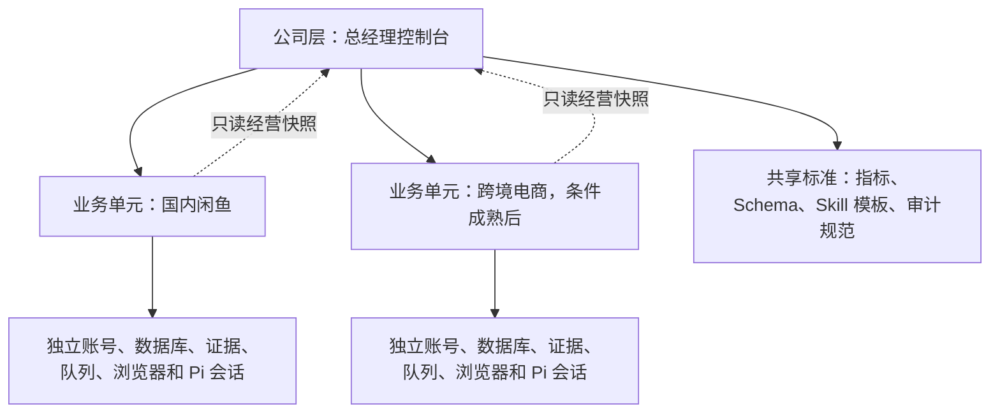
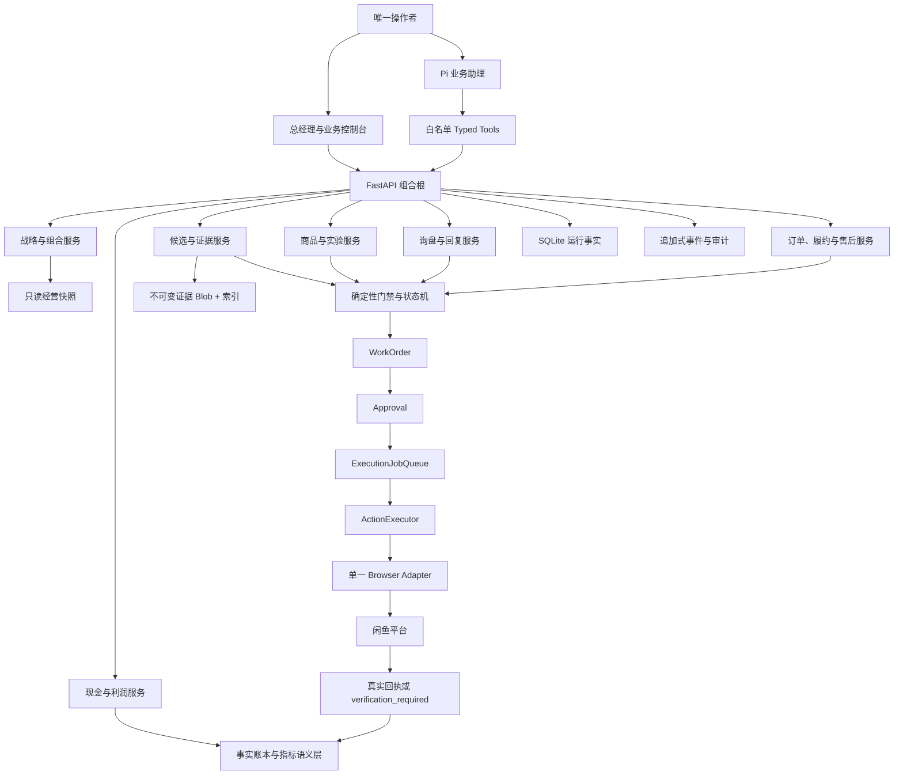
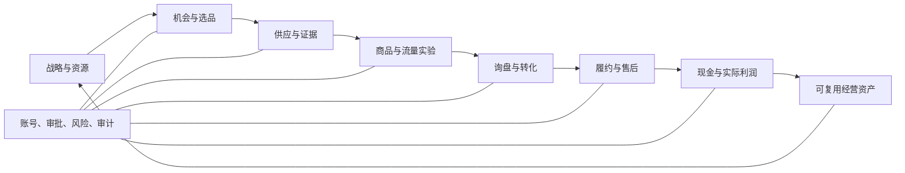

# Xianyu Pi 一人公司总经理蓝图

> 版本：2026-08-30，最近更新：2026-08-31
> 适用范围：国内闲鱼业务单元 `E:\闲鱼\xianyu`
> 决策视角：项目总经理、资本分配者和唯一操作者
> 文件性质：未来 12 个月的经营与系统目标架构，不是收入承诺

---

## 0. 总经理结论

这个项目下一阶段不应继续以“增加 Agent、接口和自动化功能”为主要进度指标。真正要建立的是一个小而完整、证据可复核、现金可控制、可以由一个人持续运营的经营单元。

项目的唯一主线是：

> 用一个有权运营的真实闲鱼账号和一个精确供应商 SKU，完成从证据、核算、上架、询盘、成交、采购、物流、售后到实际利润对账的完整闭环；闭环能够重复后，再逐步扩到同一垂直品类的最多三个在售 SKU。

未来架构采用以下总原则：

1. Pi 是唯一主要自然语言基座，但不是业务事实源，也不是审批者。
2. FastAPI 和确定性领域服务保存事实、计算指标、执行状态机和门禁。
3. 所有平台写动作继续经过 `WorkOrder -> Approval -> ExecutionJobQueue -> ActionExecutor`。
4. 国内闲鱼与未来跨境电商是两个业务单元，技术规范可以共享，运行数据和写入路径绝不共享。
5. 首年重点是形成“一个垂直品类、一个账号、最多三个在售 SKU”的可重复微型利润单元，而不是追求账号数量、GMV 或商品数量。
6. 当前首选商用厨具只是待验证的经营假设，不是已经证明的品类结论。
7. 任何营收、利润、转化率和供应商优势，在真实样本形成前都只能作为目标或假设。

---

## 1. 当前真实基线

截至 2026-08-30，本项目处于“技术底座基本就绪、商业 Alpha 尚未开始”的位置。

### 1.1 已经具备

- Pi RPC 运行时、项目内 Extension、Skills 和 13 个白名单工具已经形成。
- FastAPI 已覆盖账号、候选、证据、商业条款、审批、执行、询盘、订单、利润、Dashboard 和复盘等领域。
- 候选商品已有 12 项一品启动包门禁，Day-0 有 20 项启动门禁。
- 五类候选证据使用候选强绑定、内容寻址、SHA-256 校验和修订替代机制。
- SQLite 已延迟初始化并绑定 `Settings.db_path`；旧库和 live 库表行数已核对一致，迁移备份保留。
- 核心能力已经形成可恢复 Git 基线。
- 2026-08-31 全量隔离测试为 `945/945` 通过。
- 本轮修复了同长度、同时间戳文件篡改可能命中完整性缓存的问题；证据检查现在每次重新计算 SHA-256。
- 通用 Agent dispatch、OpenClaw/Hermes HTTP 入口和直接擦亮已退役。
- 旧 listing/physical API 只会创建草稿和审批工单；`publish=true` 不再触达 Adapter。
- Pi 已移除任意路径 `read`，只保留 12 个业务 Typed Tools，并过滤无关业务环境变量。
- 服务默认只绑定 `127.0.0.1`，本地 Console 之外不开放 CORS。

### 1.2 仍然没有发生

- 没有绑定真实卖家账号。
- 唯一候选仍是占位商品 `T`，启动包只有 `1/12`。
- 没有供应商报价、库存、履约、图片权利和竞品基线五类真实证据。
- 没有目标账号和类目的当天商业条款快照。
- 没有 `12/12` 候选、`20/20` 启动预览或真实 Commercial Alpha 批次。
- 没有真实发布 ID、询盘、回复回执、付款订单、采购、双物流或实际利润。
- 当前服务和 Pi 进程未运行，因此不能把 2026-08-29 的健康检查当作当前运行证明。

### 1.3 管理判断

技术系统已足够支持首个真实小闭环。继续横向增加功能的边际价值，已经低于完成账号、商品证据和首轮实验的价值。

当前真正的第一约束不是 Agent 智能，也不是 Dashboard，而是：

1. 真实账号；
2. 一个精确 SKU；
3. 五类当期证据；
4. 当天商业条款；
5. 人工批准与真实平台回执。

---

## 2. 公司目的和北极星

### 2.1 公司目的

建立一个面向冷门、非标或小批量设备需求的证据驱动型转售经营系统，用低库存、严格核算和快速学习寻找可持续的小规模利润，而不是先承担库存和组织成本再寻找需求。

### 2.2 客户价值

客户购买的不是“自动化”，而是以下价值：

- 能快速确认真实规格、价格、库存和交付条件；
- 对非标或批量需求得到清晰、可信的回答；
- 商品描述、承诺和实际履约一致；
- 出现破损、错货或退换时，能够快速识别责任并解决；
- 对商用设备类商品，降低买家比较、沟通和采购的时间成本。

### 2.3 北极星指标

首年北极星不是 GMV，也不是发布数量，而是：

> 可审计订单贡献利润 / 创始人投入小时

其中：

```text
订单贡献利润
= 实际结算收入
- 实际采购成本
- 供应商与买家两端运费
- 平台及支付费用
- 包装、安装和其他履约成本
- 退款、补偿和售后损失
- 税费准备
```

只有完成实际对账的订单才进入正利润；已发生亏损应及时进入止损口径。缺失成本不能按零处理，买家付款也不等于资金已经可支配。

### 2.4 北极星护栏

北极星必须同时满足以下护栏，不能用利润掩盖风险：

- 证据和订单强关联率为 100%；
- 发布前启动门禁完整；
- 未确认的平台写入结果不能自动重试；
- 没有超过预设现金预算和最坏售后准备金；
- 没有未解决的重大质量、描述、权利或账号异常；
- 操作者时间没有连续超预算；
- 每一笔订单都能追溯到候选、版本、审批、执行回执和实际费用。

---

## 3. 一人公司的目标组织架构

一人公司不是“一个人顺序做完所有事情”，而是一个人掌握最终决策权，系统同时维护多个反馈环，并只在需要时把异常推给操作者。

### 3.1 三层组织



#### 公司层

负责战略、资本分配、业务单元比较、风险限额、月度复盘和长期资产目录。公司层只读取各业务单元导出的标准快照，不直接写业务数据库，不代替业务单元审批。

#### 业务单元层

国内闲鱼和跨境电商分别拥有自己的：

- 账号与凭据；
- 数据库和证据目录；
- WorkOrder、Approval 和 ExecutionJobQueue；
- 浏览器 profile；
- Pi 进程、会话和上下文；
- 商品、订单、现金和风险限额；
- 运行日志与恢复策略。

#### 共享标准层

只共享版本化的代码和合同：

- KPI 定义和快照 Schema；
- 经营状态机和审计字段规范；
- 通用 Skill 模板；
- 供应商、实验和资产评分模型；
- 发布包和回归测试标准。

共享标准不等于共享运行数据。任何跨业务单元写入都应被架构禁止。

### 3.2 决策权分配

| 事项 | 人 | Pi | 确定性系统 | 平台/适配器 |
|---|---|---|---|---|
| 战略和现金预算 | 最终决定 | 汇总与建议 | 校验限额 | 无 |
| 账号登录与绑定 | 执行和确认 | 解释步骤 | 保存绑定状态 | 返回身份事实 |
| 商品和供应商事实 | 提供和核验 | 检查缺口 | 保存版本与证据 | 无 |
| 候选排序 | 复核 | 分析和建议 | 计算评分 | 无 |
| 上架与回复草稿 | 审阅 | 生成草稿 | 校验事实字段 | 无 |
| 发布、回复、采购、退款 | 批准 | 不得批准 | 门禁和排队 | 执行并回执 |
| 订单利润 | 核对实际成本 | 解释差异 | 重新计算 | 返回订单事实 |
| 异常和争议 | 最终处置 | 提供选项 | 冻结、升级、记录 | 返回外部状态 |

---

## 4. 目标系统架构

### 4.1 总体架构



### 4.2 各层职责

#### 交互层

- Console：任务队列、经营指标、门禁、审批和异常处理。
- Pi：自然语言解释、汇总、草拟和查询。
- 不为每个职位长期启动一个独立 Agent 进程。

#### 领域层

- 候选、账号、实验、消息、订单、现金分别拥有清晰状态机。
- 领域服务只接受结构化命令，不从自然语言直接推断批准。
- 跨领域动作通过 ID、版本和事件关联，不靠自由文本。

#### 治理层

- 任何外部写动作都必须有当前证据版本、审批快照和幂等键。
- 结果未知时进入 `verification_required`，等待平台核验或人工关闭。
- 过期证据、账号异常、费用变化或候选修改会使旧批准失效。

#### 数据层

- SQLite：账号、商品、订单、会话、队列和其他可变运行事实。
- 内容寻址文件：报价截图、库存、履约、图片权利和竞品基线等证据 Blob。
- 追加式事件：关键决策和状态变化。
- JSON：逐步降为导出、快照或不可变报告，不继续承担并发交易状态。

### 4.3 业务对象层级

所有数据最终应能落在以下层级：

```text
Company
  -> BusinessUnit
    -> Account
      -> CategoryTermsVersion
      -> Candidate / ExactSKU
        -> EvidenceRevision
        -> ListingRevision
        -> CommercialTrial
          -> TrafficObservation
          -> Inquiry / Conversation
          -> Order
            -> Purchase
            -> SupplierShipment
            -> BuyerShipment
            -> AfterSalesCase
            -> ActualProfitReconciliation
```

任何无法绑定到这个层级的经营事实，都不应该直接进入 Dashboard 的正式指标。

---

## 5. Pi 数字组织设计

### 5.1 总体决策

一个 Pi 技术基座不等于一个共享的长会话，更不等于把两个项目塞进同一个上下文。

目标结构是：

- 一套版本化 Pi Package 和 Skill 规范；
- 每个业务单元一个独立 Pi 进程和项目配置；
- 每个业务单元独立会话、工具白名单和数据根；
- 公司层以后可有一个只读“总经理 Pi”，只消费业务快照；
- 业务写动作仍由业务单元自己的审批和执行链完成。

### 5.2 能力不等于常驻 Agent

未来数字团队按能力域组织，多数能力应实现为 Skill 和 Typed Tool，而不是常驻自治 Agent：

| 能力域 | 主要产出 | 运行方式 |
|---|---|---|
| 总经理助理 | 今日优先级、阻塞、周复盘、资本建议 | Pi 主会话 + 只读工具 |
| 市场情报 | 候选、竞品差异、需求假设 | Skill + Discovery 工具 |
| 商品经理 | 精确 SKU、证据缺口、经济性 | Skill + Candidate 工具 |
| 内容与实验 | 结构化草稿、单变量实验 | Skill + Listing 工具 |
| 销售支持 | 意图、回复草稿、流失原因 | Skill + Message 工具 |
| 履约支持 | 四项复核、异常分类、供应商记录 | Skill + Order 工具 |
| 财务分析 | 实际贡献、现金暴露、对账缺口 | Skill + Ledger 工具 |
| 风险审计 | 过期、未知结果、重复动作、证据完整性 | 确定性检查 + Pi 解释 |

### 5.3 Pi Package 和 Skill 准入规则

第三方包不能因为“看起来有用”就进入生产运行时。准入必须满足：

1. 对应一个已确认的经营瓶颈；
2. 固定来源、版本和内容哈希；
3. 明确文件、网络、进程和凭据权限；
4. 在隔离目录和只读数据上验证；
5. 不增加第二条浏览器或外部写路径；
6. 能用 Typed Tool 限制输入和输出；
7. 有失败、超时和卸载方案；
8. 通过回归后才进入业务单元白名单。

当前没有必须进入生产 Pi RPC 的第三方 Package。已有生态调研和参考项目结论记录在 `docs/research/github-and-pi-ecosystem-review-2026-08-30.md`。

### 5.4 当前 Pi 架构仍需补齐

当前首轮只有一个账号，因此可以先进入账号 onboarding；但在第二账号或第二业务单元之前，必须完成：

- 使用服务端生成的 `ScopeEnvelope` 绑定业务单元、账号、商品、候选版本、操作者和 correlation ID；
- 禁止用模型提供的裸 `cookie_id`、`default` 或缺失的市场字段决定作用域；
- Pi session 按“业务单元 + 操作者角色 + 账号 + 商品案件”隔离；
- 草稿类工具增加 `expected_revision` 和 `idempotency_key`；
- 公司级 Pi 只能读标准经营快照，不能持有业务单元 Cookie 或执行工具。

---

## 6. 七个经营反馈环

项目不是一条从选品到成交的线，而是七个同时运行、相互反馈的循环。



### 6.1 战略与资源环

- 输入：时间、现金、账号能力、供应商关系和风险承受额。
- 决策：当前只解决一个主要瓶颈。
- 输出：本周期目标、预算、停止条件和唯一优先商品。

### 6.2 机会与选品环

- 输入：原材料、高客单、批量需求、区域需求和同商品多链接差异。
- 处理：七维评分、竞品证据和可履约性检查。
- 输出：一个精确 SKU，而不是泛品类口号。

### 6.3 供应与证据环

- 输入：报价、库存、履约、售后责任、图片权利和市场基线。
- 处理：文件归档、候选绑定、时间新鲜度、哈希和修订。
- 输出：可复核的一品启动包。

### 6.4 商品与流量实验环

- 输入：已批准候选和结构化商品草稿。
- 处理：真实发布、基线观察和一次一个变量的实验。
- 输出：继续、修订、暂停或淘汰。

### 6.5 询盘与转化环

- 输入：真实消息和当前商品事实。
- 处理：意图分类、回复草稿、人工审批和真实发送回执。
- 输出：问题模式、流失原因和成交证据。

### 6.6 履约与售后环

- 输入：真实付款订单和精确 SKU。
- 处理：规格、地址、库存和成本复核，采购审批，双物流和异常处置。
- 输出：签收、退换、损失和供应商可靠性。

### 6.7 现金与资产环

- 输入：实际费用、利润和人工时间。
- 处理：对账、止损和复盘。
- 输出：供应商评分、标题模式、回复模板、实验结论和下轮资本分配。

---

## 7. 商品组合和增长逻辑

### 7.1 首年组合原则

- 起点：一个账号、一个垂直、一个商品。
- 验证后：同垂直最多三个同时在售 SKU。
- 候选池可以有 5-8 个，但采用“一进一出”，不全部发布。
- 首选商用厨具作为待验证假设；优先探索同一 B2B 客群的相邻需求。
- 杂货铺、多垂直和多账号不是首年起点。

### 7.2 商品生命周期

| 阶段 | 进入条件 | 核心动作 | 退出条件 |
|---|---|---|---|
| Explore | 有初步需求线索 | 收集候选和竞品 | 无法形成精确 SKU 则停止 |
| Evidence-ready | 商品、供应和经济性可核验 | 完成五类证据 | 证据过期或贡献为负则退回 |
| Validate | `12/12`、`20/20`、人工批准 | 发布并观察 14 天 | 继续、修订或淘汰 |
| Grow | 已有正贡献订单和可控履约 | 增加同客群相邻 SKU | 时间、现金或售后超限则冻结 |
| Harvest | 需求和利润稳定 | 优化人工时间和供应 | 连续衰退则回到 Validate |
| Stop | 需求、利润、风险任一失效 | 下架、结清、沉淀结论 | 不因沉没成本重新激活 |

### 7.3 扩品门槛

增加第二个在售 SKU 前至少满足：

- 首个 SKU 有一笔完整签收和实际利润对账；
- 累计订单贡献不为负；
- 没有重大售后或账号异常；
- 供应商事实在有效期内；
- 操作者周时间没有超预算；
- 新 SKU 服务相同或高度相邻的买家群体。

增加第三个在售 SKU 前，应有至少两个干净实验周期，并能够解释当前最大瓶颈。

---

## 8. 供应链和现金模型

### 8.1 供应商不是联系人列表

每个核心 SKU 的供应方案应包含：

- 精确商品和规格映射；
- 报价、MOQ、库存和有效时间；
- 出库时效和物流方式；
- 是否能够按约定不附带无关价格信息；
- 错货、少件、破损、退换和运费责任；
- 图片或文案使用权；
- 历史订单的准时、准确和售后记录；
- 主供应商与备用供应商状态。

备用供应商必须经过至少一次真实小额履约验证，不能只保存联系方式。

### 8.2 四个现金桶

1. 采购池：只用于已批准订单采购。
2. 售后准备金：覆盖退款、补偿、退货运费和破损。
3. 固定支出池：软件、网络和必要工具费用。
4. 实验预算：首图、样品、证据采集和有限试错。

首轮仍采用当前系统的保守控制带：采购预算上限 1000 元、已实现亏损上限 100 元；正式启动前由操作者确认。任何已承诺采购加最坏售后准备金超过可用现金时，应停止接收新承诺。

### 8.3 财务预测纪律

前五笔完整订单前不发布固定月收入或月利润预测。形成样本后再按以下模型建立低、中、高三档：

```text
预计结算收入 = 合格流量 × 有效询盘率 × 付款转化率 × 平均实收
预计贡献利润 = 预计完成订单数 × 单均实际贡献
预计创始人时薪 = 预计贡献利润 / 实际经营小时
```

缺失率、退款和费用必须用保守值，不得把一两笔订单的比例外推成稳定能力。

---

## 9. 流量、转化和客户运营

### 9.1 漏斗定义

```text
可用曝光
-> 想要/收藏
-> 去重询盘
-> 有效询盘
-> 明确购买意向
-> 付款
-> 发货
-> 签收
-> 完成对账
```

字段缺失和真实零必须分开。任何漏斗比例都应保留分子、分母、时间窗口和数据可用性。

### 9.2 实验纪律

一次只改变以下一个变量：

- 标题；
- 首图；
- 价格呈现；
- 规格表；
- 详情结构；
- 所在地；
- 发货承诺。

所在地、价格和可交付规格必须真实。一个实验必须有基线、开始时间、停止时间、假设、主要指标和结果结论。

### 9.3 回复系统

回复的目标不是“像真人”，而是：

- 快速识别买家真正缺失的信息；
- 使用当前商品事实，避免自由生成价格、库存和承诺；
- 给出清晰下一步；
- 将折扣、退款、争议和超出边界的承诺升级审批；
- 保存草稿、批准版本和真实发送结果。

买家语气分类可以作为后续优化，但优先级低于事实准确、回复及时和发送结果可确认。

---

## 10. 经营节奏

“每天五分钟”可以是查看摘要的时间，但不能承诺为整个业务的总投入。首轮真实运营建议使用以下节奏。

### 10.1 事件驱动

下列事件立即进入操作者待办：

- 新付款订单；
- 账号失效或验证码；
- 外部动作结果未知；
- 供应商缺货或涨价；
- 物流异常；
- 退款、争议或严重质量问题；
- 证据过期导致已有批准失效。

### 10.2 每日 20-40 分钟

- 清理待审批、待核验和失败任务；
- 处理新询盘和订单；
- 查看现金暴露和证据过期；
- 只推进当前第一阻塞；
- 记录实际投入时间。

### 10.3 每周 60-90 分钟

- 检查完整漏斗和最大瓶颈；
- 审阅商品、供应商和售后根因；
- 只选择一个下周实验；
- 更新停止条件和现金预算；
- 沉淀一项可复用资产。

### 10.4 每 14 天

- 对一个商品形成 continue、revise、pause 或 stop 结论；
- 没有订单也可以形成合格实验结论，但不能称为商业成功；
- 不因浏览量高而忽略贡献利润和售后风险。

### 10.5 每月和每季度

- 月度：资本分配、组合进出、供应商集中度和创始人时间。
- 季度：是否继续该垂直、是否扩品、是否需要架构重构。
- 只有单业务单元稳定后，才评估第二账号或跨境业务单元。

---

## 11. KPI 树和管理看板

### 11.1 总经理层

| 指标 | 定义 | 用途 |
|---|---|---|
| 可审计贡献利润 | 已完成对账订单的贡献合计 | 判断业务是否创造现金价值 |
| 创始人时薪 | 贡献利润 / 实际投入小时 | 判断一人公司是否值得继续 |
| 现金暴露 | 已承诺采购 + 最坏售后准备 | 防止增长造成现金断裂 |
| 未知外部结果 | `verification_required` 数量和时长 | 防止重复写和账实不符 |
| 经营 WIP | 在售、实验、待审批、异常数量 | 防止一个人被并发工作淹没 |

### 11.2 商品层

- 证据就绪周期；
- 发布提前期；
- 14 天去重有效询盘；
- 有效询盘到付款；
- 付款到签收；
- 单均实际贡献；
- 售后损失和原因；
- 每询盘、每订单人工分钟数。

### 11.3 供应商层

- 报价偏差；
- 库存准确；
- 按承诺出库；
- 错货、少件和破损；
- 售后响应时间；
- 实际退款和运费承担；
- 主备供应覆盖。

### 11.4 Pi 和系统层

- 建议采纳率；
- 首阻塞识别准确率；
- 错误放行和错误阻塞；
- 草稿修改率；
- 外部动作重复数，目标为 0；
- 未知结果人工关闭时间；
- 每单减少的人工分钟数。

### 11.5 小样本规则

- 少于 20 个完成订单时，优先看绝对事件和根因；
- 不用一两单计算“稳定转化率”或“稳定售后率”；
- 不把缺失数据当作零；
- 所有比例必须显示样本数；
- Dashboard 建议必须能回到原始记录。

---

## 12. 未来 12 个月走势

这是一组条件式管理目标，不是结果承诺。任何阶段未通过，都允许维持、缩小、转向或停止。

| 阶段 | 时间 | 经营范围 | 关键成果 | 晋级门槛 |
|---|---|---|---|---|
| 0. 激活 | 现在至第 2 周 | 0 个真实在售 | 真实账号、精确 SKU、五类证据、当天条款 | 候选 `12/12`、启动 `20/20` |
| 1. 首次闭环 | 第 1-2 月 | 1 个商品 | 一个真实发布、完整 14 天实验 | 有证据的继续/修改/停止结论 |
| 2. 首单与复验 | 第 2-3 月 | 仍为 1 个商品 | 首笔签收与实际利润，或第二次干净实验 | 累计贡献不为负、无重大异常 |
| 3. 垂直成形 | 第 4-6 月 | 最多 3 个同垂直 SKU | 核心品、低门槛真实规格品、相邻需求品 | 连续 8 周可控、全部订单对账 |
| 4. 韧性建设 | 第 7-9 月 | 3 个在售，5-8 个候选 | 主备供应、异常演练、资产沉淀 | 人力、现金和售后均在限额内 |
| 5. 公司化 | 第 10-12 月 | 国内业务稳定后再评估第二单元 | 公司层只读快照和资本比较 | 10 笔完整订单、连续 3 月正贡献作为评估目标 |

### 12.1 第 1-3 月

- 不追求商品数量。
- 完成一个账号和一个 SKU 的真实链路。
- Alpha 经营目标仍是 14 天内 3 个去重有效询盘和 1 个付款订单。
- 未达到时，判断是商品、证据、流量、价格、详情还是供应问题。
- 完成首笔签收和实际利润后才讨论扩品。

### 12.2 第 4-6 月

- 只向相同买家群体的相邻 SKU 扩展。
- 同时在售不超过 3 个。
- 建立供应商 A/B 方案。
- Dashboard 从任务视图升级为贡献利润、现金和人工时间视图。
- 半年审计不通过时，缩回一个商品、换品类或停止。

### 12.3 第 7-9 月

- 验证账号失效、供应商缺货、物流异常和售后情景。
- 建立回复 Outbox、执行 lease/fencing 和未知结果人工闭环。
- 从真实订单提炼商品、回复、供应商和实验资产。
- 不为了“规模感”扩到杂货铺或多个账号。

### 12.4 第 10-12 月

- 只有累计至少 10 笔完整对账订单、连续 3 个月贡献为正且时间可承受时，才评估第二账号或跨境试点。
- 跨境试点从一个独立账号、独立数据根和一个 SKU 开始。
- 公司层只比较标准经营快照，不直接调度两个业务单元的写动作。

---

## 13. 预计效果

### 13.1 近期效果：0-2 个月

可以合理预期：

- 所有人工作业有明确顺序和首阻塞；
- 账号、商品、证据、审批和平台回执能够强关联；
- 即使零订单，也能产出一个可信的商品实验结论；
- 系统不会把 synthetic、mock 或占位数据计为经营成绩。

不能承诺：首月收入、首月利润或必然成交。

### 13.2 中期效果：3-6 个月

在真实需求和供应链成立的前提下，可以期望：

- 形成 1-3 个同垂直在售 SKU；
- 日常工作由“到处找信息”变成“处理明确待办和异常”；
- 商品事实、供应商责任和费用重复录入减少；
- 能知道利润来自哪个 SKU、供应商和实验，而不是只看余额或 GMV；
- 创始人时间更多用于供应商、客户和决策，减少机械整理。

### 13.3 长期效果：7-12 个月

只有前述门槛通过后，项目才可能形成：

- 一个可重复的垂直经营单元；
- 一套可迁移到第二业务单元的标准，而不是复制运行数据；
- 可比较的资本回报和时间回报；
- 供应商、商品、回复和实验资产的复利；
- 有条件扩展而不会立刻增加全职人力的运营系统。

---

## 14. 当前最需要改进的地方

### P0：进入真实 Alpha 前

1. **真实账号和商品输入**
   - 这是当前第一业务阻塞，系统无法代替操作者提供。
   - 要求一个有权账号、一个精确 SKU、五类证据和当天条款。

2. **当前运行验收**
   - 当前服务和 Pi 未运行。
   - 在真实登录前按启动脚本启动，重新验证 health、Pi status、数据库绝对路径和重复启动行为。

3. **证据完整性**
   - 2026-08-30 已移除基于 mtime/size 的完整性缓存。
   - 还应在首单后增加离线全库完整性审计和恢复演练。

4. **旧直连路径，已完成**
   - Generic dispatch、OpenClaw/Hermes 路由、直接 publish 和自动 polish 已经退役。
   - 旧 listing API 已转为草稿和审批工单；相关回归进入 `test_single_execution_path.py`。

5. **Pi 最小权限，已完成首轮**
   - 任意路径 `read` 已从 allowlist 删除。
   - 子进程不再继承数据库、Feishu 和 Adapter 等无关凭据。
   - 默认监听和 CORS 已限制为本地控制台。

### P1：首次平台写入前后

1. **外部动作 lease 和 fencing，2026-09-01 已完成首轮**
   - Worker 领取任务时写入租约和 fencing token。
   - 旧 Worker 即使恢复，也不能提交新结果。
   - 当前实现覆盖同一台本机和本地磁盘；多主机前应迁移为事务数据库队列。

2. **未知结果状态，2026-09-01 已完成首轮**
   - 超时不等于失败。
   - 发布、回复、删除、退款和采购结果未知时进入 `verification_required`，禁止自动重复。
   - 操作者需保存平台编号、页面 URL 或截图，并明确记录已执行或未执行。
   - 详细恢复步骤见 `docs/ops/execution-recovery-runbook.md`。

3. **Reply Outbox，2026-09-02 已完成首轮**
   - 回复草稿、审批、发送尝试、平台回执和人工关闭已投影为一个只读生命周期视图，没有增加第二条发送链。
   - 账号、买家、会话、商品、来源事件、修订和文本哈希共同形成 action digest；执行前重算。
   - 入站事件使用确定性幂等键；人工显式 key 被不同内容复用时返回 HTTP `409`。
   - 未知发送结果继续进入 `verification_required`，只有确认未发送后才能显式重试。
   - 详细操作见 `docs/ops/reply-outbox-runbook.md`。

4. **浏览器失败证据，2026-09-02 已完成首轮**
   - 每账号使用哈希隔离的证据目录，不在路径或清单保存账号和目标原值。
   - 发布、修改、回复、删除和发货失败会尽力保存截图、页面摘要、时间、adapter 状态、失败阶段和 `write_attempted`。
   - 提交后断连继续进入 `verification_required`；自动截图不能替代平台状态核验。
   - 详细操作见 `docs/ops/browser-write-evidence-runbook.md`。

5. **作用域和幂等凭证，2026-09-04 已完成首轮**
   - 每个 Approval 携带服务端生成的 `scope_envelope`，绑定账号、目标、参数、快照、金额、版本和时效。
   - proposal 固化 `expected_revision`、确定性 `idempotency_key`、唯一 correlation ID 和 action digest。
   - 人工批准绑定具体 action digest；批准前、入队前、执行前和未知结果核验关闭前都会重新计算。
   - 发布动作额外绑定落盘草稿和图片内容版本；无版本的旧发布审批不得进入 BrowserAdapter。
   - 账号归属修改会清空原批准并回到待审批；已有 ExecutionJob 的工单不能直接改绑账号。
   - 当前是应用层摘要绑定，不是密码学身份签名，也不能替代平台回执。操作见 `docs/ops/action-scope-approval-runbook.md`。

### P2：首轮闭环后

1. **模块边界**
   - `server.py`、`web/app.js`、`commercial_trial.py` 已经过大。
   - 采用逐路由、逐功能的绞杀式拆分，不在首个真实闭环前发动大重构。

2. **数据事实源**
   - 把仍承担交易状态的可变 JSON 逐步迁入 SQLite。
   - JSON 保留为导出、报告和不可变快照。

3. **财务语义层**
   - 统一结算收入、成本、费用、损失、现金暴露和人工时间定义。
   - 所有 Dashboard 数字都能追溯到订单和证据。

4. **供应商评分卡**
   - 用实际履约而非联系人数量评价供应商。
   - 形成主备供应和集中度风险。

5. **经营资产注册表**
   - 标题、规格表、回复模板和供应商经验必须绑定来源样本和适用条件。
   - 未验证资产不能显示为“有效方法”。

6. **可重放决策记录**
   - 记录输入快照、证据哈希、政策/模型/SYSTEM/Skill/Tool 版本、工具参数与结果哈希、人工决定和平台回执。
   - Pi session 只作为辅助上下文，不能替代业务审计账本。

7. **一致时点经营快照**
   - 当前 Pi business snapshot 聚合多个请求，未来改成服务端一次生成带 snapshot token 的一致快照。
   - Dashboard 和 Pi 应引用同一 snapshot ID，避免组合出不同时间点的结论。

### P3：稳定后扩展

1. 公司层只读经营快照。
2. 第二账号的独立浏览器、队列和限额。
3. 跨境业务单元的独立 Pi 进程和数据根。
4. 业务单元间只共享版本化代码、Schema 和经验资产。

---

## 15. 明确不做的事情

- 不为了展示复杂度增加 Agent 数量。
- 不重新引入 OpenClaw 作为第二主运行时。
- 不增加第二套浏览器执行路径。
- 不让 Pi 绕过审批直接发布、回复、采购、退款或删除。
- 不把验证码、登录失效或未知平台结果当普通可重试错误。
- 不在首单闭环前扩多账号、多品类和大量商品。
- 不把测试、mock、synthetic、占位候选和页面可打开写成商业成功。
- 不使用过期资料中的固定平台费率和历史转化率作为当前事实。
- 不承诺收入、利润、流量、供应商折扣或复购。
- 不因大文件和技术债马上做全仓重写。

---

## 16. 接下来 30 天执行计划

### 第 0 周：收口基线

- 保留本轮 `945/945` 测试证据。
- 合并证据完整性修复。
- 更新状态、交接和总经理蓝图。
- 保持服务停止，直到操作者准备进行真实登录，避免无意义常驻和终端弹窗。

### 第 1 周：账号和商品事实

- 启动服务并重新验收当前 runtime。
- 操作者在专用浏览器完成真实账号登录和二阶段绑定。
- 同账号完成 Prompt、商品和订单同步检查。
- 选择一个精确 SKU，填写商品、供应商和经济性事实。
- 收集五类当期证据文件。

### 第 2 周：激活和 Day-0

- 上传并激活五类证据。
- 记录当天账号和类目商业条款。
- 重新定价，完成 Agent review 和人工批准。
- 达到一品启动包 `12/12`。
- 达到 Day-0 `20/20`，只创建一个 batch，仍不自动发布。

### 第 3-4 周：首次真实发布和观察

- 逐字段核对结构化 listing 草稿。
- 完成发布审批和单次执行。
- 保存真实 external item ID 或明确的 `verification_required`。
- 建立流量基线，14 天内只运行一个变量实验。
- 处理真实询盘；有付款订单时进入采购和履约，无订单时形成无成交结论。

---

## 17. 阶段定义

### 技术 READY

- Git 基线可恢复；
- live SQLite 和数据根明确；
- 隔离全量测试通过；
- 服务和 Pi 可重复启动、停止；
- 测试不污染真实数据。

当前判断：代码基线达到，当前 runtime 因停止状态需要在实操前重验。

### Commercial Alpha READY

- 一个真实账号 readiness 全过；
- 一个候选 `12/12`；
- 五类证据 active 且完整；
- 当前商业条款已关联；
- Day-0 preview `20/20`。

当前判断：BLOCKED。

### Commercial Alpha COMPLETE

- 一个真实 batch；
- 一个真实发布回执或完整无发布阻断结论；
- 真实流量与询盘证据；
- 有订单时完成采购、双物流、签收和利润；
- 无订单时跑满完整观察周期；
- 形成 continue、revise、pause 或 stop 决策。

当前判断：NOT STARTED。

### 可扩展

- 闭环可以重复；
- 累计贡献为正；
- 供应和售后可控；
- 操作者时间可承受；
- 未知外部结果能安全关闭；
- 才允许扩到 2-3 个商品，再评估第二账号或第二业务单元。

当前判断：NOT ELIGIBLE。

---

## 18. 下一步唯一目标

> **Phase 29C-E：把一个真实账号和一个真实精确 SKU 推进到候选 `12/12`、Day-0 `20/20`，创建一个不自动发布的 Commercial Alpha batch。**

这个目标分成两部分：

系统现在可以继续完成：

- 保持技术基线、测试和运行脚本可靠；
- 在操作者输入到来后验证每一个门禁；
- 修复真实 onboarding 暴露的错误；
- 生成准确的第一阻塞和最短人工作业清单。

必须由操作者提供：

- 有权运营的闲鱼账号和人工登录；
- 一个精确商品与供应商 SKU；
- 五类真实证据；
- 当天账号和类目商业条款；
- 候选、启动、发布、回复、采购和异常处置的人工批准。

在这些输入出现之前，继续增加宏观功能不应成为项目主线。最有价值的工程工作，是保证首个真实闭环遇到失败时可解释、可恢复、不会重复执行。
