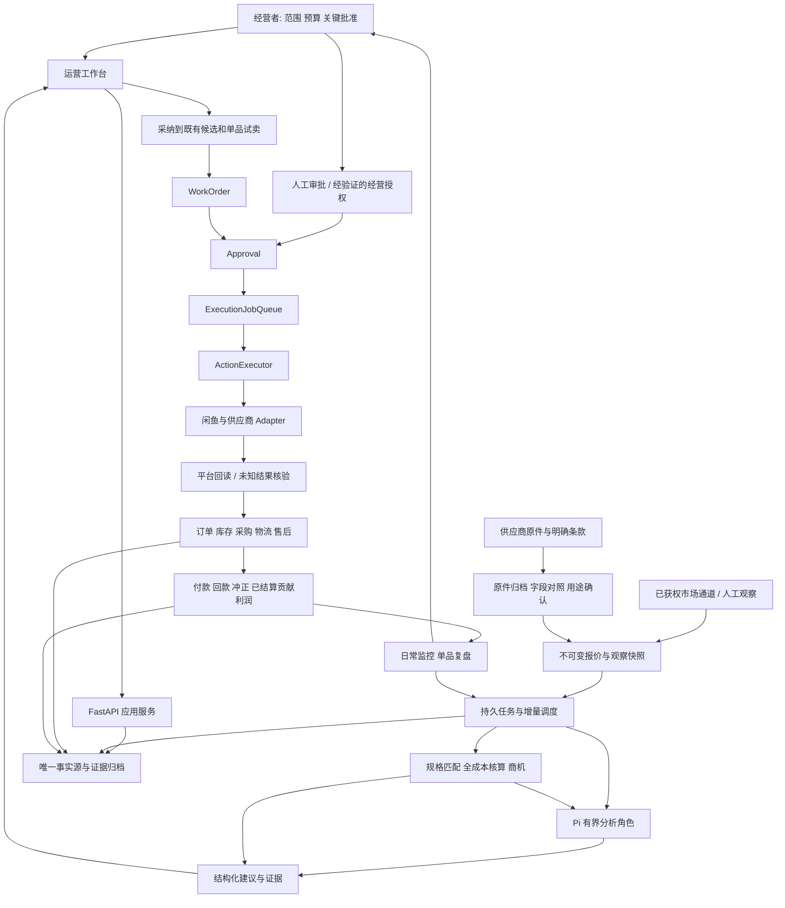

# 闲鱼自动经营项目总计划与 GLM 实施工作包

日期：2026-10-11。范围：`E:\闲鱼\xianyu`，国内闲鱼项目。

状态：规划交付，G0-G5 新增工作尚未实施。本计划不是上线批准、收益承诺或真实平台能力证明。

入口：[GLM_HANDOFF.md](../../GLM_HANDOFF.md)。逐项验收：[GLM_ACCEPTANCE_MATRIX_2026-10-11.md](GLM_ACCEPTANCE_MATRIX_2026-10-11.md)。

## 1. 项目章程

### 1.1 总目标

将当前项目做成一个可投入受控经营的 Pi 闲鱼工作台：自动汇集可用报价与市场观察，排除假价差，产出能解释、能复核、能交付的经营机会；连接发布、咨询、成交、采购、履约、售后和回款。用户批准经营范围与关键决策，AI 处理资料、分析、建议和获准的日常动作。

真正的最终产物不是 Agent 数量，而是一个能够持续运行、遇到错误能停止或恢复、每笔经营事实能核对的业务系统。

### 1.2 必须分别验收的三个目标

| 目标 | 定义 | 不能替代它的证据 |
|---|---|---|
| 软件可用 | 能部署、完成真实 HTTP/UI 流程、持久化、取消、恢复、备份与定位异常 | 仅有函数、配置、README 或截图 |
| 自动化可用 | 在指定输入、账号、策略、预算下，常规步骤不需人反复搬 ID 和点执行；越界可交接 | 注册了角色、空循环、后台进程存在 |
| 生意成立 | 有可重复供货、真实需求、可交付订单，按实际费用与售后核对后的贡献利润可接受 | 挂牌价差、演示订单、一次模型调用、测试全绿 |

第一笔真实回款证明首单链路，不证明稳定利润。系统不能保证买家购买或供应商永不变价。

### 1.3 经营范围

- 主线是稳定供货渠道向闲鱼销售，不将个人二手捡漏转卖和供应商分销混用模型。
- 首轮一个经营账号、一个品类、一个上线 SKU。研究池可先覆盖约 20 个 SKU；不能将研究池数量等同铺货数量。
- 首个 SKU 优先规格可表达、运输可控、售后成本可估、可确认供货的商品。历史商用厨具方向可以保留，但不因旧评分高就默认大型制冷设备最适合首发。
- 一家真实供应商足以启动受控试验；扩大供货前验证备用供应商，不把未联系的商家算备选。
- 不做跨境合并、多租户 SaaS、全网无差别铺货、自动抢购或数字商品自动交付。
- AI 可提出新类目/新供应商建议，不能据此自行扩张经营范围。

### 1.4 分工

| 角色 | 负责 | 不负责 |
|---|---|---|
| 用户 | 品类、供应关系、账号、资金上限、重要承诺、试卖与扩张批准、重大异常 | 逐条搬运内部 ID、计算金额、调度每个分析任务 |
| GLM | 代码、迁移、测试、隔离验证、证据、文档、准确报告阻塞 | 伪造真实资料、代签经营批准、凭计划开启付款 |
| Pi 角色 | 提取、缺口审查、匹配解释、定价复核、机会筛选与运营建议 | 修改金额事实、绕过库存预算、直接批准或交易 |
| 确定性业务服务 | 匹配硬约束、金额、时效、状态、额度、幂等、执行和核对 | 将模型猜测变成来源事实 |
| 验收者 | 按固定输入和失败路径复验，区分软件/真实数据/经营结论 | 根据代码数量或测试数量自动宣布工业级 |

## 2. 已有成果与本轮起点

### 2.1 2026-10-11 复核摘要

| 对象 | 已确认事实 | 下一轮处理 |
|---|---|---|
| 代码 | HEAD `4bd2cf7`，另有 R6-R9 未提交文件 | G0 保留并锁定完整工作区，不只按 HEAD 重建 |
| 历史验证 | 09-23 隔离回归 1489/1489；10-11 核对 254 份受检源码与清单一致 | G0 重新运行；配置、依赖、运行态另核对 |
| 数据入口 | 文件/结构化文本导入、两阶段确认、批次撤销、来源时效、只读准入 | 补原件归档、受信任操作者、用途与版本绑定 |
| 商机计算 | 快照、四级匹配、Decimal 利润、状态和决策卡已接 API/UI | 补持续输入、自动串联、真实成本与生命周期连接 |
| Pi | 持久分析、四角色、输入和工具证据、预算、失效判定、恢复 | 保留；补任务范围和事件触发，不推倒重写 |
| 旧运营 | 候选、证据、试卖、消息、承诺、审批、执行与回执已有 | 与新商机映射；继续保持唯一写链 |
| 新采购账务 | 库存、采购、账本、恢复有服务层及隔离演练 | 接入主服务/面板，不将模拟层完成当产品闭环 |
| 当前 live | 账号表 0、商品表 0；新 commerce 无报价和商机文件 | 真实资料和账号验收待输入 |
| 订单事实 | SQLite 有 1 行订单、12 行对话，未审定来源 | 不称零订单，也不将这些行数称真实经营证据 |
| 来源登记 | 2 个 CONFIGURED，3 个 UNVERIFIED，真实样本数均为 0 | 逐来源取证，禁止批量改成 VERIFIED |
| Pi 真实运行 | R7 为 2 行 demo 报价、1 次真实任务、3401 tokens | 证明调用链，不替代真实报价商业验证 |
| 部署 | 查询时 8000/8788/9223 无监听，配置选择 browser | 不推断其他端口；不恢复自启动 |

### 2.2 当前最值得修正的具体问题

1. `agent_scheduler.discovery_loop` 只列任务和日志，不实际完成扫描链路。
2. `server.py` 的在线来源 probe 除 supplier_file 外拒绝未验证通道，PDD/1688 适配并未真正接通。
3. 商机 UI 需要手工输入快照 ID，Pi 要另点 run-next，主要还是工程分步工具。
4. `web/console.html` 预填费率 0.03、包装 5、退货损失 12、可归因成本 4；前端作为已知值提交，不能继续作为真实成本默认值。
5. 新 Opportunity 与旧 candidate / CommercialTrial 未完整贯通；新 `ProcurementService`、`InventoryAllocationService`、`LedgerService` 未在主 server 实例化接入。
6. 资料准入评估最多返回 ready_for_human_review；这不是身份认证、用途批准或交易授权。
7. 跨文件 JSON 最终一致性与线程互斥已有改善，但不等于多进程事务或外部动作 exactly-once。

## 3. 目标架构与不可破坏的约束

### 3.1 目标图

以下为目标，不把尚未连接的部分当现状：



### 3.2 架构决策

- 保留模块化单体、现有前端和 Pi RPC。按本包边界提取路由/前端模块，不以全量重写为前置条件。
- 新持久分析只经现有 AgentJobStore 及受控 dispatcher；外部平台写动作仍经 ExecutionJobQueue。两者职责不同，不合成第二个交易执行器。
- 不以 Pi 会话日志作为订单或财务事实源。Pi 能解释事实，不能修改已发生交易。
- 主入口已为 Pi，但旧业务有直接模型调用；只在接入的工作流内逐步统一预算和证据，不做全仓无关改名。
- 跨境项目只共享可复用方法与接口规范，不共享凭据、数据库、账号、批准或资金。
- 单机验证阶段保持一个业务写入进程；HTTP 请求、调度线程、恢复器共享同一组服务和锁，不能每次请求新建各自拥有锁的服务实例。
- G2 的定时触发不意味着启动第二个 Python writer。若确需独立 worker，先进入 G5A，不能依赖每进程独立 thread lock。
- 生产事务目标沿用 ADR-0001 的 PostgreSQL + repository 迁移；不额外引入 Redis/Celery/Temporal/Kafka 作为必需依赖。
- 平台外部动作不能与本地事务原子提交。使用执行前 intent、幂等键、平台回读和 UNKNOWN 对账，不承诺网络 exactly-once。

### 3.3 三种批准必须分开

| 批准 | 表示什么 | 不表示什么 |
|---|---|---|
| 资料用途确认 | 某人核对了某批原件/快照，允许指定用途至指定时间 | 供应商绝对可靠；允许发布或付款 |
| 商品经营决策 | 当前账号/条款/成本下，允许一个 SKU 进入受控试卖 | 已执行平台发布；永久允许所有改价 |
| 动作授权 | 对特定动作、载荷版本、账号及额度批准 | 批准下一次不同载荷；授予 Pi 任意写入 |

复用现有批准机制；不足时增加类型/适配层，不另建互不相认的审批系统。操作者身份从已认证的本地会话或受控服务配置得到，不能信任请求体里的任意 operator 字符串。没有该入口时，在 G1A 补最小本地操作者确认通道，不引入大型 SSO 项目。

### 3.4 唯一关联与版本

```text
source artifact -> import batch -> offer snapshot/version
supplier-scoped SKU -> internal canonical SKU
market snapshot + supplier snapshot -> match/version -> economics/input hash
opportunity -> candidate -> trial -> listing -> sales order
sales order -> procurement order -> receipt -> ledger entries
job/attempt -> decision -> adoption/rejection -> action -> business outcome
```

一个商机更新可追加评估，不应重复建商品。一个销售单可以涉及多个实际履约情况，首版限定一单一 SKU 一采购；超出则明确升级人工，不假装已支持拆单/合单。供应商货号不能直接当跨供应商全局 SKU。

关联表或引用属于业务事实，不是额外的独立状态机。生产迁移后仅有一个可写权威，旧视图可以作为只读兼容投影。

## 4. 商业运行顺序与数据口径

### 4.1 顺序

1. 选定一类需求与风险边界。
2. 确认供应商、规格、价格阶梯、MOQ、库存、运费目的地、发货与售后。
3. 保存来源与时间明确的市场观察，区分展示价/咨询报价/自己的实际成交。
4. 规格匹配、履约条款核对、全成本核算；未知保留未知。
5. 形成候选与试验假设，不把“有价差”直接判为 validated。
6. 用户批准一个 SKU，完成账号/类目条款、商品证据和 Day-0；首发人工批准。
7. 平台回读确认上线，之后才统计该商品的真实曝光和询盘。
8. 买家沟通、价格承诺、付款核验；来源变化时先重验再承诺。
9. 采购前重验价格/数量/地址运费/交付，预留库存与预算后人工下单。
10. 关联供应商单号、物流与闲鱼履约状态；处理取消、缺货和售后。
11. 凭实际付款和回款核对账本，再得出已结算贡献利润。
12. 7 天看过程、14 天做 SKU 决策；售后和回款未结束时延长财务观察，不强行结算。

### 4.2 金额与估计

```text
预计单笔贡献利润
= 可实现售价假设
- 实付采购预计额
- 供应商运费与本方包装/发货成本
- 平台及支付费用
- 适用税费
- 预期退货损失与售后准备
- 可归因获客/模型等经营成本
```

- 金额使用 Decimal 与明确币种；计价单位、数量、MOQ、运费范围一起计算。
- 已有 Money 的 known/unknown/not_applicable 不重写；另用输入元数据表达 observed/estimated、来源、版本、适用地区/数量/账号/类目。
- 不以 0 补缺失，不以 not_applicable 绕过成本；不适用须有明确理由。
- 展示价不是成交价。没有低位售价或压力成本依据时，不制造三种不同情景；标明情景相同及数据不足。
- 当前平台费率来自 AccountCommercialTermsStore 的账号/类目快照，而不是写死 3%。变化后使相关未执行决定失效。
- 税费保留条件和估计依据；本计划不规定税率，投入经营前由用户确认适用口径。
- 预计利润、暂估利润、已结算贡献利润、可用现金分栏显示；固定经营开支另报，不把贡献利润称公司净利润。
- 退货准备与实际退货损失不可双算；原单据不覆盖，调整用新的分录/冲正和依据。
- 现金占用包括采购预留、实付未回款、退款准备等明确组成，不把未到账货款当可再次采购现金。

### 4.3 机会准入

EXACT 是某组已知规格约束一致，不代表质量/品牌授权/税费/交付也已核实。COMPARABLE/UNKNOWN 进入研究，不能与 EXACT 共用自动价差结论。型号、成色、尺寸、材质、等级、层数/功能、数量单位、地区运费、保修与售后须按品类定义关键字段。

标题相似度只用于召回，不用于证明同款。AI 可提出需确认字段，不能将缺失字段补成匹配。来源过期、批次撤销、人工纠错、价格变化要重评估；即使重评估调度尚未执行，任何下游使用前也要同步重验，不能依赖旧的 ready 状态。

## 5. 来源与外部工具策略

### 5.1 来源优先顺序

| 顺序 | 来源 | 开发与验证策略 |
|---|---|---|
| 1 | 用户有权使用的供应商报价原件 | 先交付 CSV/XLSX/粘贴资料闭环；逐记录核验，不等全平台 API |
| 2 | 有来源的人工市场观察 | 首张真实商机卡可用；标为人工，不称自动扫描 |
| 3 | 已获权的闲鱼市场观察或已验证浏览器读取 | 复用账号上下文；先少量只读探针，确认字段和限制，再做定时 |
| 4 | PDD/1688 等实际获准接口 | 只实现一个已拿到合同和样本的适配；不同时铺多个空 SDK |
| 5 | 有合同的服务商/ERP 执行通道 | 比较真实能力、费用、回调与导出，只替换 Adapter |

截至本次复核，没有已验证的无条件免费统一查价通道。闲鱼公开的小程序接入文档要求定向邀请、企业主体和权限申请；结论仅限该路径，不推断所有平台能力。[官方说明](https://open.goofish.com/doc/quick-start.html)。

PDD/1688 当前账号权限与费用未验证；旧 PDF 的免费字样不作为预算依据。API 无法获得时保留文件/人工观察路线，不能用 fixture 代替真实响应。

### 5.2 每个来源的交付证据

provider ID、官方/第三方身份、文档与核对日期、账号范围、实际获准接口、费用与额度、缓存与保留许可、分页及限流、SKU/库存/运费字段覆盖、优惠资格、脱敏响应证据、失败与降级路径。

真实资料首次分析不必等全部来源 VERIFIED；文件通道可在逐批人工核验后使用。全局 VERIFIED 仍遵守现有真实样本门槛，不为首个分析改松登记规则。首个真实样本、来源验证和商业发布是三道不同验收。

### 5.3 第三方项目与 skills

优先使用现有代码和 `.pi/skills`，不新增插件清单作为本轮关键依赖。需要外部模块时交付一个短 ADR：缺少什么、现有模块为何不能满足、上游 URL/commit/license、复制边界、兼容性、可替换性、测试和维护成本。

本地闲鱼项目只借鉴消息去重、人工接管、账号隔离、采集适配和操作状态；不整包运行多个回复机器人。协议库“可调用”不等于平台授予商用访问。

## 6. 工作包与依赖

### 6.1 执行图

```text
G0 基线
  -> G1A 原件与用途确认
  -> G1B 真实成本与失效联动
  -> G1C 面板资料闭环
  -> G2A 持久增量流程 -> G2B 单一市场通道 -> G2C 首张真实商机卡
  -> G3A 商机采纳桥接 -> G3B 单品受控试卖
  -> G4A 采购库存账本整合 -> G4B 首单与售后回款
  -> G5A 生产事务与恢复 -> G5B 按动作受控自治
```

G2-G4 的隔离软件开发不必等待真实成交；真实验收必须等待对应输入。G5A 设计可从 G0 开始；任何第二写进程或 L2 自动平台执行引入前，必须提前完成 G5A。不得因表格排序而先并发写 JSON。

### 6.2 时间与交付预算

以下是供排期的初始工程预算，不是 GLM 实际工时保证；G0 后重估，外部权限、供货、真实订单等待单列。

| 包 | 初始开发预算 | 可见结果 |
|---|---|---|
| G0 | 1-2 个工程工作日 | 当前代码与运行基线可复现 |
| G1 | 3-5 日 | 一次确认真实资料和成本，后续复用 |
| G2 | 5-8 日 | 自动生成/刷新商机卡，错误可解释 |
| G3 | 4-6 日 | 商机进入单品试卖并关联平台回读 |
| G4 | 5-8 日 | 一个订单贯通采购、物流、回款、售后 |
| G5A | 5-10 日 | 事务存储、恢复、迁移与运行控制可用 |
| G5B | 3-5 日，观察另算 | 经过验证的动作在有限授权内自动处理 |

合计约 26-44 个工程工作日作为初始容量估算，约 5-9 周单执行者工作量；不是交付期限承诺。真实观察至少覆盖计划中的 14 天单品窗口及后续回款/售后，影子样本不足则延长，不能按日历宣布自动化成功。

## G0：锁定基线和所有权

**目标：** GLM 接到的是完整现状，不回到旧 HEAD 重新实现。

**工作：**

1. 核对仓库指令、HEAD、所有未提交/未跟踪成果；输出与 R9 的差异，不回滚。
2. 核对 Python/Node/Pi/依赖锁、数据目录、模型与平台开关、后台任务和端口；只记录脱敏配置。
3. 在隔离模式运行已有全量和关键专项，保留退出码、失败名、源码清单及 live 前后摘要。
4. 建立入口矩阵：谁调用 import/match/economics/jobs/procurement/ledger/execute；标明服务层、HTTP、UI、真实通道分别是否接通。
5. 记录待整合业务对象的权威与兼容读者，尤其 ResaleManager 与新 commerce 采购/账本。

**产物：** G0 基线报告、manifest、缺口表、各包实际涉及文件清单、首轮排期。

**验收：** A00-A03。没有源码/配置快照不得照抄历史测试数。发现 blocker 优先修影响当前工作包的问题，不顺手全仓重构。

## G1：真实资料与成本入口

### G1A 原件归档、操作者确认和用途绑定

**复用：** `supplier_import.py`、`supplier_intake.py`、`quote_provenance.py`、`commerce/repositories.py`、`candidate_evidence_store.py` 的可复用归档能力和既有批准路径。

**拟新增的最小业务记录：** 资料用途确认记录，不另造供应商订单/审批系统。字段至少包括确认 ID、批次 ID、快照 ID+revision 集合、原件 artifact/hash、声明 hash、供应商身份材料引用、允许用途、适用 SKU/账号、核验操作者、时间/有效期、规则版本、拒绝/撤销/替代引用、幂等键。

**实现要点：**

1. 原件保留实际字节、媒体类型、取得时间和摘要；读取使用前重算 hash。字段对照保留 sheet/row/column 或明确文本位置、原值、标准值、换算依据。
2. 现有 CandidateEvidenceStore 强制 candidate_id，而导入可能还没有候选。先评估抽取通用 blob 归档原语并增加 owner_type/owner_id 的最小兼容扩展；不能创建虚假候选来占位，也不能复制另一套归档状态机。
3. 上传/预览/确认/批准含义分开；界面展示所核验的精确输入摘要。服务端产生一次性预览绑定，过期或变更返回冲突，不能照旧通过。
4. 核验人不能来自任意表单字符串；Pi job token 不能确认资料用途。确认记录只写已核验事实，不声称系统自动认证供应商。
5. 本地分析、外部模型分析、后续经营使用分别表达。资料用途批准不能授予执行器交易权限。
6. 批次状态、快照版本、原件摘要、时间、范围任何一项失效，后续使用都返回精确原因。人工重新批准不能延长供应商原报价期限。
7. 重放同一请求返回同一确认；同幂等键不同载荷拒绝。明确同一批次部分 SKU 获准的语义，不将批准扩大到全批。
8. 解决跨文件写入失败：保持 pending、不显示为有效；恢复器只处理自己拥有的记录，与确认/撤销使用同一同步域。

**拟议接口语义：** 复用现有 readiness GET/POST 保持只读；另外提供资料确认 preview/confirm/revoke/detail。具体路径由 GLM 在实现前列明，不擅改旧 readiness 为写操作。

**验收：** A10-A19。无法核实原单元格语义的字段保留缺口，不仅比较 hash 就说与报价完全一致。

### G1B 费用来源与资格失效

**复用：** `account_commercial_terms.py`、`unit_economics.py`、`opportunity_service.py`、报价来源门禁和旧候选资格机制。

1. 清除生产表单中的演示费用默认值；演示填充只在显式 demo 模式且不可进入真实资格。
2. 平台费率绑定账号+类目条款版本；包装/运费/退货/税费等保存依据、单位、目的地、数量适用条件及估计属性。
3. unknown 不替代 0；没有事实依据的售后风险可让用户给出明确保守估计，但显示为假设，不伪装观察值。
4. 成本或匹配修订时追加新评估及输入摘要，旧历史保持不变；已批准但未执行的动作重新校验。
5. 单位核算覆盖每件、每箱、每单、整单运费分摊、MOQ 和阶梯价格；一件试卖不允许套用十件批发价。
6. 资料缺用途批准时，确定性本地演示可继续，真实经营资格和外部模型调用按用途分别阻断。
7. 使当前输入版本成为资格依据；延迟投影不能让执行使用过期 ready。市场展示价明确标预计，不直接写为 settled 收入。

**验收：** A20-A26。

### G1C 资料操作面板

保留现有 console；把本工作包收成一条用户流程：上传/粘贴 -> 字段对照 -> 缺口 -> 选择用途并确认 -> 当前资格与到期时间。用户选商品名称/规范 SKU，不要求复制 snapshot ID；内部 ID 可供排障查看。

加载、空、拒绝、网络失败、版本冲突、部分成功与撤销状态齐全。刷新后恢复当前对象；重复点击不重复导入或批准。与现有费用和证据视图共用数据，不建立第二套前端缓存事实。

**验收：** A30-A33，桌面 1440x900、移动 390x844。报告中的 screenshot 必须来自真实资产及明确标注的后端模式。

## G2：持续商机雷达

### G2A 持久的增量流程

**复用：** `agent_jobs.py`、`pi_jobs.py`、`providers/`、匹配/核算/商机服务。

**拟新增：** 薄的 radar application service/dispatcher，文件名由 GLM 按本地惯例确定。它组合服务，不重新拥有报价/商机状态。

1. 触发来自获准批次、新观察、规范 SKU/费用/规则变化、到期检查以及用户显式启用的定时计划。
2. 幂等键包含项目、来源/账号范围、规范 SKU、输入版本/摘要、阶段与规则版本；同输入重复事件不重复建商机或付费分析。
3. 划分取数、匹配、核算、Pi 复核阶段。任务完成后持久保存输出引用，再推进依赖；失败只重试可安全重放的阶段。
4. 现有 claim_next 不按角色过滤，PiTaskRunner 只接受四角色。扩展 dispatcher/原子角色过滤时防止 Pi runner 抢走非 Pi 任务，也防止通用任务执行器认领平台写任务。
5. 初期不新增写进程；在应用显式启动/停止生命周期中管理调度，单分析 worker 串行。服务器导入模块不应意外创建新调度器或多次认领。
6. 输入按任务对象筛选，不每次把全库发给模型。保存实际 snapshot/revision、所用模型与 prompt/skill 版本。
7. 基础筛选和核算不依赖模型在线；有歧义才调用 Pi。超时/预算/未知消耗沿用现有约束，失败清理子进程，迟到结果不得有效。
8. 每来源配额、刷新间隔和退避依据真实合同配置；未知配额时不开无人值守在线扫描。配额对实际请求尝试计数，含重试；不能只计成功响应。
9. 预算不足持久记录下一可处理时刻/截止，不紧循环反复入队；过 deadline 按既有状态收尾。
10. 提醒按 SKU/原因/输入版本去重；只读影子观察和正式任务调度互不伪装为授权者。

**验收：** A40-A48。使用事件屏障复现并发，不依赖暂停方超时释放来让测试通过。

### G2B 单一市场观察通道

**优先复用：** `browser_adapter.py` 中既有账号上下文和读取能力；不要把旧 product_discovery 的独立浏览器另部署成第二份账号系统。

1. 先做只读能力探针：登录状态、当前账号、返回字段、价格含义、规格/成色/数量、页游标、证据、时间、错误分类。
2. 各响应转入统一 OfferSnapshot，保存原始字段与标准化结果；保留展示价类型，不将字段名含 sold 就武断认定成交。
3. 缺字段返回 unknown；拒绝页面显示的起售价、定金、区间价误当精确 SKU 落地价。
4. 分页去重、断点、空页/失败区分、429/401/403/5xx/超时处理、凭据失效提醒。认证失败不持续重试，不绕过验证。
5. 上游缓存时间与本次抓取时间分开；不能把重新读取缓存当报价更新。
6. 部分结果可保存，但任务标 partial/degraded，不将缺失商品推断为下架或库存为零。
7. 适配无法验证时返回结构化不可用原因；允许用户录入带依据的观察继续本地核算，面板明确手工来源。

**验收：** A50-A55。工程可用脱敏/演示契约测试；真实通道必须有实际获准请求和人工逐条核对结果。

### G2C 第一张真实商机卡

首张卡可从一份真实报价和人工观察开始，不能等齐 20 个 SKU 才提供价值。随后扩展建议至少 20 组有来源的真实商品对，用于发现缺字段、假价差与来源适用范围，所有候选人工复核。

卡片必须回答：什么规格、货从哪来、价格适用何数量/地区/人群、市场是什么价格类型、成本何者实际/估计/未知、保守利润为何、资料何时到期、Pi 提了什么、下一步要谁做什么。

保留原有离线标注集，另外记录真实样本与困难负例；EXACT 精确率须随分母、召回和弃权率报告，历史保留集 6/6 不能外推线上“100%”。第一批发现 0 个可行动机会也是有效结果，不调低门槛凑数量。

**验收：** A60-A63。真实模型验证须有用途批准和独立预算；无批准时停在本地确定性卡片和 Pi 待执行，不替换假结果。

## G3：商机进入单品试卖

### G3A 采纳桥接

**复用：** `opportunity_service.py`、`resale.py`、`candidate_activation.py`、`candidate_evidence_store.py`、`commercial_trial.py`、`commercial_preflight.py`、`commercial_launch.py`。

1. 建立显式采纳操作，将当前商机映射到既有候选；记录用户决定、输入版本和理由，不用模型 advance 自动模拟用户批准。
2. 同商机/规范 SKU/账号作用域重复采纳不得重复候选；不同账号不能共用授权。修改后的新评估不能偷偷覆盖旧试卖依据。
3. 将报价、规格、图片使用依据、供应/履约/售后、市场基线映射到既有候选证据。导入一个文件不等于五类证据全部通过。
4. 接入旧候选完整校验和 Day-0，保留最终人工决定；不得为了连通而跳过旧条件。
5. ready_for_test、candidate approved、trial active、platform published、business validated 是不同事实，UI 不混合成“上线成功”。
6. 利润口径统一至同一已审定输入；旧评分只作选品参考，不取代全成本核算。

**验收：** A70-A74。

### G3B 受控真实试卖

1. 用户完成指定账号登录，预览并确认绑定；旧无归属任务逐项审阅/隔离，不自动归属给首个账号。
2. 核对当前账号/类目商业条款及实际费率，确认预算、损失上限、售价下限和试验范围。
3. 商品事实生成结构化草稿，图片和承诺有依据；首次发布人工批准，执行走旧链。
4. 必须有平台商品 ID、账号归属、页面回读；验证码/类目不支持转人工，未知结果先核验不重发。
5. 只在真实上线后开始单品观察；咨询去重并关联该商品。没有曝光字段不填 0，没有发送回执不写已承诺。
6. 7 天过程诊断、14 天继续/调整/停止。单次只变一个实验变量，平台回读确认后开始计时；不得无限自动降价。

**验收：** A80-A85。数据与真实批准缺失时只交付隔离链路，状态 NOT_AUTHORIZED/WAITING_INPUT，不称真实试卖完成。

## G4：采购库存与实际利润闭环

### G4A 将已有服务接入主链

**复用：** `procurement.py`、`inventory.py`、`ledger_service.py`、`recovery.py`、`budget_reservations.py`、旧订单 runtime 和 purchase_task。

1. server/application composition 只创建一组服务实例，API、worker、恢复器共享；浏览器中的页面状态不能决定订单事实。
2. GLM 先提交事实所有权表：新采购单/库存/账本作为相应新域的权威；旧 purchase_task 作为兼容任务投影或明确迁移，不永久双写两套互相修正的账。
3. 凭平台付款事实生成采购准备，不信任手写 paid 字段；校验同账号/商品/订单/数量关联。
4. 采购前重核供应商报价、MOQ、真实数量、收货地区运费、库存及承诺；涨价后利润不满足原授权则升级，不自行下单。
5. 库存和预算预留要有一个业务操作关联；跨文件失败导致的悬挂必须可识别、可恢复且与创建/取消同锁。若不能证明恢复正确，提前迁移 G5A 而非宣称原子。
6. 一单一有效采购的幂等作用域包含账号与销售平台订单，不让两个账号同号碰撞。部分/重复/迟到事件按版本处理。
7. 先做人工供应商下单与付款凭证登记；现有禁止自动提交行为保留到 G5B 单独能力评审。
8. 供应商单号、采购付款、物流、平台发货、回款分别记录；API 成功不是这些事实的替代。
9. 已下单后买家取消进入售后/追回款流程，不直接释放已消耗库存和把成本抹零。
10. 将 real receipt 和 ledger entries 投影到同一订单详情，能从总利润追到每一笔收支。

**验收：** A90-A99。

### G4B 首单和财务复核

先用固定手算黄金样本贯通 HTTP/UI，再在批准的单品范围处理真实订单。正常成交、未回款、缺货、采购后取消、全额退货、部分退款、运损、补发和供应商赔付须有明确表示；首版不支持的场景保持 awaiting_human，不擅自借普通退款表示。

已结算支出凭付款证据、收入凭回款证据；退款/冲正校验币种、累计上限和原单引用。对账应涵盖平台原金额、手续费、退款、供应商费用与时间差，未差异解释前不标 settled closed。

**验收：** A100-A104。无真实买家时不能制造成交；首单等待期间继续恢复/迁移/影子评估工程。

## G5：生产可靠性与额度内自治

### G5A 事务存储、部署与恢复

此包必须在第二业务写入进程或无人值守平台执行之前完成；设计可以提前，落地不必阻塞首张只读商机卡。

1. 新 ADR 明确迁移域、表/唯一键、现有 JSON/SQLite 各字段去向、读兼容、切换点及回退条件。生产只选一个权威，证据 blob 保留内容寻址。
2. 将实际共享写入的工作单/批准、预算、执行、商业任务、采购库存账务等纳入完整事务边界；不能只迁移一个商机表就宣布支持多 worker。
3. 在已选生产数据库上测试实际并发事务、原子条件更新、重复事件及崩溃回滚。数据库事务可保证本地多步变更的原子性，不能覆盖外部平台副作用。[PostgreSQL 事务说明](https://www.postgresql.org/docs/current/tutorial-transactions.html)。
4. outbox 与业务变更同事务提交；外部请求发送后结果未知保留 intent 和预算，依靠平台核验，不释放后盲重试。
5. 迁移前备份和校验，停写切换；核对行数、金额合计、唯一关系、未完成任务、未知执行和证据 hash。隔离演练后才对真实目录申请切换。
6. 回退如已有新交易不能简单还原旧快照，应先停写、导出差异、人工对账；写清不可逆边界。
7. 服务显式启动/停止/健康检查，默认不暴露公网；日志脱敏、容量/磁盘与备份可观察。不给用户新增弹窗或系统自启动。
8. 记录每个任务的来源、阶段、耗时、attempt、token/费用、异常和结果关联，不存隐藏推理链。
9. 恢复演练先给出恢复时间和可恢复范围的实际测量；在用户批准运行承诺前不宣传高可用或固定 RTO/RPO。
10. 发布版本可回溯到 schema、代码、配置摘要、依赖锁；停机、模型失败、平台失联都能降级为只读/人工。

**验收：** A110-A116。代码存在不等于迁移完成；隔离迁移与真实切换分别验收。

### G5B 按动作开放自动化

| 顺序 | 可考虑自动化 | 开放条件 | 仍需人工 |
|---|---|---|---|
| L0 | 资料提醒、核算、分析、机会更新 | 资料用途、任务预算和来源时效满足 | 批准资料真实性/新范围 |
| L1 | 草稿、建议、采购准备 | 受控链路与人工动作批准 | 首发、下单、付款、退款 |
| L2-1 | 有版本依据的 FAQ、常规规格答复 | 实际消息样本、去重、接管、发送回执及有限 mandate | 投诉、新价格/库存/到货承诺 |
| L2-2 | 授权区间内议价、库存同步/暂停 | 当前成本底线、有效承诺、次数/金额、执行前重验 | 新供应商/大单/超额/冲突 |
| 后续 L3 | 成熟模板发布、已获权供应商订单提交等 | 真实渠道能力、每动作独立验收、结果核验和预算 | 支付、退款与重要承诺是否可自治需另行批准 |

长期自动采购若有价值，必须具备真实供应商接口权限、幂等提交、订单查询、价格/运费确认、取消与资金处理能力；任何一项缺失就保留人工。不能因为当前函数返回 blocked，就只删检查完成“自动采购”。

影子评估按账号+策略+动作+版本统计：建议、允许/拒绝、实际人工决定、错误、原因及结果。沿用至少 7 天/100 条有效自然建议作为最低观察门槛，去重并排除 demo、未知、越域及失效来源；未达就延长，不重复事件刷数。达到门槛仍要人工评审，不能自动解锁。

所有平台动作保留唯一执行链。经营授权先由用户签发，系统产生 policy 类型授权记录，不能假冒人工审批；排队前及执行前校验当前版本、预算、库存和取消状态。超出范围回到人工。

**验收：** A120-A127。先选一个低风险动作验证，默认不同时开放发布/采购/退款。

## 7. 前端最终组织

不先做全量 UI 重写，随工作包逐步整合为四个工作区：

| 工作区 | 用户要回答的问题 | 必有功能 |
|---|---|---|
| 今日待办 | 今天必须决定/处理什么 | 资料缺口、将到期报价、审批、失败、未知执行、售后；点入可回到原筛选 |
| 商机与商品 | 哪些值得试、哪些该停 | 同款对照、成本来源、利润情景、历史变化、采纳到试卖、询盘与实验 |
| 订单与利润 | 哪笔有异常、钱在哪 | 平台单/采购/物流/退款/回款关联，预计/暂估/已结算分开，证据可查 |
| Agent 与决策 | 谁做了什么、建议是否有用 | 角色、job/attempt、输入版本、简明理由、工具事件、用量、采纳/拒绝和结果 |

界面不得靠固定数据显得完整。加载、空、失败、过期、部分成功均明确；关键按钮稳定、重复点击幂等、移动端文字和操作不溢出。工具用现有图标库/熟悉图标及 tooltip，业务命令用清晰文本。不会让用户读取 JSON 才能知道下一步。

## 8. 里程碑与经营决策

| 里程碑 | 最小可见成果 | 允许的结论 |
|---|---|---|
| M0 基线 | G0 测试与运行快照 | 开发基线已锁定 |
| M1 真实资料 | G1 确认/失效/UI 闭环，至少一份经核验资料 | 可用于批准用途，不代表能交易 |
| M2 商机价值 | G2 第一张真实卡及后续样本复核 | 能找到/解释机会或无机会 |
| M3 受控试卖 | G3 一个真实 SKU 发布回读、真实询盘路径 | 已开始经营试验 |
| M4 首单闭环 | G4 真实采购、交付、回款及账本可核对 | 首单流程成立，不保证可重复 |
| M5 生产基础 | G5A 事务、恢复、可观测与发布回退通过 | 满足已声明部署范围，不无限外推 |
| M6 有界自动化 | G5B 指定动作的真实影子和授权验收通过 | 仅该动作/账号/策略可自动执行 |

每周看：来源可用率、可比样本比例、未知成本率、人工复核有效机会率、资料确认/每单人工分钟、有效询盘、成交、退款/缺货、回款周期、已结算贡献利润、模型及通道成本。指标分母、时间范围、样本来源明确；缺失不写 0。

停止/调整规则：持续依赖不可重复优惠、供货/退货无法确认、运费吞掉利润、错误匹配/误承诺、未知执行未消除、没有需求而反复降价、维护成本超过贡献时，缩小或停止该策略。参数如最大亏损、最低利润和预算由用户设定，未设定不默认为无限。

## 9. 阻塞与用户输入

### 9.1 GLM 可以先完成

G0，G1 的全部软件，G2-G4 的隔离集成与演练，G5A 的隔离迁移和部署验证，G5B 的策略与影子工程。用 demo 只证明对应软件行为，不能伪装真实业务。

### 9.2 用户不可替代的输入

| 时点 | 输入 | 没有时的处理 |
|---|---|---|
| M1 | 真实供应商报价、身份/使用依据、交付与售后条款 | 缺口清单；继续隔离开发 |
| 外部 Pi 分析前 | 资料允许提供给模型的范围、模型调用预算 | 保留本地核算与待分析状态 |
| M2 自动在线观察 | 合法可用账号/来源权限与查询额度 | 保留人工观察；不宣称自动取数 |
| M3 | 平台登录、类目条款、图片依据、采购与损失上限、单品批准 | 只产草稿和预检，不发布 |
| M4 | 实际付款/供应商单号/物流/回款凭证或获准可读接口 | 暂估/待核对，不造实际分录 |
| M6 | 指定动作、SKU/账号、价格/次数/金额/期限及接管条件 | 保持人工审批 |

集中报告精确缺口和受阻里程碑；不要让用户自己理解技术内部 ID。阻塞只作用于受影响验收，不把整项目停在“等资料”也不跳过事实门槛。

## 10. 交付与变更控制

- 每个子包都有代码/契约、专项、HTTP 集成、需要的浏览器流程、全量隔离回归、证据与回退说明。
- 不删除/放宽已有回归来获得全绿；行为契约确需改动时同时说明新旧语义和数据兼容。
- 更新实际状态时引用本矩阵 ID，报告 software/integration/real_data/commercial 四个状态，不使用一个笼统 PASS。
- 任何新来源、插件、数据库或模型更换都做小型兼容/能力验证，不将未锁定最新依赖引入生产。
- 商业范围改变、自动化扩权、生产迁移和资金动作必须对应显式批准；日常代码实现细节 GLM 自主决定。
- 本计划不要求修改所有历史文档。历史报告保留，新增入口指向当前计划，避免多个“全部完成”互相覆盖。

## 11. 参考依据

- [09-18 总计划](INDUSTRIAL_AUTONOMOUS_XIANYU_MASTER_PLAN_2026-09-18.md)与[旧工作包](ZCODE_IMPLEMENTATION_BACKLOG_2026-09-18.md)：经营范围、对象和旧分阶段目标。
- [R9 报价来源验收](../acceptance/CODEX_R9_QUOTE_PROVENANCE_2026-09-23.md)：已实现行为与真实资料批准缺口。
- [R7 真实 Pi 演示验证](../acceptance/CODEX_R7_ISOLATED_PI_VALIDATION_2026-09-22.md)：真实模型调用与 demo 输入的区别。
- [供应商准入说明](../SUPPLIER_INTAKE_READINESS.md)及[输入合同](../ops/supplier-quote-input-contract.md)：当前只读准入与字段语义。
- [Commercial Alpha 运行手册](../ops/commercial-alpha-runbook.md)：已有候选、账号、Day-0、执行和经营回执要求。
- [存储 ADR](../adr/0001-commerce-storage-and-migration.md)：当前 JSON 单机边界和生产迁移方向。
- 闲鱼与 PostgreSQL 官方资料链接见对应章节，核对日期 2026-10-11。它们说明外部约束/技术能力，不证明本项目拥有权限或已部署生产数据库。
