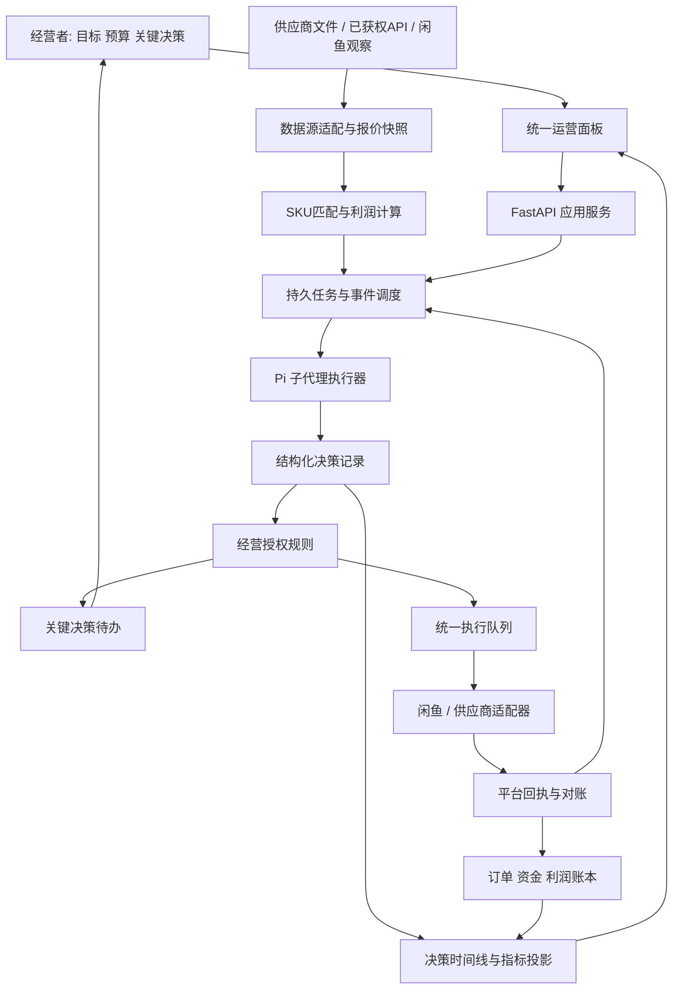

# 闲鱼 AI 自动经营系统：工业化落地总计划

日期：2026-09-18。决策者：项目负责人。执行者：Zcode。状态：设计定稿，尚未实施本计划新增功能。

## 1. 项目决策

将现有系统发展成「Pi 驱动的闲鱼自动经营工作台」：持续发现供需价差，判断精确商品的实际利润，在你设定的经营规则和额度内自动完成常规运营，你负责经营范围、预算、重要承诺、异常和扩张决策。

长期目标是自动经营闭环：行情采集 → 同款匹配 → 供应商验证 → 利润核算 → 商品实验 → 发布与咨询 → 议价成交 → 采购履约 → 售后对账 → 策略更新。

这里有三个不同的交付目标，必须分别验收：

1. 软件可用：能部署、恢复、监控、升级，数据和执行行为可靠。
2. 自动化可用：在明确范围内，常规任务无需逐次人工点击，越界时能及时交接。
3. 生意成立：有真实需求、可交付供应商、已结算订单和计入全部成本后的利润。

测试通过只能证明第一项的一部分；无人值守时长不能证明第三项。系统自动处理卖家侧工作，无法控制买家是否购买。

本计划取代旧文档中「永久逐条人工审批所有操作」和「账号接入前只能继续补门禁」的未来产品定位。已有实现保持兼容，通过新增额度授权逐步释放自动化。现有账号、SKU、资金和真实回执前置条件仍然有效。

## 2. 本次实际审计到什么

本次读取了当前代码、项目状态、最新交接增量、本地六个参考目录及其关键文件，并查阅 GitHub 和平台公开材料。没有启动服务、安装依赖或修改业务代码；本次没有重跑全量测试，也没有验证真实账号或平台订单。

### 2.1 当前基线

| 对象 | 当前可确认事实 | 对计划的影响 |
|---|---|---|
| 主仓库 | `E:\闲鱼\xianyu`，分支 `codex/opc-dashboard-v1` | 所有实施集中在该仓库 |
| 审计时 HEAD | `790dff8`，2026-09-17，记录 GH-05 议价记忆与回复追踪 | 工作包开始时重新记录 HEAD，不能依赖旧日期推断版本 |
| 审计时工作树 | `git status -sb` 无变更条目 | 本次只新增规划文档 |
| Pi 依赖 | `@earendil-works/pi-coding-agent` 固定 `0.84.2` | 新插件必须对这个版本做兼容性试验 |
| Pi 调用 | `PiRpcClient` 管理单个 RPC 子进程并串行处理操作回合；12 个项目工具 | 不能把现有 specialists 直接宣传为持久化并发 AI 公司 |
| 后端 | FastAPI，`server.py` 约 6556 行 | 按功能迁出路由和应用服务，保持 HTTP 兼容 |
| 前端 | `console.html`、`app.js`、`style.css`；app.js 约 5233 行 | 先扩展现有工作台，不整体换框架 |
| 业务对象 | 候选、证据、审批、执行、订单、试运营、复盘已存在 | 不另建第二套候选/订单业务系统 |
| 执行可靠性 | action scope、lease/fencing、未知结果核验已实现 | 新自动化必须沿用同一执行服务 |
| 最新交接增量 | ChatEvent、价格承诺、product facts、reply trace 已有代码 | 优先扩展和验证，不重写 |
| 测试历史 | ZCODE_HANDOFF 的 09-06 增量记录 `1026/1026`；PROJECT_STATUS 仍记录 `996` | 是历史结果，WP-00 刷新权威状态，不称本次通过 |
| 当前监听 | 本次未查到 8000/8788 监听 | 当前不能声称在线可用 |
| 真实经营 | 最新文档仍记录 0 账号、占位候选、空单品包 | 本次未重验账本，真实经营完成度保持待核实 |

### 2.2 需要优先处理的实际差距

1. `product_discovery.py` 主要基于浏览器捕获闲鱼搜索响应，尚不是统一的多平台采购报价服务。
2. `agent_scheduler.py` 的 discovery loop 当前列出任务并记录日志，不能等同于可靠、可恢复的发现任务执行器。
3. `AgentRegistry.dispatch` 是 handler 分发，任务历史和讨论不足以表示持久化任务、模型版本、证据版本、决策授权与业务结果。
4. 采购平台命名有 `pdd` 与 `pinduoduo` 等差异，需要边界归一化，保留历史兼容映射。
5. `XianGuanJiaAdapter` 有实现，但端点、认证、返回结构、费用和平台身份仍需用真实服务合同验证。HTTP 200 或缺少 error 不足以证明发布成功。
6. 当前价格解析及议价记忆需要否定句、历史报价、运费、规格数字、多商品语境验证，不能把每个提到的金额当作当前承诺。
7. `physical_sourcing.py` 存在声称「我们在其他平台也有店铺」等固定话术。发布前必须改为由已验证经营事实生成，不能让模板制造供应关系或承诺。
8. 多个 JSON/JSONL 业务文件和 SQLite 混用，单机可运行，但跨对象事务、崩溃恢复、查询和多 worker 一致性尚需整合。
9. 当前离线包仍要求用户手填大量字段。应该演进为 AI 提取资料、突出缺失事实、用户一次核对的导入体验。
10. 「AI 做大部分决策」需要可测的授权策略、任务预算和结果评估；仅增加 Agent 名称或聊天记录不能实现。

## 3. 产品范围与商业模式

### 3.1 主线

先做国内闲鱼卖家经营，采购来源可来自供应商报价、1688、PDD 等；跨境项目独立。共享接口规范和经营方法，不共享账号、订单、权限和资金账。

首轮选择一个供应可靠、规格可比较、发货和退货可估算的品类。历史商用厨具方向可以保留，但不因过去评分高就默认选择大型制冷设备。首个 SKU 优先运输可控、低易损、至少两家可供货商的商品。

差价机会必须满足：同规格、同数量、同成色、同交付地区、同税费口径、同退货条件。只看标题和最低展示价会产生大量不可兑现机会。

### 3.2 四个产品模块，按顺序实现

| 模块 | 用户价值 | 优先级 | 验证方式 |
|---|---|---|---|
| 商机雷达 | 自动收集采购和市场报价，过滤假价差 | P0 | 真实报价样本及同款匹配人工标注 |
| AI 店铺运营 | 草稿、客服、受控议价、库存提醒、实验 | P0 | 一个账号一个 SKU 的真实链路 |
| 采购与利润工作台 | 防重复采购、物流、售后、现金占用和实收利润 | P0 | 平台订单、供应商回执及对账 |
| 总经理控制台 | 看谁做了什么、为什么、花了多少、结果如何 | P0 | 任一动作可追到决策、规则、证据和回执 |

后续可增加：供应商报价订阅、店铺缺货预测、类目知识库、慢销库存处理和利润异常预警。数字商品自动交付、跨境、自动抢购、SaaS 多租户都不进入首轮。

### 3.3 建议初始运营限制

以下为设计起点，需在实际实验创建时由你确定，不是收益承诺：

- 一个卖家账号、一个 SKU、一次 14 天观察；成功后到 3 个 SKU，再到 10-30 个。
- 研究池允许更多候选，但上线池有严格名额；不因抓到 1000 条数据就铺 1000 条商品。
- 客服优先级高于价格扫描，订单异常高于新商品发现。
- 采购预算需覆盖采购价、供应运费、可能退款和账期；未收到平台回款不能计作可支配利润。
- 第一轮不把返佣、首单券、一次性补贴作为持续利润基础。
- 7 天检查过程指标，14 天做保留/调整/停止；没有咨询是有效结论，不能无限自动降价。

## 4. 免费数据渠道：现实方案

### 4.1 免费的定义

分别记录「API 调用费用」「应用审核和资质」「登录或授权」「额度」「商业使用范围」「维护成本」。开源客户端免费不表示数据接口开放，试用额度不表示永久免费，公开页面也不代表随时可稳定获取。

本次未验证到一个可无条件承担闲鱼、PDD、1688 全量实时查价的免费官方统一 API。产品必须允许部分来源不可用，不能把未经验证的接口作为硬依赖。

### 4.2 渠道策略

| 来源 | 本次证据状态 | 适用数据 | 现实限制 | 计划 |
|---|---|---|---|---|
| 供应商 CSV/XLSX/报价单 | 本地可实现导入；数据由供应商提供 | 精确 SKU、阶梯价、库存、运费 | 要求更新频率、授权与可追溯性 | 第一条可交付数据通道 |
| PDD 多多进宝 | 官方历史 PDF 描述 `pdd.ddk.goods.search` 为免费 API；2026 权限未核实 | 联盟商品线索、价格区间 | 申请应用、商品范围、券资格、地区价和额度需实测 | 第一条外部 API 候选 |
| 1688 开放平台 | 官方门户本次未能读取 | 商品和供应链相关能力 | 具体 API、授权、收费、字段不可凭空假定 | WP-02 获取当前合同后接入 |
| 淘宝联盟 | 本次未验证当前搜索接口合同 | 联盟商品比价候选 | 联盟商品不等于稳定采购货源 | 第二期可选，不阻塞首版 |
| 抖音精选联盟 | 官方材料显示权限包要求及部分销量返回区间 | 扩展市场线索 | 非全量采购目录，数据口径有限 | 延后 |
| 闲鱼浏览器当前可见信息 | 当前项目有实现路径 | 展示价、规格、地区、可见互动 | 登录、页面变化、缺字段和平台限制 | 作为市场观察源，禁止推断真实成交价 |
| 用户自有闲鱼订单 | 需真实账号和实际订单 | 成交价、退款、平台费用 | 只能覆盖自己的经营样本 | 真正价格反馈和利润依据 |
| 第三方闲鱼 API/闲管家 | 本项目有适配代码，服务合同未验证 | 视供应商授权能力而定 | 不承诺免费，不按类名判定官方身份 | 备选通道，WP-02 评估 |

PDD 历史材料：[商品搜索 API](https://commoncdn.yangkeduo.com/pdd_oms/2021-01-12/2e22638bda0b0f77479f89dab1de2988.pdf)、[应用申请流程](https://funimg.pddpic.com/ddjb/2020-12-04/4f8c0c46-e2c3-40e4-bfee-5ac05ba96607.pdf)。两者分别为 2021/2020 年资料，仅证明曾有此机制，不证明当前账号可用。

抖音数据限制参考：[官方权限说明](https://op.jinritemai.com/docs/guide-docs/33/4495)、[官方数据口径说明](https://buyin.jinritemai.com/developer/service-provider/help-support?docId=6199&noSearchMenu=1000&searchMenu=0)。

### 4.3 接口准入试验

每个外部来源交付一份 Provider Capability Report：

1. 精确 API 文档地址、阅读日期、接口版本、供应方、凭据类型。
2. 账号真实获准能力、日/月额度、费用或免费证据、允许的数据使用方式。
3. 20 个具体 SKU 的脱敏请求/响应和人工核对结果。
4. SKU/数量/币种/运费/库存/时间/优惠条件字段覆盖率；缺失写 unknown。
5. 429、过期授权、空结果、业务错误、超时、分页中断测试。
6. 成本上限、刷新策略、失效处理和替代来源。
7. 状态只能为 `UNVERIFIED / CONFIGURED / VERIFIED / DEGRADED / DISABLED`。

一周内无法获得权限的来源保持 UNVERIFIED，继续使用已可用的供应商数据和闲鱼观察，不模拟接口响应后宣称已接通。

## 5. 总体架构

采用模块化单体业务核心、独立 worker 和浏览器适配进程。先解决业务一致性，规模达到阈值再拆服务。



### 5.1 每层唯一职责

| 层 | 负责 | 不承担 |
|---|---|---|
| 数据源适配 | 真实取数、分页、额度、缓存、字段标准化 | 判断商机是否赚钱 |
| 比价与核算 | 精确匹配、价格口径、成本和预算计算 | 用自然语言臆造库存 |
| Pi/子代理 | 解释证据、提出策略、生成草稿、分类异常 | 直接修改订单与资金事实 |
| 调度器 | 优先级、租约、依赖、取消、恢复、任务预算 | 作为第二个聊天 Agent |
| 授权策略 | 确定该动作是否属于已批准经营范围 | 使用模型自由文本作为授权 |
| 执行层 | 调用适配器、保存回执、处理未知结果 | 自动重放结果不明的外部写操作 |
| 业务数据库 | 唯一事实与事务 | 依赖 Pi 会话日志恢复订单 |
| 面板 | 日常决策、接管、定位异常、评估收益 | 替代服务端规则 |

### 5.2 存储与部署取舍

- 当前单机 Alpha 可继续 SQLite，但新表使用 repository 接口和明确事务。
- 逐步把工作单、授权、预算预占、任务、事件迁入事务数据库；JSONL 保留导出和历史证据用途。
- 生产多 worker 模式以 PostgreSQL 为目标，使用 SQLAlchemy/Alembic 管理迁移；具体版本由 WP-00 根据环境锁定并记录。
- 文件证据仍按 SHA-256 存储，数据库保存引用、类型、归属、时间和保留策略。
- 可靠队列首期使用数据库 job 表与事务 outbox；无需同时引入 Redis、Celery、Temporal、Kafka。
- Temporal 仅在跨服务长事务、计时器和人工等待确实复杂时做 ADR 评估，当前排期不依赖它。
- Windows 保留开发和可见浏览器登录；后端生产可使用 Linux 单节点，浏览器 worker 所在机器由实际平台验收决定。
- 不预设 Kubernetes、微服务集群、向量数据库和桌面壳为工业级必需品。

## 6. 子代理组织与调度

逻辑角色不是常驻进程数量。初始 worker 并发为 2，子代理按事件运行并结束，避免十个角色同时反复聊天消耗预算。

| 角色 | 触发 | 输入 | 必交付结果 | 评价指标 |
|---|---|---|---|---|
| 经营规划 Agent | 每日/人工新目标 | 预算、利润、异常、实验 | 当日任务优先级与原因 | 有效任务比例、超预算次数 |
| 机会发现 Agent | 新报价/扫描计划 | 报价快照、类目约束 | 带来源的机会候选 | 人工确认有效机会率 |
| 商品匹配 Agent | 两平台疑似同款 | 属性、规格、图片 | 匹配证据、冲突字段、匹配等级 | 错配率、弃权率 |
| 供应商 Agent | 新 SKU/报价失效 | 供应商记录、条件 | 待核对事项与备选供应商 | 缺货率、准时率、返工率 |
| 定价 Agent | 新成本/实验到期 | 同款市场、成本、承诺 | 建议售价、底价、场景利润 | 实际贡献利润、成交反馈 |
| 上架 Agent | 已通过商品实验 | 商品事实、图片授权 | 结构化草稿与事实引用 | 修改率、虚假字段数 |
| 客服 Agent | 真实买家入站 | 同会话事实、商品、承诺 | 回复草稿/议价建议/升级原因 | 回复及时率、纠正率、承诺错误 |
| 履约 Agent | 付款确认/物流变化 | 订单、库存、供应回执 | 采购计划、物流异常 | 重复采购数、迟发数 |
| 售后 Agent | 退款/损坏/争议 | 订单、凭证、政策 | 分类、处理建议、金额 | 处理时长、误退款数 |
| 经营复盘 Agent | 日/周/实验结束 | 成交、退款、费用、实验 | 调整/停止建议与证据 | 决策兑现率、节省工时 |

首版优先实现发现、匹配、定价、客服四个角色，其他角色先复用现有函数式业务模块。经营规划 Agent 给建议，调度器决定是否有资源执行。

### 6.1 任务合同

`AgentJob` 至少包含：job_id、project_id、account_id（研究任务可空）、role、goal_id、input_refs、input_versions、priority、deadline、status、attempt、lease_owner、lease_until、fencing_token、model_budget、parent_job_id、idempotency_key、created_at。

状态：queued → leased → running → succeeded / failed / cancelled / timed_out / awaiting_input。重启后恢复未完成任务；纯分析可重试，已发起外部动作由 ExecutionJob 的结果状态决定。

优先顺序：付款和售后异常 > 买家回复 > 库存与供应异常 > 发布任务 > 新品发现 > 每日报表。

初始资源参数为工程配置：单分析任务最多 12 次工具调用、3 次模型回合、120 秒；复杂研究可配置到 5 分钟。超限输出已有结果与未完成项，不无限 self-loop。客服用独立队列和更短超时，不能排在长研究后面。

### 6.2 Pi 集成选择

保留 Pi 0.84.2 并先做版本兼容探针：子会话启动、工具允许列表、取消、结构化输出、费用统计、异常退出、Windows 进程清理。

推荐先试验 `nicobailon/pi-subagents` 的子代理执行方式；业务 job 和状态仍由 Python 数据库拥有。若与当前 Pi 包命名空间或 Windows 不兼容，使用官方 SDK/RPC 受控子会话替代。不要为了装插件整体升级线上 Pi。

每个角色使用独立 profile、会话 ID、prompt/skill 版本和必要工具。以 `job_id` 关联结果，不能把用户主会话当成所有账号的共享记忆。

外部页面和买家文字进入证据区；角色 system prompt、工具集合和额度不接受外部文字覆盖。失败的子代理返回明确失败，不能由父代理包装成成功。

## 7. AI 决策与人的关键决策

### 7.1 自动化等级

| 等级 | 行为 | 用途 |
|---|---|---|
| L0 离线 | 导入、分析、影子决策，不执行平台动作 | 数据及模型验证 |
| L1 辅助 | AI 生成动作，用户逐项批准 | 首个真实商品与首单 |
| L2 额度内自治 | 用户批准一份有期限的经营规则，常规动作自动执行 | 稳定 FAQ、库存同步、限定范围议价 |
| L3 有界经营 | 已验证品类和供应商内，商品补充、调价、部分履约按策略自动化 | 足够真实样本和恢复演练后 |

你日常批准的是目标、品类、账号、供应商、总预算、价格下限和自动化范围。只有新范围、额度增加、异常资金动作及规则冲突再进入人工待办。

### 7.2 权限矩阵

| 动作 | 默认授权方式 | L2 可自动的条件 | 需要你决定的情况 |
|---|---|---|---|
| 研究/比价/淘汰弱候选 | 自动 | 来源可用、任务预算内 | 开新付费来源 |
| 草稿生成 | 自动 | 有商品事实 | 无实证的规格和承诺 |
| FAQ 回复 | L1 后开放 L2 | 已验证知识、同账号同商品、无新价格承诺 | 投诉、退款、事实矛盾 |
| 议价回复 | L1 后开放 L2 | 价格区间、有效承诺、限次、地区运费已知 | 低于底价、大单、包邮无法核算 |
| 调价 | L1，后续 L2 | 同 SKU、限定幅度/频次、无承诺冲突 | 跌破利润线或跨范围 |
| 新商品发布 | 首发人工，成熟模板可 L3 | 供应和类目已验证、实验名额内 | 新供应商、新类目、大额风险 |
| 库存同步/缺货暂停 | L2 | 来源可信，单账号单商品 | 供应冲突、结果不明 |
| 采购计划 | 自动生成 | 真实已付款订单、精确 SKU | 缺货/替代规格 |
| 采购下单与支付 | L1 | 后期仅在供应商接口、支付合同、额度扣减均验证后单独开放 | 默认真实资金仍由你决定 |
| 物流同步/平台标记发货 | L1 后 L2 | 真实揽收及订单匹配、接口支持 | 无有效单号、异常单号 |
| 退款/争议承诺 | 人工 | 可自动分类和准备 | 实際退款、责任争议 |
| 扩品类/账号/预算 | 人工 | 不自动扩大 | 始终属于关键经营决策 |

### 7.3 从逐条审批迁移到规则授权

新增 `OperatingMandate`：账号、SKU集合/类目范围、动作类型、价格上下界、单笔/日额度、数量、时段、有效期、供应商、最大任务数、版本、操作者、撤销时间。

自动化动作流程：

1. Agent 固化 Proposal 和证据引用。
2. 确定性 Policy Engine 检查当前 mandate、商品事实、版本和余额。
3. 数据库事务内预占额度，写 `AuthorizationRecord`、ExecutionJob 与 outbox。
4. Executor 再次检查 mandate 未撤销、版本未变化、额度仍归该任务。
5. 执行成功扣实额；明确未执行释放预占；未知结果保留预占并核验。
6. 每次动作记录 `authorization_type=human|mandate` 和授权版本，不能伪装成人工批准。

旧 Approval 记录继续可读，新动作复用现有 action_digest 和 scope。撤销经营授权必须阻止尚未提交的任务；已发送到平台的请求不能承诺撤回，需查询并处理。

## 8. 行情、匹配与商机引擎

### 8.1 统一报价模型

`OfferSnapshot`：provider_id、source_item_id、source_sku_id、source_url、observed_at、fetched_at、expires_at、currency、unit、quantity、condition、attributes、price_type、list_price、eligible_price、eligibility_conditions、shipping_quote、destination_region、stock_state、stock_quantity、moq、tier_prices、tax_mode、seller_ref、evidence_ref、payload_hash、schema_version。

缺失字段使用 null/unknown。货币以整数分或 Decimal 处理，禁止 float 参与最终资金账。地区使用粗粒度报价区，买家完整地址独立保管。

`price_type` 至少区分展示价、SKU价、券后条件价、阶梯价、供应确认价和自有实际成交价。任何派生价格保留原快照。

### 8.2 同款匹配规则

1. 硬约束：规格、数量单位、型号、材质、尺寸、电压/功率（适用时）、成色、附件、交付范围。
2. RapidFuzz 等仅用于候选召回；标题相似度不是同款证明。
3. AI 对属性冲突给出结构化解释，不能改写来源原文。
4. 匹配结果：EXACT / COMPARABLE / MISMATCH / UNKNOWN。
5. EXACT 才可计算直接套利；COMPARABLE 用于市场定位，不能共享采购报价。
6. 缺关键属性时弃权并生成「向供应商确认」任务。
7. 保存正例、硬负例和人工纠正，用于后续评测而非自动修改生产规则。

### 8.3 核算公式

预期单件贡献利润 = 销售实收预估 - 实付采购 - 供应运费 - 自承担配送/包装 - 平台费用 - 预期退货损失 - 售后准备 - 可分摊获客及模型成本。

退货损失按情景概率 × 对应损失计算，避免把收入退回、商品残值、退回运费重复相减。固定运行成本在经营净利润层另扣一次。

演示数据（不是当前真实商品）：售价 299，采购 150，供应运费 15，包装 5，暂估平台费 8.97，预期售后损失 12，获客和模型 4，则贡献利润 104.03，贡献率约 34.79%。平台费数字只作公式演示，不是闲鱼现行费率。

对每个机会输出保守/基准/乐观三种情景；决策优先使用保守值。优惠不可重复、退货承担不明、运费未知或 SKU 不一致时不能标记为「可交易商机」。

### 8.4 机会状态与排序

状态：discovered → needs_match → needs_supplier → costed → qualified → experiment_ready → active → paused / retired。

排序先过滤事实不完整、无利润和不可履约，再参考贡献利润、需求证据、供应稳定性、资本占用和人工成本。现有 7 维 ProductScorer 作为策略特征保留，不能代替精确利润核算。

展示「原始发现数、可比商品数、成本齐全数、合格商机数」，避免大抓取量造成业务繁荣假象。

## 9. 自动交易运营顺序与异常

### 9.1 首个商品

供应商资料导入 → AI 提取草稿 → 用户核对重要事实 → 五类证据归档 → 真实账号条款 → 利润重算 → 人工首发决定 → 发布草稿 → 平台执行 → 查询平台商品并保存 ID → 建立观察基线。

导入可以自动填写已被证据支持的字段；仅未知事实集中交给用户，不能要求用户重新手填所有 JSON。未知事实不会因为 AI 填出一句话就变为 verified。

### 9.2 买家咨询

入站事件去重 → 同账号/会话/商品上下文 → 人工接管状态 → FAQ 或模型分类 → 商品事实检索 → 价格承诺校验 → 决策记录 → mandate/人工授权 → Reply Outbox → 发送与回执 → 更新有效承诺。

人工发送后设置接管期限并持久化；机器人重新接管前检查期间新增消息。并发消息按会话排序，过期回复不发送。

### 9.3 成交与履约

平台已付款证据 → 本地订单 → 重查库存/采购价/收货规格 → 采购额度预占 → 采购计划 → 下单和支付（分开） → 供应商订单确认 → 物流 → 平台发货 → 签收 → 退款窗口 → 实收与成本对账。

采购接口没有真实支持时，自动化应交付一份完整可下单任务给你；不得把采购草稿写成采购成功。自有库存模式和供应商代发模式分别设计库存预占。

### 9.4 必须覆盖的异常

| 异常 | 系统应做 | 恢复条件 |
|---|---|---|
| 登录/认证失效 | 暂停该账号写队列，显示影响范围 | 账号重新验证 |
| 查价失败 | 标记来源 degraded，保留旧价及年龄 | 当前有效报价或人工确认 |
| 供应涨价/缺货 | 暂停受影响商品，重算履约方案 | 用户接受替代方案或当前供应恢复 |
| 买家已付款但供应无货 | 生成最高优先级异常 | 实际补货、替代确认或退款决定 |
| 提交后超时 | 标记 unknown，先平台查询 | 确认已执行或明确未执行 |
| 重复消息/订单 | 返回原本地记录 | 无需重复业务动作 |
| 退款与采购并发 | 冻结未提交采购，核对已采购状态 | 订单状态与资金处置一致 |
| AI/模型不可用 | 已核验 FAQ 可继续，复杂咨询交接 | 模型恢复并重新验证任务 |
| 预算耗尽 | 停止新增支出，继续处理已有订单 | 新额度或现有预占释放 |

## 10. 你看到的面板

保留现有 Console 为入口，第一阶段按业务域拆分 JS 模块。视图共用同一账号筛选、时间范围和数据新鲜度，不同时建立另一套监控后台。

### 10.1 总经理首页

- 今日实际实收、贡献利润、待回款、采购预占、售后准备、AI费用。
- 我需要做的关键决策：原因、截止时间、影响金额、AI建议和依据。
- 正在运行的经营目标：预算已用、合格机会、在售商品、未完成订单。
- 自动化状态：当前等级、有效授权范围、已自动处理数量、需接管数量。
- 数据和账号状态：更新年龄、接口额度、失效账号及受影响任务。

### 10.2 子代理任务台

列表字段：角色、任务、账号/商品、状态、开始/完成时间、输入版本、模型、花费、输出决策、是否执行、结果。

状态区分：等依赖、排队、运行、等待你、完成、失败、取消。心跳只能显示进程存活，不能显示任务成功。

点击一个任务展开可核查的决策卡：

```text
定价 Agent / job_...
对象：账号A / SKU-...
输入：报价v8，竞品快照v12，商品事实v5
建议：售价从319调整到299，7天单变量实验
依据：同规格样本、保守利润、既有价格承诺
未知：部分竞品实际成交价不可得
授权：mandate_... v3，剩余额度，命中规则
执行：job_...，状态confirmed，平台商品ID与回查时间
结果：咨询/成交/贡献利润；不足样本时显示待观察
```

面板记录简洁决策依据、证据和结果，不依赖模型隐藏思维链。工具输入输出经过脱敏，原始业务事实通过受控详情查看。

### 10.3 商机雷达

采购侧与市场侧并排：精确 SKU、报价条件、运费、数量、时间、供应商、匹配等级、利润情景、下一动作。提供确认同款、排除、申请补证、进入实验操作。

### 10.4 其他视图

| 页面 | 关键功能 |
|---|---|
| 商品实验 | 基线、单变量、实际平台状态、实验窗口、停止规则 |
| 客服台 | 会话、事实、承诺、草稿、授权、发送回执、人工接管 |
| 订单台 | 平台订单、采购订单、双物流、异常、退款、实际利润 |
| 决策中心 | 人工批准/拒绝/修改建议、证据差异、批量审批预览 |
| 自动化规则 | 授权范围、价格底线、预算、有效期、撤销、影子运行 |
| 数据源 | 能力、收费/额度、最新同步、错误、字段缺失率 |
| 经营复盘 | 自动完成率、人工分钟数、利润、失败原因、策略版本对比 |

### 10.5 前端验收

桌面 1440px 和手机 390px；核心表格可横向滚动且主动作可见；状态不只靠颜色；加载、空数据、过期数据、无权限、断网、重连都能区分。事件采用 SSE 增量更新和 cursor 断点续接，断开时回退到有界轮询。浏览器刷新不重复提交审批或任务。

## 11. 数据和接口合同

### 11.1 新增核心实体

| 实体 | 唯一键/归属 | 不变量 |
|---|---|---|
| ProviderCapability | provider+account+version | 未实测不置 VERIFIED |
| OfferSnapshot | provider+item+sku+observed_time+hash | 原始报价不可覆盖 |
| ProductMatch | 两快照+规则版本 | 冲突字段与人工修正可追溯 |
| Opportunity | canonical_sku+source组合 | 研究结果和已上线商品分离 |
| AgentJob/AgentRun | job_id/run_id | 重试保留历史，不覆盖失败 |
| DecisionRecord | decision_id+input_versions | 生成后不可静默改写 |
| OperatingMandate | mandate_id+revision | 额度扩大必须新版本 |
| AuthorizationRecord | decision+action_digest+mandate_revision | 不伪装为人工签字 |
| BudgetReservation | account+job+budget_bucket | 并发不超额度 |
| DomainEvent/Outbox | event_id+aggregate_version | 原子写账与待投递事件 |

旧 Candidate、WorkOrder、Approval、ExecutionJob、ChatEvent、Order、PriceCommitment 继续作为领域基础，通过 repository 渐进迁移。

### 11.2 计划新增 API（不是当前已存在）

```text
GET  /data-providers
POST /data-providers/{id}/probe
GET  /offers
POST /supplier-imports/preview
POST /supplier-imports/{id}/commit
GET  /opportunities
POST /product-matches/{id}/decision
GET  /agent-jobs
GET  /agent-runs/{id}
POST /agent-jobs/{id}/cancel
GET  /decisions
GET  /decisions/{id}/trace
POST /operating-mandates/preview
POST /operating-mandates
POST /operating-mandates/{id}/revoke
GET  /budgets
GET  /events/stream
GET  /dashboard/general-manager
```

所有读列表分页，写操作有 idempotency_key，冲突明确返回 409，异步任务 202+job_id。预览和提交绑定当前 revision；时间统一 UTC 存储、Asia/Shanghai 展示。错误码区分认证、额度、字段、来源失败、版本过期和平台结果未知。

## 12. 本地项目与 GitHub 集成决策

详细证据见同目录来源报告。总体策略是吸收设计、协议样本或小型依赖，由主项目拥有统一业务流程。

| 参考项目 | 确定吸收内容 | 目标模块 | 取舍 |
|---|---|---|---|
| 本地 xianyuapis-main | token/WS 注册与消息协议样例 | adapter contract fixtures | 目录名与 upstream 不一致，先确认来源；不是官方 API |
| 本地 xianyu-auto-reply-main | 多账号生命周期、消息优先级、订单事件、后台扫描模式 | account runtime、客服台 | 不整体运行另一套服务；源码与许可要按实际版本核对 |
| 本地 mulitXianYuAugent-main | 账号独立上下文、手动接管、角色分工 | profile 与 AgentRun | 不把买家自动购买模式混入卖家首版 |
| 本地 fastPickUp-master | 线索收件箱、已读/未读、分页和入库 | opportunity inbox | Java 服务无需额外部署 |
| 本地 LittleCrawler-main | CrawlerFactory、统一存储、清理接口 | Provider 接口 | 当前本地支持 xhs/zhihu，不能当现成 PDD/1688 数据源 |
| 本地 XianyuAuto-master | Android 页面定位样例 | 未来移动端适配评估 | 大量 busy-wait，不能直接作为常驻工业服务 |
| ai-goofish-monitor | 定时观察、过滤、价格历史、结果展示 | 商机雷达 | 已归档，只参考设计 |
| XianyuAutoAgent | 意图路由和专家回复分工 | 客服评测 | 当前已类似，不替换整个客服引擎 |
| pi-subagents | 子会话、并发、结果产物 | Pi worker runner | 必须先固定版本验证 |
| pi-mcp-adapter | 外部工具协议适配 | 可选研究工具 | 当前 Typed HTTP 工具足够，首轮不必装 |
| RapidFuzz | 字符串近似检索 | 商品匹配召回 | 确定集成候选，不能单独判同款 |
| Crawlee Python | 采集任务/会话/重试组织 | 浏览器数据源 | 只有现有采集维护成本高时引入，避免两套浏览器池 |
| OpenTelemetry | trace/span 与运行指标 | 技术观测 | 采用标准埋点，先本地导出 |
| Langfuse | 模型 trace、prompt 版本、评测 | 可选 AI 观测后台 | 自托管也有运维成本，业务决策账不能依赖它 |
| Temporal | 长任务恢复与计时思路 | 未来编排层 | 初期不部署，避免冗余 |

每次集成保留 URL、精确 commit、license、复制文件、修改摘要、测试和升级负责人；没有清楚许可的内容只研究架构后独立实现。开源服务间 HTTP 调用不自动消除许可义务，按实际选择处理。

## 13. Skills 与插件规划

先盘点项目已有 9 个 operator skills，修正文档仍写 8 的差异。已有选品、竞品、客服、上架、履约、实验、复盘和 daily-operator 原则保留。

新增或扩展的业务 skills：

| Skill | 明确输出 | 可调用工具 |
|---|---|---|
| opportunity-screening | 可比证据、利润情景、unknown字段 | offers/matches/opportunities |
| supplier-verification | SKU供应事实、缺口、需人核对的问题 | supplier snapshots/evidence |
| pricing-experiment | 建议价/底价/单变量实验/承诺冲突 | economics/product facts/commitments |
| exception-triage | 异常级别、影响订单、恢复动作 | runtime/orders/execution read |
| general-manager-review | 预算使用、经营结果、一个优先关键决策 | dashboard/decisions/budgets |

Skill 是业务说明，不能代替服务端规则；工具定义与 API schema 一致。版本变更附评测，不能让 Agent 在生产中自改规则后立即生效。

插件安装策略：只为明确缺口安装；研发 profile 可用通用代码工具，生产角色使用业务工具。按项目安装，固定版本，保留回滚。正式试验只选择一个 subagent 实现，避免多个插件竞争同名工具。

## 14. 工业级可投入使用的验收定义

以下是拟定验收目标，不是当前已经达到的数字。

### 14.1 正确性

- 100% 已执行动作能关联账号、商品/订单、决策、授权版本、执行记录和结果证据。
- 重复事件、重复提交、进程崩溃、超时、并发 worker 的测试中，不产生重复采购/付款/退款/发送副作用。
- 平台不提供幂等时，使用查证和冻结；不能承诺跨网络的绝对 exactly-once。
- 配额、库存、预算预占在并发下不得超限；撤销策略和过期版本执行前失效。
- 金额使用整数分/Decimal；退款、采购和结算分录逐笔可对账。
- 漏字段与业务错误不会被当成 0 或成功。

### 14.2 性能和稳定性

建议首版目标负载：3 账号、30 在售 SKU、每日 1 万条报价、每日 1000 条事件；是容量测试，不是平台抓取许可或真实业务规模。

- 本地核心 API P95 < 500ms（不含外部接口/模型）；面板常用页 P95 < 2s。
- 收到入站后的任务入库 P95 < 1s；常规 FAQ 生成 P95 < 5s，模型回复 P95 < 30s（模型可用条件下）。
- 队列积压、来源延迟、未知执行、账号离线在 60 秒内进入面板告警。
- 7 天无人值守技术浸泡测试，未处理异常为 0；真实平台断连单列，不隐藏在平均值中。
- 生产服务目标可用性 99.5%，平台/模型依赖故障分别显示；统计周期和排除项先定义。

### 14.3 恢复与交付

- 数据库每日完整备份、增量恢复策略、证据文件校验；RPO 目标 15 分钟、RTO 60 分钟，需实际演练。
- 即使恢复了旧备份，也先与平台核对恢复窗口内动作，不能自动重发「看似没执行」的任务。
- 每次发布有迁移预检、备份、版本清单、升级日志、回滚步骤；破坏性迁移优先采用兼容扩展再收缩。
- 测试 fixture 与真实经营数据隔离，部署配置可重复生成。
- 首发不改 Windows 自启动；用户选择常驻部署后，再明确选择服务托管和维护窗口。

### 14.4 AI 质量

- 初始构建 200 条固定离线场景，覆盖 FAQ、议价、否定句、旧报价、规格数字、运费、缺货、退款、接管和恶意指令。
- 同款评测至少 100 对，必须包含外观相似但规格不同的硬负例。首轮 precision 目标 ≥95%，允许主动弃权；样本太少时不得用该数字宣传可靠。
- 固定高风险集不能出现无依据参数或越权资金承诺；一例关键失败即阻断相关自动化等级。
- 至少 7 天影子运行并收集 100 次可评价建议；少于样本量则延期，不补造数据。
- L2 初始目标：限定常规任务自动完成率 ≥70%，人工实质纠正率 ≤10%；低样本报告样本数和不确定性。

### 14.5 商业验收

至少一个真实完整订单能从报价、上架、咨询、采购、物流追到结算；退款也有完整处理方案。没有订单时，只能验收试运营过程，不能宣称盈利模型成立。

扩到多 SKU 前：完成 14 天观察和可解释的保留/淘汰决定。扩大自动支付前：需另有支付权限、资金风险分析、真实演练和你批准的额度。

## 15. 实施阶段、时间与交付

按一个主要开发执行者估计，生产候选版本约 12-16 周，再用 4-8 周真实运行积累数据。以下为工作量规划，不是固定完成承诺；平台权限和真实成交不可用工程加速替代。

| 阶段 | 时间窗 | 交付 | 进入下一阶段的条件 |
|---|---|---|---|
| A 基线与合同 | 第1周 | 现状校验、数据源试验、模型/接口合同 | 清楚哪些能力真实可用 |
| B 数据与商机 | 第2-4周 | 文件导入、第一来源、快照、匹配、利润 | 真实样本可比价，unknown正确处理 |
| C 子代理与决策面板 | 第4-6周 | job/run/decision、Pi runner、时间线 | 每个建议可追到证据与模型 |
| D 额度自动化 | 第6-8周 | mandate、预算、shadow、FAQ自动化 | 原子授权与撤销测试通过 |
| E 真实交易闭环 | 第8-11周 | 首发、客服、采购、物流、对账 | 一个完整真实闭环或明确商业阻塞 |
| F 工业化发布 | 第11-16周 | DB迁移、备份恢复、压测、告警、部署 | 发布验收矩阵通过 |
| G 有限扩展 | 第17周以后 | 多SKU/多账号、更多来源 | 稳定性、人工工作量、利润支撑 |

可并行：供应商资料采集和外部应用申请；接口合同、UI原型和评测集。不可并行越过：没有商品事实就承诺价格，没有付款证据就采购，没有回执就记成功，没有对账就报利润。

## 16. 成本、现金与预计效果

研发成本以工作包人日估算见执行清单。运行成本不写「全免费」：API可零调用费，但主机、电、模型、备份、短信/通知、维护和你的时间仍是成本。

月度总成本 = 主机与存储 + 模型 token + 数据调用 + 通知 + 运维时间 + 商品实验亏损。

每次 AgentRun 记录输入/输出 token、模型价格版本和实际费用；缺价格时显示 unknown，不能记 0。给研究、客服分别设日额度，研究耗尽不能影响处理已有订单。

首轮建议使用可配置总软件预算 300-1000 元/月作为讨论起点，需按实测请求量替换；采购资金另计。费用超额先停低优先级扫描，不能停止售后处理。

预计效果按验收观察：

1. 资料录入由手填转为 AI 提取后核对。
2. 价格扫描、初筛、FAQ和日常复盘可自动化。
3. 你可直接看到每个角色的依据、成本和结果，并集中处理少量关键决策。
4. 利润预估能够被真实退款、运费和结算纠正。
5. 不能承诺固定月利润；先衡量有效商机率、实际贡献利润、每单人工分钟和现金周转。

## 17. 第一周具体执行顺序

1. Zcode 读取本计划和工作包，刷新当前 HEAD、测试、Pi版本和状态文档差异。
2. 盘点已实现 GH-04/05，建立功能矩阵和缺陷清单。
3. 定义 OfferSnapshot、ProductMatch、DecisionRecord、AgentJob 的 schema，不先改全部旧模型。
4. 做供应商文件导入 preview，并给出字段映射、单位、来源时间和缺失字段。
5. 研究 PDD/1688 的当前账号权限；获取不到就记录阻塞，继续本地真实资料通道。
6. 建立同款硬负例与议价否定句评测，避免旧价格提取逻辑造成自动承诺。
7. 给你演示「一份报价资料 → 一个候选机会 → 一张有证据的决策卡」的可运行薄版本。

第一周不要求你完成所有 JSON。系统要主动提取能提取的资料，只把需要真实身份、供货承诺或预算的事项集中交给你。

## 18. 决策与变更管理

本文件规定产品方向和上线目标；详细工作包规定实现顺序。当前代码是已实现能力事实源，平台回执是外部动作事实源，数据库是业务事实源，文档不能覆盖真实结果。

重要技术取舍写 ADR：数据库迁移、Pi插件、行情来源、自动授权、生产部署。任何 ADR 说明问题、候选方案、成本、选择、回滚和验收；不要为了增加组件数量而增加架构。

Zcode 每完成一个工作包，更新证据和实际状态。未完成明确写 BLOCKED 和缺什么，不能把生成 MD、定义类或跑 mock 当成业务落地。

配套文件：

- [Zcode 执行工作包](ZCODE_IMPLEMENTATION_BACKLOG_2026-09-18.md)
- [本地与 GitHub 来源及集成报告](../research/INTEGRATION_EVIDENCE_2026-09-18.md)
