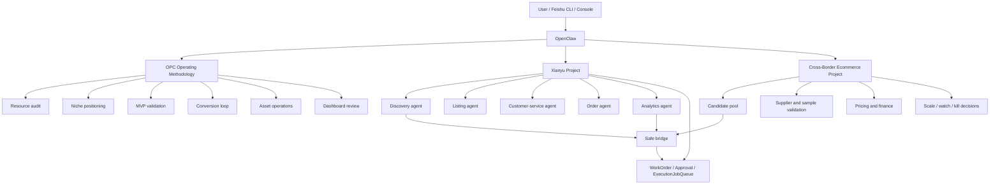

# OpenClaw OPC Xianyu Operations Plan

> Date: 2026-05-26
> Scope: OpenClaw two-project operating model, OPC methodology adoption, and Xianyu strategy-layer refactor.
> Status: Phase 0-4 complete

---

## 1. Core Decision

The correct direction is not to merge Xianyu and cross-border ecommerce into one codebase. The correct direction is:

```text
One OpenClaw control entrance
  -> Project A: Xianyu channel execution adapter
  -> Project B: Cross-border ecommerce operating backend
```

Project identities:

- Xianyu project: `019e4d30-e8d3-71d2-a93c-32978635a896`
- Cross-border ecommerce project: `019dcbe3-ade2-70d0-b87f-c98788b896c4`

The two projects should run in parallel under one OpenClaw operating layer. They should share decisions, candidate status, review summaries, and approval events through bridge APIs, but they should keep separate codebases, separate data stores, and separate responsibility boundaries.

This keeps the current `xianyu` project aligned with its existing design: Xianyu is the channel execution adapter, while ecommerce is the business source of truth for candidates, suppliers, finance, validation, and scaling decisions.

---

## 2. Target Architecture



OpenClaw is the operator. OPC is the operating method. Ecommerce is the business backend. Xianyu is the channel execution system.

---

## 3. Responsibility Boundaries

### OpenClaw

OpenClaw should act as the one-person company command layer:

- Accept natural-language instructions from the user.
- Route work to the right project and agent.
- Keep a high-level memory of project decisions.
- Ask for human approval before high-risk execution.
- Trigger periodic review workflows.

OpenClaw should not become the business database, supplier system, Xianyu automation script, or payment/refund executor.

### Cross-Border Ecommerce Project

The ecommerce project should remain the business source of truth:

- Candidate products.
- Supplier comparison.
- Sample verification.
- Cost, margin, and finance.
- Launch test records.
- Scale / watch / kill decisions.
- Business dashboard and daily review.

It can send approved or watch-listed candidates to Xianyu, but it should not directly operate the Xianyu account.

### Xianyu Project

The Xianyu project should remain the channel adapter:

- Xianyu market discovery.
- Listing draft generation.
- Title, image, description, city, and price test strategy.
- Buyer-message intake and reply drafts.
- Order, fulfillment, dispute, delete, refund workflows.
- WorkOrder, Approval, ExecutionJobQueue, and ActionExecutor.
- Browser adapter and platform guard.

It can report Xianyu-specific results back to ecommerce, but it should not become the master finance or supplier system.

---

## 4. OPC Methodology Adoption

The book at `E:\GitHub上下载的\一人公司方法论` should be used as an operating framework, not as runtime automation code.

Recommended OPC mapping:

| OPC concept | Runtime interpretation |
| --- | --- |
| Resource audit | What accounts, suppliers, skills, tools, content assets, and cash constraints exist |
| Niche positioning | Which Xianyu categories or cross-border tracks are worth testing |
| Value proposition | Why the buyer should choose this listing instead of another seller |
| MVP validation | Small-batch listing tests before scaling |
| Conversion loop | Exposure -> click -> inquiry -> reply -> order -> review |
| Asset operations | Save reusable titles, images, supplier notes, scripts, reply templates, and category playbooks |
| Dashboard review | Weekly decision: keep testing, scale, pause, or kill |

OPC should produce and maintain lightweight operating artifacts, for example:

- `docs/ops/opc/resource-audit.md`
- `docs/ops/opc/niche-positioning.md`
- `docs/ops/opc/mvp-validation.md`
- `docs/ops/opc/conversion-loop.md`
- `docs/ops/opc/weekly-review.md`

These files should guide agents and dashboards, but should not bypass the existing approval architecture.

---

## 5. Xianyu Strategy Layer From `闲鱼赚钱路子.docx`

The article should be transformed into an internal Xianyu operating playbook. The goal is not to copy its tone or risky shortcuts. The goal is to extract the durable operating logic.

### 5.1 Product Selection

Turn the article's selection ideas into a scoring model:

- Cold-category potential: does the product avoid crowded consumer-electronics competition?
- High-ticket potential: can one order produce meaningful gross profit?
- Batch-order potential: can buyers naturally buy multiple units?
- Non-standard differentiation: can copywriting, specification clarity, service, or scene images influence conversion?
- Supplier advantage: is there real cost, logistics, or service advantage?
- Fulfillment risk: size, fragility, warranty, return freight, and complaint risk.
- Compliance risk: prohibited goods, fake goods, rights issues, platform-sensitive claims.

Candidate categories from the article's logic:

- Commercial kitchen equipment.
- Wood, metal, plastic, stainless-steel products.
- Office and factory equipment.
- Farming and breeding equipment.
- Large-format household or business supplies.
- Hobby and niche equipment.

### 5.2 Discovery Agent Changes

The `discovery` agent should move beyond generic keyword search. It should support strategy-driven discovery modes:

- Raw-material expansion: "stainless steel", "wood", "plastic", "glass", "metal".
- High-ticket scan: products above a configurable price threshold.
- Batch-demand scan: fences, mats, storage, restaurant supplies, factory supplies.
- Regional scan: match listing city with likely warehouse or demand city.
- Same-product multi-link scan: detect whether competitors use different titles, photos, prices, or locations.

Output should be a ranked candidate list with evidence, not just an AI opinion.

### 5.3 Listing Agent Changes

The `listing` agent should generate structured listing drafts:

- Main title.
- Search keywords.
- Lead image requirement.
- Specification table.
- Price ladder or specification ladder.
- Low-entry-price explanation when applicable.
- Buyer trust paragraph.
- Delivery and after-sales notes.
- Questions the operator must verify before approval.

The listing agent must not copy seller copy or third-party product images. It should generate original copy and ask for owned or authorized images.

### 5.4 Customer-Service Agent Changes

The `customer_service` agent should become a conversion assistant, not a free-chat bot:

- Identify buyer intent: price, specification, delivery, quality, comparison, after-sales, complaint.
- Reply with short, useful, platform-safe messages.
- Avoid external-contact guidance.
- Escalate risky or sensitive replies into Approval.
- Save reusable reply templates per product and category.

The article's conversion logic can be abstracted into:

- Do not answer only the literal question; also clarify the buyer's use case.
- When buyer asks for another size/spec, recommend the most suitable spec.
- When buyer negotiates, protect margin while offering a controlled concession.
- When buyer compares platforms, explain service, logistics, stock, or specification differences without making false claims.

### 5.5 Order and After-Sales Changes

The `order` agent should add pre-fulfillment checklists:

- Confirm product specification.
- Confirm color, size, material, function, thickness, and quantity.
- Confirm address and phone when the category is large or fragile.
- Confirm supplier shipping constraints.
- Capture after-sales risk notes before fulfillment approval.

For after-sales:

- Distinguish quality issue, buyer mistake, transit damage, and non-quality return.
- Prefer evidence collection and supplier coordination.
- Keep refund, return, and dispute actions approval-gated.

---

## 6. Operating Cadence

### Daily

- Run Xianyu discovery tasks.
- Review new candidates.
- Generate listing drafts for approved tests.
- Review pending buyer-message drafts.
- Review WorkOrders and failed execution jobs.
- Record today's useful assets: title patterns, reply templates, supplier notes, category observations.

### Weekly

- OPC dashboard review:
  - Which category produced inquiries?
  - Which listings had exposure but no inquiry?
  - Which inquiries failed to convert?
  - Which product had after-sales or supplier risk?
  - Which playbook asset should be saved or updated?
- Decide one priority for the next cycle:
  - More discovery.
  - Better listing copy.
  - Better images.
  - Supplier negotiation.
  - Customer-service conversion.
  - Kill or pause a category.

### Monthly

- Decide whether to move from杂货 testing to vertical store operation.
- Identify repeatable category playbooks.
- Identify products suitable for ecommerce scaling.
- Archive weak experiments and preserve only reusable assets.

---

## 7. Phased Roadmap

### Phase 0: Planning Freeze

Goal: lock the operating model before implementation.

Deliverables:

- [x] This plan.
- [x] A short project-boundary note in `docs/PROJECT_PLAN.md`.
- [x] A clear decision that Xianyu and ecommerce are parallel projects under OpenClaw, not one merged codebase.

Exit criteria:

- [x] User confirms the two-project architecture.
- [x] User confirms OPC is used as operating method, not runtime automation code.
- [x] User confirms Xianyu strategy layer is based on the article's logic, with safety boundaries.

### Phase 1: OPC Operating Artifacts

**Status: complete**

Goal: create the lightweight operating files that guide the one-person company workflow.

Deliverables:

- [x] `docs/ops/opc/resource-audit.md`
- [x] `docs/ops/opc/niche-positioning.md`
- [x] `docs/ops/opc/mvp-validation.md`
- [x] `docs/ops/opc/conversion-loop.md`
- [x] `docs/ops/opc/weekly-review.md`

Implementation notes:

- Keep these as human-readable Markdown first.
- Do not add runtime behavior yet.
- Use them as source material for later prompts, dashboards, and agent instructions.

### Phase 2: Xianyu Playbook Extraction

**Status: complete**

Goal: convert `闲鱼赚钱路子.txt` into a safe internal playbook.

Deliverables:

- [x] `docs/ops/xianyu/product-selection-playbook.md`
- [x] `docs/ops/xianyu/listing-playbook.md`
- [x] `docs/ops/xianyu/conversion-reply-playbook.md`
- [x] `docs/ops/xianyu/fulfillment-after-sales-playbook.md`

Important boundaries:

- Do not copy article text as final user-facing copy.
- Do not encode deceptive claims.
- Do not suggest bypassing platform rules.
- Do not use third-party seller images or seller copy without rights.

### Phase 3: Strategy Scoring Model

**Status: complete**

Goal: make Xianyu discovery and resale review more measurable.

Deliverables:

- [x] Product opportunity scoring fields:
  - [x] demand evidence (cold_category score)
  - [x] margin estimate (supplier_advantage score)
  - [x] high-ticket score
  - [x] batch-order score
  - [x] non-standard differentiation score
  - [x] supplier advantage score
  - [x] fulfillment risk
  - [x] compliance risk
  - [x] recommended action: test / watch / weak / reject
- [x] Tests for scoring behavior (`tests/test_product_scoring.py`, 17 tests passing).
- [x] Console display for score and recommendation (dashboard summary + `list_by_recommendation`).

Suggested implementation files:

- [x] Modified `xianyu_agent/resale.py` — added `ProductScorer` class, integrated into `create_candidate`, added `score_candidate` and `list_by_recommendation` methods, updated dashboard summary.
- [x] Modified `xianyu_agent/product_discovery.py` — added `_score_discovered_product` method, scoring integrated into `analyze_product`.
- [x] Added `tests/test_product_scoring.py`.

### Phase 4: Agent Prompt and Workflow Alignment

**Status: complete**

Goal: make agents follow the new strategy layer.

Deliverables:

- [x] Discovery agent uses strategy modes (`strategy_discovery` handler with raw_material, high_ticket, batch_demand, regional modes).
- [x] Listing agent produces structured, approval-ready drafts (existing collaborative listing flow preserved).
- [x] Customer-service agent uses conversion-safe reply patterns (`classify_intent` handler with 7 intent types and playbook strategies).
- [x] Order agent uses pre-fulfillment and after-sales checklists (`check_fulfillment` and `classify_after_sale` handlers).
- [x] OpenClawRouter can route messages like:
  - [x] `按原材料法选品：不锈钢`
  - [x] `分析商品 rc_xxxxxxxx`
  - [x] `高客单价扫描` / `批量需求扫描`
  - [x] `做本周闲鱼复盘`

Safety boundary:

- [x] Natural-language commands can create candidates, drafts, WorkOrders, and Approvals.
- [x] They cannot directly publish, send buyer messages, refund, delete, pay, or bypass verification.

### Phase 5: Dashboard and Review Loop

Goal: turn operations into a repeatable one-person company cockpit.

Deliverables:

- Dashboard section for:
  - new candidates
  - test listings
  - pending approvals
  - inquiry conversion
  - failed jobs
  - category performance
  - weekly bottleneck
- Weekly review output saved as Markdown or JSON.
- Decision log for scale / watch / kill.

### Phase 6: Bridge With Ecommerce

Goal: keep Xianyu and ecommerce parallel but synchronized.

Deliverables:

- Xianyu pushes candidate review results to ecommerce.
- Ecommerce sends approved candidates or decisions back to Xianyu.
- Both sides keep their own databases.
- Bridge events are idempotent and auditable.

Safety boundary:

- Bridge intake creates WorkOrders or candidate records.
- Bridge intake does not execute high-risk platform actions.

### Phase 7: Trial Run

Goal: validate the whole operating loop with a small, controlled test.

Trial scope:

- Pick 1 category.
- Pick 5 to 10 candidate products.
- Generate draft listings only.
- Manually approve 1 to 3 listing tests.
- Monitor exposure, inquiry, and conversion.
- Run a weekly OPC review.

Success criteria:

- The system produces better candidate reasoning than generic search.
- Listing drafts are reviewable and not unsafe.
- Buyer reply drafts improve conversion without violating platform rules.
- WorkOrder and Approval remain the execution gate.
- The weekly review identifies one clear bottleneck.

---

## 8. Hard Boundaries

These stay unchanged:

- Do not reintroduce Ollama.
- Do not bypass captcha, human verification, or platform risk control.
- Do not directly execute risky actions from natural language.
- Do not auto-pay, auto-refund, or auto-place supplier orders.
- Do not copy third-party product images or seller copy as owned material.
- Do not store secrets in UI snapshots.
- Do not collapse ecommerce and Xianyu into one database.
- Do not make OpenClaw the only place where business state exists.

---

## 9. Recommended Next Step

Start with Phase 1 and Phase 2 before changing code.

Reason:

- The current system already has WorkOrder, Approval, ExecutionJobQueue, discovery, listing, customer-service, and ecommerce bridge foundations.
- The missing layer is not more automation first; it is the operating doctrine that tells agents what "good work" means.
- Once the playbooks exist, later code changes can be small, testable, and aligned with a clear strategy.

The first implementation plan should therefore be:

1. Create OPC operating artifacts.
2. Extract the Xianyu playbooks from the article.
3. Add a strategy scoring model.
4. Update agent prompts/workflows to consume that model.
5. Add dashboard review output.

